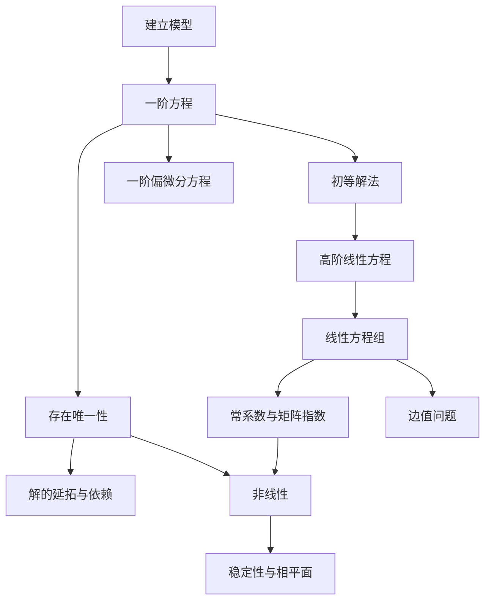

# 《常微分方程》（王高雄等，第四版）点化学习系统

## 这本书在讲什么
它把常微分方程拆成两条腿：一条是"能解出来的"——一阶初等解法与常系数线性方程的具体计算；另一条是"解不出来也要说清"——存在唯一性、解对初值的依赖、稳定性和相平面定性。作者的主张很明确：计算技巧是入口，理论保证才是这门课真正的骨架。

## 全书心智模型

## 学习路径（推荐顺序）
| 步骤 | 章节 | 主题 | 前置 | 检查点 |
|---|---|---|---|---|
| 01 | ch01 | 基本概念与模型 | 微积分 | 能判阶数与线性性 |
| 02 | ch02 | 一阶初等解法 | ch01 | 四类方程各解一题 |
| 03 | ch03 | 存在唯一性 | ch02 | 复述皮卡定理证明 |
| 04 | ch04 | 高阶线性方程 | ch03 | 特征根三种情形全会 |
| 05 | ch05 | 线性方程组 | ch04 | 手算 3×3 的 e^(At) |
| 06 | ch06 | 非线性与稳定性 | ch05 | 奇点分类与 V 函数 |
| 07 | ch07 | 一阶线性 PDE | ch02 | 特征线法解柯西问题 |
| 08 | ch08 | 边值问题 | ch04 | 构造格林函数 |

## 章节索引
- 第 1 章 绪论（★☆☆）→ chapters/ch01-绪论.md
- 第 2 章 一阶方程的初等解法（★★☆）→ chapters/ch02-一阶方程初等解法.md
- 第 3 章 解的存在唯一性（★★★）→ chapters/ch03-解的存在唯一性.md
- 第 4 章 高阶线性微分方程（★★☆）→ chapters/ch04-高阶线性方程.md
- 第 5 章 线性微分方程组（★★★）→ chapters/ch05-线性微分方程组.md
- 第 6 章 非线性与稳定性（★★★）→ chapters/ch06-非线性与稳定性.md
- 第 7 章 一阶线性偏微分方程（★★★）→ chapters/ch07-一阶线性偏微分方程.md
- 第 8 章 边值问题（★★★）→ chapters/ch08-边值问题.md

## 前置知识（零基础缺口补讲）
| 缺口 | 对应补讲位置 | 学完标志 |
|---|---|---|
| 导数与变化率 | ch01 零基础讲解 1.1 | 能把"变化率已知"翻译成方程 |
| 不定积分与换元 | ch02 零基础讲解 2.1 | 能独立完成分离变量后的积分 |
| 行列式与线性相关 | ch04 零基础讲解 4.2 | 能算 3 阶朗斯基行列式 |
| 矩阵特征值 | ch05 零基础讲解 5.3 | 能判断可否对角化 |
| 正定二次型 | ch06 零基础讲解 6.3 | 能判断 V 的正定性 |

## 术语表 / 模式库 / 速查表 入口
- 术语：glossary.md
- 模式：patterns.md
- 速查：cheatsheet.md
- 测验：quiz.md
- 抽认卡：flashcards.md
