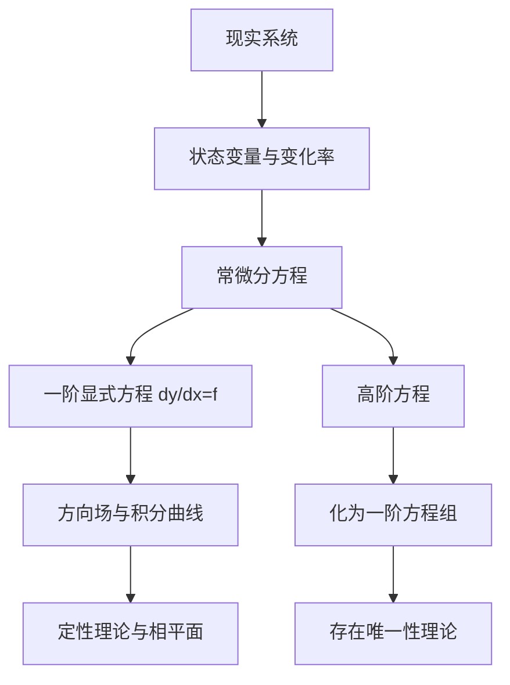

# 第 1 章：绪论——微分方程到底在解什么

- **难度**：★☆☆ | **预估学时**：3 小时 | **前置**：微积分（导数、积分、链式法则）

## 学习目标
学完本章，你能：
1. 说清微分方程与代数方程的区别：一个求"数"，一个求"函数"；
2. 给定一个方程，判断它的阶数、是否线性、自变量与未知函数；
3. 区分通解、特解、隐式解、初值问题，并解释"含 n 个独立任意常数"里的"独立"指什么；
4. 把一阶方程 y′=f(x,y) 读成一张方向场，说出积分曲线与等斜线的关系；
5. 把 n 阶方程改写成一阶方程组。

## 一句话核心
微分方程不是"求出 y 等于多少"，而是"已知 y 的变化率与 y 自身的关系，反推 y 这个函数"。所以它的解天生带着任意常数，要靠定解条件把常数钉死。

## 零基础讲解

### 1.1 从代数方程到微分方程

中学解 2x+3=7，未知量是一个数。微分方程里未知量是一个函数 y(x)，方程里出现的是它的导数。

为什么需要这种方程？因为现实世界里我们常常只能测到"变化率"。RLC 电路里，基尔霍夫第二定律给出的是各元件电压降的代数和为零，而电感上的电压降是 L·dI/dt，这就把电流 I 的变化率和 I 本身绑在了一个式子里：

L·dI/dt + R·I = E

这里 E 是电源电压。你不知道 I(t) 长什么样，但你知道它每一刻怎么变。微分方程的任务就是从这个"怎么变"反推"是什么"。

### 1.2 五个必须能默写的模型

| 模型 | 方程 | 关键假设 |
|---|---|---|
| RL 电路 | L·dI/dt + R·I = E | 电阻、电感为常数 |
| RLC 电路 | L·d²I/dt² + R·dI/dt + I/C = de/dt | 电源电压 e(t) 已知 |
| 数学摆 | d²θ/dt² + (g/l)·sin θ = 0 | 只受重力，绳长 l |
| 马尔萨斯人口 | dN/dt = r·N | 净相对增长率为常数 |
| 逻辑斯谛人口 | dN/dt = r·N·(1 − N/N_m) | 环境容量 N_m 有限 |
| 两种群竞争 | dx/dt = x(a − b·y)，dy/dt = y(−c + d·x) | 系数正负决定关系类型 |
| 洛伦茨 | dx/dt = σ(y − x)，dy/dt = x(ρ − z) − y，dz/dt = x·y − β·z | σ=10，ρ=28，β=8/3 |

这些模型的共同点：**状态变量的变化率只依赖当前状态**，不依赖历史。这叫"无记忆"，是常微分方程能描述的系统的基本特征。洛伦茨方程是反例里最出名的一个——它对初值极端敏感，初始差 0.001，几十步后轨迹就分道扬镳，这就是混沌。

> 类比：微分方程像一段"驾驶指令"——它不告诉你车最终停在哪，只告诉你"当前速度 = 当前位置的函数"。给定起点，轨迹就被决定了（大多数情况下）。类比失效的地方：洛伦茨方程说明，起点差一点点，轨迹可以差到完全无关，这时"给定起点决定轨迹"在实用意义上失效。

### 1.3 基本概念逐个钉死

**阶数**：方程中出现的未知函数最高阶导数的阶数。y′+y=0 是一阶，y″+y=0 是二阶。

**线性**：把方程整理成 F(x, y, y′, …, y⁽ⁿ⁾)=0 后，左端关于 y 及其各阶导数是一次的整式。y″+x·y′+sin(x)·y = eˣ 是线性；y″+y²=0 不是；y·y′=1 也不是。注意：系数里出现 x 的非线性函数（如 sin x）不影响线性性，因为"线性"只针对未知函数 y。

**解**：把 y=φ(x) 代进去使方程成为恒等式。若解由 Φ(x,y)=0 隐式确定，叫隐式解（也叫积分）。

**通解**：n 阶方程含 n 个**独立**任意常数的解。独立的意思是：对 φ 及其直到 n−1 阶偏导数关于 c₁,…,cₙ 的雅可比行列式不为零。白话讲，就是这些常数真的各管一件事，不能互相替代。

**特解**：满足某组初值条件的解。n 阶方程的初值条件是

y(x₀)=y₀，y′(x₀)=y₀′，…，y⁽ⁿ⁻¹⁾(x₀)=y₀⁽ⁿ⁻¹⁾

**初值问题**：方程 + 初值条件一起构成的问题，记作 y′=f(x,y), y(x₀)=y₀。

### 1.4 几何视角：积分曲线与方向场

一阶方程 y′=f(x,y) 有一个漂亮的读法：在平面上每一点 (x,y) 画一小段斜率为 f(x,y) 的线段，得到**方向场**。解曲线（积分曲线）就是处处与这些线段相切的曲线。

把方向场里斜率相同的点连起来，得到**等斜线**：f(x,y)=k。用几条等斜线就能大致勾出积分曲线的走向。

再往前一步：如果方程右端不显含 x，即 y′=f(y)，把 x 轴换成 t 轴、y 轴换成 x 轴，得到 dx/dt=f(x)，这就是**相平面**（一维情形叫相直线）。此时的解曲线叫**轨线**，它只记录状态怎么变，不记录什么时候变。

垂直等斜线：f(x,y)=0（轨线切线竖直）；水平等斜线：g(x,y)=0

两者的交点就是奇点，在那里 x 和 y 都不再变化。

### 1.5 高阶化一阶：为什么教材偏爱方程组

n 阶方程 y⁽ⁿ⁾=g(x, y, y′, …, y⁽ⁿ⁻¹⁾) 令

y₁=y，y₂=y′，…，yₙ=y⁽ⁿ⁻¹⁾

就变成

dy₁/dx=y₂，dy₂/dx=y₃，…，dyₙ/dx=g(x, y₁, …, yₙ)

写成向量形式 dy/dx=f(x,y)，y∈Rⁿ。这一步的意义是：存在唯一性定理、解的延拓、稳定性理论都只需要对一阶方程组陈述一次，高阶情形自动包含。

## 图示

看图说明：整门课的主线只有两条。左路是"求出来"——初等解法、幂级数解法；右路是"不求也能说清"——存在唯一性、延拓、稳定性、相平面。第一章站在最上面，把两条路的分岔口标出来。

## 类比与实例

**类比**：把 y′=f(x,y) 想成地图上的水流。方向场是每一点的水流箭头，积分曲线是一片叶子随水漂出的轨迹。叶子不能凭空拐弯，它的每一段都必须顺着箭头。

**失效边界**：水流箭头本身可能随时间变（非自治方程 y′=f(t,y)），这时方向场是动的，"静态地图"的直觉就不成立了。

**实例**：验证 y=ce^(−x)+x−1 是 y′+y=x 的通解。

代入左端：y′=−ce^(−x)+1，所以 y′+y = (−ce^(−x)+1)+(ce^(−x)+x−1)=x。恒等成立。c 只有一个，方程是一阶，所以这是通解。取 y(0)=2，则 c·1+0−1=2，c=3，特解 y=3e^(−x)+x−1。

## 常见误解

- **别以为"通解就是所有解"**——实际上通解可能漏掉奇解。例如 y′=√(1−y²) 的通解是 y=sin(x+c)，但 y=±1 也是解，它们不含任意常数，不在通解族里。
- **别以为"线性"是指图像是直线"**——实际上线性说的是方程关于 y 及其导数是几次的。y″+y=x² 是线性的，它的解曲线完全不是直线。
- **别以为"解一定有任意常数"**——实际上初值问题给定了常数，答案是唯一的特解；而奇解可以一个常数都没有。

## 自测题（答案）

1. 判断 y·y″+(y′)²=0 的阶数与线性性。
   （答案：二阶，非线性。解析：含有 y·y″ 这一项，关于 y 和 y″ 是二次的，所以非线性。）

2. 方程 y′=3y 的通解是什么？满足 y(0)=5 的特解是什么？
   （答案：y=ce^(3x)；特解 y=5e^(3x)。解析：分离变量得 dy/y=3dx，积分得 ln|y|=3x+c₁。）

3. 一阶方程 y′=f(x,y) 的等斜线 f(x,y)=0 有什么几何意义？
   （答案：在这条线上积分曲线的切线是水平的。解析：斜率为 0 意味着切线平行于 x 轴；同时它也是相平面上的"水平等斜线"的来源。）

4. 把 y″+3y′+2y=0 化为一阶方程组。
   （答案：令 y₁=y，y₂=y′，则 y₁′=y₂，y₂′=−2y₁−3y₂。解析：从 y″=−3y′−2y 直接读出第二个分量。）

5. "n 阶方程的通解含 n 个任意常数"这句话，为什么强调"独立"？
   （答案：因为常数可能相互替代，例如 c₁+c₂ 实质上只是一个常数，那就退化成了 n−1 个自由度，不能覆盖全部解。独立性用雅可比行列式不为零来判定。）

## 复习锚点
- 微分方程解的是函数，不是数；通解带常数，定解条件钉死常数。
- 一阶方程 = 方向场，解 = 顺着箭头走的曲线。
- 高阶化一阶，是把整门课的理论统一到 dy/dx=f(x,y)。
