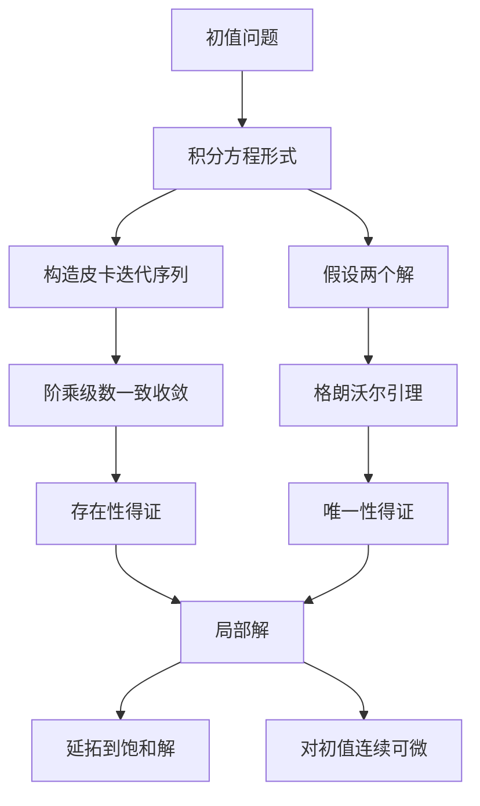

# 第 3 章：解的存在唯一性——为什么"解存在"需要证明

- **难度**：★★★ | **预估学时**：10 小时 | **前置**：第 2 章、一致收敛、柯西序列、格朗沃尔引理

## 学习目标
学完本章，你能：
1. 复述并证明皮卡定理：连续 + 李普希茨 → 局部存在唯一；
2. 用皮卡迭代序列构造解，并写出第 n 次近似的误差估计；
3. 用格朗沃尔引理证明唯一性，而不是靠"两个解相减"的直觉；
4. 说清"解能延拓到哪"的判据，以及解对初值是连续可微的；
5. 判别奇解：p-判别式与 C-判别式的区别；
6. 写出欧拉法与四阶龙格-库塔公式，并说出误差阶。

## 一句话核心
初等解法能解出来的方程只是极少数。整门课真正的底座是：**只要右端足够光滑，解就存在且唯一**——存在性靠构造迭代序列，唯一性靠格朗沃尔引理。

## 零基础讲解

### 3.1 把微分方程改成积分方程

考虑初值问题

dy/dx = f(x, y)，y(x₀) = y₀

它在区间 I 上的解与下面这个积分方程的解完全等价：

y(x) = y₀ + ∫[x₀→x] f(t, y(t)) dt

这一步是整章的技术起点。为什么等价？如果 y 满足微分方程，两边从 x₀ 积分到 x 就得到积分方程；反过来，积分方程右端可导，求导即得微分方程，且 x=x₀ 时积分项为零。

积分方程的好处是：它把"求导"变成了"积分"，而积分对函数的要求更低，可以拿来做迭代。

### 3.2 李普希茨条件

设 f 在矩形 R：|x−x₀|≤a，|y−y₀|≤b 上连续。若存在常数 L，使对 R 内任意两点 (x,y₁)、(x,y₂)，

|f(x, y₁) − f(x, y₂)| ≤ L·|y₁ − y₂|

则称 f 关于 y 满足**李普希茨条件**，L 叫李普希茨常数。

白话解释：f 对 y 的变化不能太陡，陡峭程度被 L 卡住。若 ∂f/∂y 在 R 上连续且有界，取 L 为其上界即可，这是最常用的验证方式。

> 类比：李普希茨条件是"坡度上限"。一条山路的坡度有上限，你从任何一点出发，走固定水平距离，海拔变化就不会超过某个值。
> 失效边界：它允许函数有折角（比如 |y|），所以比"可微"更宽松；但它排除了 y′=√|y| 这类在 0 点附近坡度无界的方程——这种方程解仍然存在，但唯一性会失效。

### 3.3 皮卡定理

**定理（皮卡存在唯一性定理）**：设 f(x,y) 在矩形 R 上连续，关于 y 满足李普希茨条件，则初值问题在区间

|x − x₀| ≤ h，h = min(a, b/M)，M = max|f| over R

上存在唯一解。

**构造性证明（逐步逼近法）**：

第 0 次近似取常数函数 φ₀(x)=y₀。定义

φₙ₊₁(x) = y₀ + ∫[x₀→x] f(t, φₙ(t)) dt

先证每个 φₙ 都落在矩形内（所以定义有意义）：由 |φₙ₊₁(x)−y₀| ≤ M|x−x₀| ≤ M·h ≤ b，归纳成立。

再证收敛。关键估计：

|φₙ₊₁(x) − φₙ(x)| ≤ M·Lⁿ·|x−x₀|ⁿ⁺¹/(n+1)!

这个式子靠归纳：n=0 时 |φ₁−φ₀| ≤ M|x−x₀|；若第 n 步成立，则

|φₙ₊₂ − φₙ₊₁| ≤ L·∫|φₙ₊₁ − φₙ| ≤ M·Lⁿ⁺¹·|x−x₀|ⁿ⁺²/(n+2)!

右边正是阶乘级数的一般项乘以 M，而 Σ|x−x₀|ᵏ/k! 收敛，所以函数项级数 Σ(φₙ₊₁−φₙ) 在 |x−x₀|≤h 上一致收敛。于是 φₙ 一致收敛到一个连续函数 φ，且 φ 满足积分方程。

**唯一性**：设 φ、ψ 都是解。令 D(x)=|φ(x)−ψ(x)|，则

D(x) ≤ ∫[x₀→x] L·D(t) dt

**格朗沃尔引理**：若 D(x) ≤ A + ∫[x₀→x] B·D(t)dt，则 D(x) ≤ A·e^(B|x−x₀|)。取 A=0，得 D≡0，唯一性成立。

### 3.4 误差估计

第 n 次近似与真解的偏差有显式上界：

|φₙ(x) − φ(x)| ≤ M·Lⁿ·hⁿ⁺¹/(n+1)!·e^(L·h)

这个式子给了"迭代几次就够用"的定量依据：L 越小、h 越短，收敛越快。

### 3.5 解的延拓

皮卡定理只保证局部（|x−x₀|≤h）。**延拓**是说：从这点解出发，只要还落在 f 的定义域内部，就可以继续往右（或往左）接下去，得到一个**饱和解**，其存在区间的端点必定顶到定义域的边界，或者解本身跑向无穷。

判据：若解在有限点 x₁ 处右端无定义，或解在该处无界，则不能延拓过去。常见情形是解在有限时间内爆破，例如 y′=y²，y(0)=1 的解 y=1/(1−x) 在 x=1 处爆破。

### 3.6 解对初值的连续性与可微性

记解为 y=φ(x, x₀, y₀)。**连续依赖**：初值的小扰动只造成解的小扰动，且有定量估计

|φ(x, x₀, y₀) − φ(x, x₀, y₀′)| ≤ |y₀ − y₀′|·e^(L|x−x₀|)

**可微性**：∂φ/∂y₀ 存在，且作为 x 的函数满足**变分方程**

d/dx(∂φ/∂y₀) = f_y(x, φ)·(∂φ/∂y₀)，初值 ∂φ/∂y₀|_{x=x₀} = 1

这条变分方程是稳定性理论与灵敏度分析的原型：它说的就是"初值扰动如何被线性化地放大"。

### 3.7 奇解

奇解是通解族的包络：它在每一点与某条通解曲线相切，本身却不是通解。两种判别式：

- **p-判别式**：从 F(x,y,p)=0 与 ∂F/∂p=0 消去 p，得到曲线；它可能包含奇解，也可能包含不属于解的曲线（须回代检验）。
- **C-判别式**：从通解 Φ(x,y,C)=0 与 ∂Φ/∂C=0 消去 C，得到包络候选。

包络是奇解的充分条件之一：若这条曲线确实是解，且在其上每点与族中某曲线相切，则为奇解。

### 3.8 数值解

**欧拉法**：yₙ₊₁ = yₙ + h·f(xₙ, yₙ)，局部截断误差 O(h²)，整体 O(h)。

**四阶龙格-库塔**：

k₁=f(xₙ,yₙ)；k₂=f(xₙ+h/2, yₙ+h k₁/2)；k₃=f(xₙ+h/2, yₙ+h k₂/2)；k₄=f(xₙ+h, yₙ+h k₃)

yₙ₊₁ = yₙ + h(k₁+2k₂+2k₃+k₄)/6

整体误差 O(h⁴)。数值方法的稳定性与刚性问题是后续课程的内容，本章只需记住"步长越小越准，但太小会放大舍入误差"。

## 图示

看图说明：这张图把"存在"和"唯一"拆成两条互不依赖的证明线。考试里最常见的错误是把这两步混着写，写成一个循环论证。

## 类比与实例

**类比**：皮卡迭代像"逐次描摹"。先画一条水平线当草稿，再把草稿代进方程，得到一条更贴合真实曲线的折线，反复代下去，草稿越来越像真解。

**失效边界**：如果方程右端坡度过陡（不满足李普希茨），代进去的草稿可能来回震荡而不收敛，例如 y′=√|y|，y(0)=0 有无穷多个解（y≡0 以及在一段区间后接抛物线）。

**实例**：用皮卡迭代解 y′=y，y(0)=1，在 |x|≤1 上。
φ₀=1，φ₁=1+x，φ₂=1+x+x²/2，…，φₙ=Σxᵏ/k!，极限为 eˣ。误差估计给出 |φₙ−eˣ| ≤ 1·hⁿ⁺¹/(n+1)!·e，取 h=1 时 n=6 已有 1/5040·e ≈ 0.00054 的量级。

## 常见误解

- **别以为"f 连续就够了"**——实际上连续只保证存在，不保证唯一。y′=√|y| 在 y=0 处连续但不满足李普希茨，解不唯一。
- **别以为"李普希茨条件必须在整个平面上成立"**——实际上只要在包含初值的某个矩形内成立即可，皮卡定理是局部的。
- **别以为"解一定能在整个区间上延拓"**——实际上有限时间爆破很常见，如 y′=y²。
- **别以为"p-判别式给出的曲线就是奇解"**——实际上它可能根本不是解，必须代回原方程检验。

## 自测题（答案）

1. 验证 f(x,y)=x·y² 在矩形 |x|≤1，|y|≤1 上关于 y 满足李普希茨条件，给出一个 L。
   （答案：|f(x,y₁)−f(x,y₂)|=|x||y₁+y₂||y₁−y₂|≤2|y₁−y₂|，取 L=2。解析：|x|≤1，|y₁+y₂|≤2。）

2. 皮卡迭代中，为什么必须先证明每个 φₙ 都落在矩形 R 内？
   （答案：因为 f 只在 R 上有定义且满足李普希茨；如果迭代跑出 R，下一步的 f(t,φₙ(t)) 可能无意义。解析：|φₙ₊₁−y₀|≤M|x−x₀|≤Mh≤b 正是为此。）

3. 用格朗沃尔引理证明唯一性时，A 取多少？
   （答案：A=0。解析：两个解之差在 x₀ 处为 0，故 D(x₀)=0，不等式变成 D≤∫L·D，格朗沃尔给出 D≤0。）

4. 方程 y′=3y^(2/3)，y(0)=0 的解唯一吗？
   （答案：不唯一。y≡0 是一个解；y=x³ 也是解（验证：y′=3x²，3y^(2/3)=3x²）。解析：f=3y^(2/3) 在 y=0 处不满足李普希茨，因为 [f(y)−f(0)]/y = 3y^(−1/3) 无界。）

5. 四阶龙格-库塔每步需要计算几次 f？
   （答案：4 次。解析：k₁ 到 k₄ 各一次；这也解释了它比欧拉法贵但精度高的原因。）

## 复习锚点
- 存在靠迭代，唯一靠格朗沃尔。两件事分开写。
- 李普希茨 = 坡度有上限；∂f/∂y 有界 ⇒ 李普希茨。
- p-判别式给候选，回代检验才算数。
