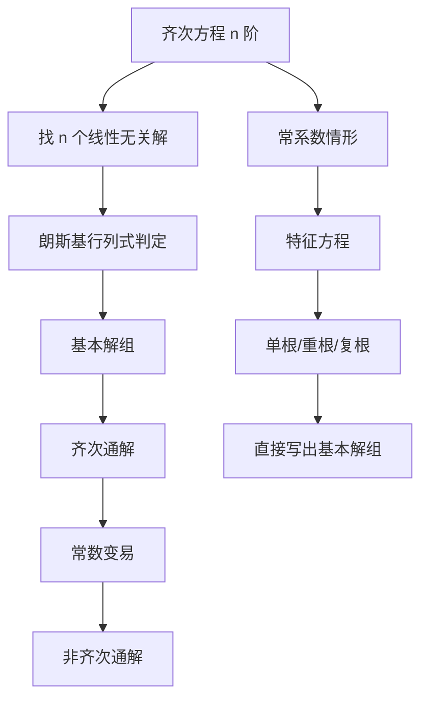

# 第 4 章：高阶线性微分方程

- **难度**：★★☆ | **预估学时**：9 小时 | **前置**：第 2、3 章、线性代数（行列式、线性相关）

## 学习目标
学完本章，你能：
1. 证明 n 阶齐次线性方程的解集构成 n 维线性空间；
2. 用朗斯基行列式判断解组的线性相关性，并用刘维尔公式计算它；
3. 用常数变易法写出非齐次方程的通解公式；
4. 用特征方程解常系数齐次方程，处理重根与共轭复根；
5. 用比较系数法处理两类右端：多项式乘指数、指数乘三角；
6. 已知一个解时降阶，在常点附近用幂级数求解。

## 一句话核心
线性方程的全部结构可以压缩成一句话：**齐次方程的解空间是 n 维的，非齐次方程的通解 = 一个特解 + 齐次通解**。剩下的一切（朗斯基、常数变易、特征根）都是在具体计算这个 n 维空间和这个特解。

## 零基础讲解

### 4.1 解的结构

n 阶齐次线性方程

y⁽ⁿ⁾ + a₁(x)y⁽ⁿ⁻¹⁾ + … + aₙ(x)y = 0

**性质一（叠加）**：若 y₁、y₂ 是解，则 c₁y₁+c₂y₂ 也是解。原因很直接：求导是线性的，代入后每一项都成对抵消。

**性质二（n 维）**：解集构成 n 维线性空间。证明的关键是：以任意一组初值 (y₀, y₀′, …, y₀⁽ⁿ⁻¹⁾) 出发的解存在且唯一，所以"初值 → 解"是一个从 Rⁿ 到解空间的线性同构。Rⁿ 是 n 维，解空间就是 n 维。

由此得到：**只要找到 n 个线性无关的解，就找到了全部解**。

**非齐次**：y⁽ⁿ⁾+…+aₙy=f(x) 的任意两个解之差是齐次解，所以通解形如

y = Y(x) + y*(x)

Y 是齐次通解，y* 是任一特解。

### 4.2 朗斯基行列式与刘维尔公式

n 个解组成的**朗斯基行列式**

W(x) = det[ y₁ … yₙ ; y₁′ … yₙ′ ; … ; y₁⁽ⁿ⁻¹⁾ … yₙ⁽ⁿ⁻¹⁾ ]

- W(x₀)≠0 ⇔ 这 n 个解线性无关 ⇔ 它们构成基本解组。
- 若在某点 W=0，则这些解线性相关（这一点对线性方程才成立，对非线性方程不成立）。

**刘维尔公式**：

W(x) = W(x₀)·exp( −∫[x₀→x] a₁(t) dt )

它说明：W 要么恒不为零，要么恒为零，不会"有时为零有时不为零"。这解释了为什么只需检查一个点。

### 4.3 常数变易法

设 y₁,…,yₙ 是齐次基本解组，令非齐次解为

y = c₁(x)y₁ + … + cₙ(x)yₙ

要求这些 cᵢ 满足方程组

Σ cᵢ′(x)·yᵢ⁽ᵏ⁾ = 0 （k=0,…,n−2），Σ cᵢ′(x)·yᵢ⁽ⁿ⁻¹⁾ = f(x)

解这个线性方程组得到 cᵢ′(x)，积分即可。

**为什么这样设？** 因为把 n 个待定函数塞进一个表达式，多出了 n−1 个自由度，可以人为加 n−1 个约束，让 y 的各阶导数形式上保持"和齐次情形一样"，把所有复杂度挤到最后一阶方程上。这不是技巧，是自由度计数。

### 4.4 常系数齐次方程：特征根法

方程 y⁽ⁿ⁾+a₁y⁽ⁿ⁻¹⁾+…+aₙy=0（aᵢ 为常数），试解 y=e^(rx)，代入得**特征方程**

rⁿ + a₁rⁿ⁻¹ + … + aₙ = 0

三种情形：

- **单实根 r**：贡献 e^(rx)。
- **k 重实根 r**：贡献 e^(rx), x e^(rx), …, x^(k−1) e^(rx)。
- **共轭复根 α±iβ（k 重）**：贡献 e^(αx)cos βx, e^(αx)sin βx，以及各自乘以 x, …, x^(k−1)。

**欧拉方程** xⁿy⁽ⁿ⁾+…=0 通过 x=e^t（即 t=ln x）化为常系数。

### 4.5 非齐次：比较系数法

**类型一**：f(x)=P_m(x)e^(λx)，P_m 是 m 次多项式。若 λ 是特征方程的 k 重根（k=0 表示不是根），则特解形如

y* = xᵏ·Q_m(x)·e^(λx)，Q_m 为待定 m 次多项式

**类型二**：f(x)=e^(αx)[P_m(x)cos βx + Q_n(x)sin βx]。若 α±iβ 是 k 重特征根，则

y* = xᵏ·e^(αx)[R_l(x)cos βx + S_l(x)sin βx]，l=max(m,n)

把 y* 代入，比较同类项系数，解线性方程组。

**为什么乘 xᵏ？** 因为 λ 已经是特征根时，e^(λx) 本身就在齐次解空间里，直接设 Q_m e^(λx) 代入会被齐次算子打成零，必须乘以 x 把它推出零空间。k 重根就乘 xᵏ。

### 4.6 降阶与幂级数解法

**降阶**：已知齐次方程的一个非零解 y₁，令 y=u·y₁，代入后 u′ 满足一个 n−1 阶方程；对二阶方程，直接得到

u′ = C·exp(−∫a₁dx)/y₁²

**幂级数解法**：在常点 x₀ 附近设 y=Σaₖ(x−x₀)ᵏ，代入方程比较系数，得到递推关系。系数行列式保证在收敛半径内可解。典型例子是勒让德方程

(1−x²)y″ − 2xy′ + n(n+1)y = 0

在 x=0 附近有两个幂级数解，其一在 |x|<1 收敛，另一在 x=±1 发散（这正是"正则奇点"要单独处理的原因）。

### 4.7 一个真实应用：第二宇宙速度

火箭竖直上升，忽略空气阻力，质量随时间按 m(t) 减少。动量守恒给出

m·dv/dt = −m·g − u·dm/dt

其中 u 是喷气相对速度。积分得齐奥尔科夫斯基公式

v = u·ln(m₀/m) − g·t

要脱离地球引力，需 v ≥ √(2gR) ≈ 11.2 km/s。这个数不是拍出来的，是从能量守恒 √(2GM/R) 算出来的。教材把它放在高阶方程一章，是因为整个推导过程是一次"建立方程—积分—代入边界条件"的完整训练。

## 图示

看图说明：左路是通用理论（任何变系数都成立），右路是常系数时的"作弊通道"。两条路在"基本解组"处汇合——一旦拿到基本解组，非齐次部分的做法完全一样。

## 类比与实例

**类比**：朗斯基行列式像"解组的身份证"。n 个解在某一点的值与各阶导数排成矩阵，行列式不为零说明它们在该点"张成"了整个 n 维空间，任何初值都能被它们组合出来。

**失效边界**：这个判据只对线性齐次方程成立。对非线性方程，W 在某点为零不代表线性相关。

**实例**：解 y″−3y′+2y = e^(3x)。
特征方程 r²−3r+2=0，根 r=1,2，齐次通解 Y=C₁eˣ+C₂e^(2x)。
右端 e^(3x)，λ=3 不是特征根，设 y*=Ae^(3x)，代入得 (9−9+2)Ae^(3x)=e^(3x)，A=1/2。
通解 y=C₁eˣ+C₂e^(2x)+e^(3x)/2。

**验算**：把 y* 代回，y*″−3y*′+2y* = 9Ae^(3x)−9Ae^(3x)+2Ae^(3x)=2Ae^(3x)，令其等于 e^(3x) 得 A=1/2。这一步必须自己算一遍，否则容易把系数算成 1/(9−9+2) 以外的东西。

## 常见误解

- **别以为"W=0 一定线性相关"对任何方程都成立**——实际上只对线性齐次方程成立。
- **别以为"特征根都是实数"**——实际上复根成对出现，要转成 cos/sin 实形式。
- **别以为"比较系数法设的特解形式可以随便写"**——实际上重根时必须乘 xᵏ，否则代进去恒等于零，解不出系数。
- **别以为"幂级数解法在任何点都行"**——实际上只在常点附近保证；奇点（如勒让德方程的 x=±1）需要另作处理。

## 自测题（答案）

1. 验证 y₁=eˣ，y₂=e^(2x) 是 y″−3y′+2y=0 的基本解组，并算它们的朗斯基行列式。
   （答案：W=eˣ·2e^(2x)−eˣ·e^(2x)=e^(3x)≠0，故线性无关。解析：也可用刘维尔公式，a₁=−3，W=W(0)e^(3x)。）

2. 求 y″+4y′+4y=0 的通解。
   （答案：y=(C₁+C₂x)e^(−2x)。解析：特征方程 (r+2)²=0，二重根 −2。）

3. 求 y″+y = cos x 的一个特解。
   （答案：y*=x·sin x/2。解析：±i 是一重特征根，须乘 x；设 y*=x(Acos x+Bsin x)，代入得 2Bcos x−2A sin x… 计算后 A=0，B=1/2。）

4. 已知 y₁=x 是 x²y″−2xy′+2y=0 的解，求另一解。
   （答案：y₂=x²。解析：用降阶公式 u′=C·exp(−∫a₁dx)/y₁²，标准形 a₁=−2/x，得 u′=C/x⁰… 具体为 u′=C·x²/x²=C，故 u=Cx，y₂=x·x=x²。）

5. 刘维尔公式说明朗斯基行列式的什么性质？
   （答案：W(x)=W(x₀)e^(−∫a₁)，指数因子恒不为零，所以 W 要么恒为零，要么处处不为零。解析：这解释了"只需检验一点"的合法性。）

## 复习锚点
- 齐次解空间 n 维，非齐次 = 特解 + 齐次通解。
- 朗斯基不为零 ⇔ 基本解组；刘维尔公式保证"零则恒零"。
- 常系数看特征根：单根、重根乘 x、复根转三角。
- 右端撞上特征根，特解必须乘 xᵏ。
