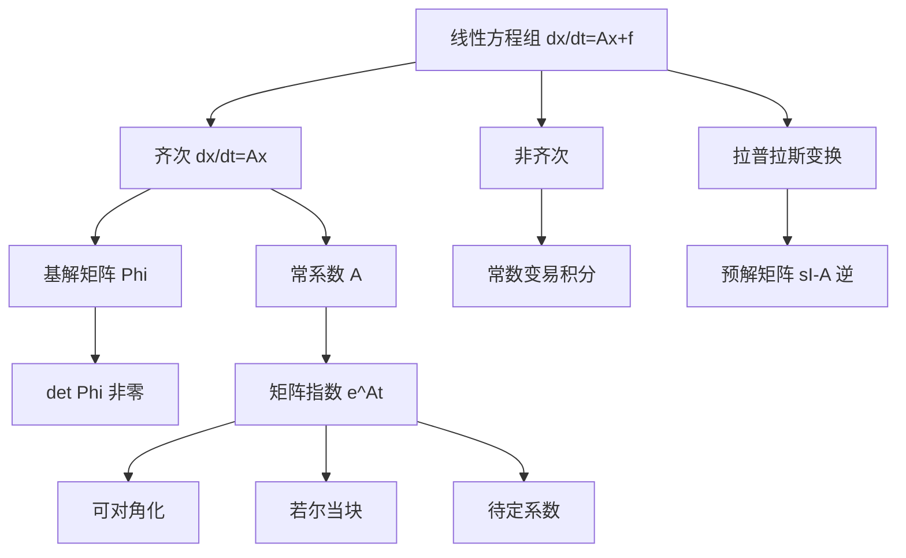

# 第 5 章：线性微分方程组

- **难度**：★★★ | **预估学时**：9 小时 | **前置**：第 4 章、矩阵运算、特征值与若尔当标准形

## 学习目标
学完本章，你能：
1. 写出方程组 dx/dt=A(t)x+f(t) 的基解矩阵定义，并验证 Φ′=AΦ、det Φ≠0；
2. 用常数变易公式 x=Φ(t)[C+∫Φ⁻¹f dt] 解非齐次方程组；
3. 证明常系数情形下 e^(At) 就是标准基解矩阵，并理解它为什么"自动"满足初值；
4. 会算 e^(At)：可对角化、若尔当块、待定系数三种路线；
5. 用拉普拉斯变换解常系数线性方程组。

## 一句话核心
第 4 章是"一个未知函数 n 阶方程"，本章是"n 个未知函数一阶方程组"，两者是同一件事的两种写法。运输工具从"标量"换成"矩阵"：解从 n 个数变成 n 维向量，朗斯基行列式变成基解矩阵的行列式，特征根变成特征值。

## 零基础讲解

### 5.1 一般理论：基解矩阵

考虑

dx/dt = A(t)·x + f(t)，x∈Rⁿ

**齐次情形** dx/dt=A(t)x。解集同样构成 n 维线性空间。取 n 个线性无关的解作为列，排成矩阵 Φ(t)，称**基解矩阵**（标准基本解矩阵）。它满足

Φ′(t) = A(t)·Φ(t)，det Φ(t) ≠ 0

任一齐次解都能写成 x=Φ(t)·C，C 是常向量。

**非齐次（常数变易）**：设 x=Φ(t)·C(t)，代入得

Φ·C′ = f，即 C(t) = C₀ + ∫[t₀→t] Φ⁻¹(s)·f(s) ds

于是

x(t) = Φ(t)·C₀ + Φ(t)·∫[t₀→t] Φ⁻¹(s)f(s)ds

这个公式和第 4 章的常数变易是同一个东西：自由度计数一样，只是把"n 个函数"换成"n 维向量"。

**刘维尔公式的矩阵版**：det Φ(t) = det Φ(t₀)·exp(∫tr A dt)。迹（trace）在这里接替了 a₁ 的位置。

> 类比：Φ(t) 像一个"坐标架"，随时间旋转伸缩。解向量 x 是这个架子里固定的坐标 C；非齐次项 f 则在每一刻把坐标架推一下，累积起来就是那个积分。

### 5.2 常系数：e^(At)

A 为常数矩阵时，定义矩阵指数

e^(At) = I + At + A²t²/2! + … + Aᵏtᵏ/k! + …

它对所有 t 绝对收敛，且

d/dt e^(At) = A·e^(At)，e^(A·0) = I

所以 Φ(t)=e^(At) 是满足 Φ(0)=I 的标准基解矩阵。初值问题 dx/dt=Ax，x(0)=x₀ 的解直接是 x=e^(At)x₀——**不需要再解常数**，这是它比其他基解矩阵好用的地方。

### 5.3 三种算法

**(a) 可对角化**：A=P·diag(λ₁,…,λₙ)·P⁻¹，则

e^(At) = P·diag(e^(λ₁t),…,e^(λₙt))·P⁻¹

**(b) 若尔当块**：对 k 阶块 J=λI+N（N 为幂零），

e^(Jt) = e^(λt)·[I + Nt + N²t²/2! + … + N^(k−1)t^(k−1)/(k−1)!]

因为 Nᵏ=0，级数在 k 项后自动截断——这正是重根情形下出现 t, t² 因子的原因。

**(c) 待定系数**：设 x=e^(λt)(a₀+a₁t+…)，代入比较系数。适合手算小矩阵。

### 5.4 拉普拉斯变换法

对 x′=Ax+f 两边取拉普拉斯变换，利用 L[x′]=sX(s)−x(0)：

(sI − A)·X(s) = x(0) + F(s)

于是 X(s)=(sI−A)⁻¹(x(0)+F(s))，再取逆变换。矩阵 (sI−A)⁻¹ 就是**预解矩阵**，它的拉普拉斯逆变换正是 e^(At)。

这个方法的价值在于：它把微分方程变成代数方程，且自动吸收初值条件。工程上的传递函数、极点分析都从这里长出来。

## 图示

看图说明：中间那条 F 是本量的核心——所有算法都在算同一个对象 e^(At)，只是走的路线不同。考试里给你一个 3×3 矩阵，先判能不能对角化，不能再用若尔当块。

## 类比与实例

**类比**：e^(At) 是"时间演化算子"。给它一个初始状态，它把状态推到 t 时刻。就像一台洗衣机：放进去脏衣服（初值），按启动（t 增长），出来的是洗好的（解）。

**失效边界**：这个类比只对线性自治系统成立。非线性系统的演化算子不是线性的，甚至可能不可逆（洛伦茨系统就是不可逆的）。

**实例**：解 x′=Ax，A=[[0,1],[−1,0]]。
特征值 ±i，可对角化（复域），e^(At) = [[cos t, sin t],[−sin t, cos t]]。
验证：对第一行求导得 (−sin t, cos t) = 第二行，符合 Φ′=AΦ。物理解释是旋转：这个系统的轨线是圆。

**实例 2**：A=[[2,1],[0,2]]（若尔当块）。
e^(At)=e^(2t)[[1,t],[0,1]]。验算：求导得 e^(2t)[[2,1+2t],[0,2]]，而 A·e^(At)=e^(2t)[[2,1+2t],[0,2]]，一致。注意 t 因子的来源正是 N 的幂零性。

## 常见误解

- **别以为"基解矩阵就是任意 n 个解排成矩阵"**——实际上必须线性无关，即行列式不为零。
- **别以为"e^(At) 可以逐元素取指数"**——实际上矩阵指数是级数定义，不是每个元素 e^(aᵢⱼt)。只有对角矩阵才逐元素成立。
- **别以为"特征值重复就一定不能对角化"**——实际上要看几何重数是否等于代数重数；不能时才用若尔当块。
- **别以为"拉普拉斯变换只适用于单个方程"**——实际上它对向量方程同样有效，只是把 sI−A 当成矩阵求逆。

## 自测题（答案）

1. 若 Φ(t) 是 dx/dt=A(t)x 的基解矩阵，C 是常向量，x=ΦC 是否一定是解？为什么？
   （答案：是。x′=Φ′C=AΦC=Ax。解析：关键是 Φ′=AΦ 与 C 为常向量。）

2. 求 A=[[1,1],[1,1]] 的 e^(At)。
   （答案：特征值 2,0；e^(At)=½[[e^(2t)+1, e^(2t)−1],[e^(2t)−1, e^(2t)+1]]。解析：A=P diag(2,0) P⁻¹，P=[[1,1],[1,−1]]。）

3. 为什么若尔当块的指数级数会截断？
   （答案：因为 N 是幂零矩阵，Nᵏ=0，k 阶块中 N 的幂次到 k−1 为止。解析：这解释了 t, t² 因子的次数上限。）

4. 用拉普拉斯变换解 x′=x，x(0)=2。
   （答案：X(s)=2/(s−1)，逆变换 x=2eᵗ。解析：sX−2=X ⇒ X=2/(s−1)。）

5. 矩阵版的刘维尔公式里，什么量取代了标量方程中的 a₁？
   （答案：矩阵 A(t) 的迹 tr A。解析：det Φ=det Φ(t₀)·exp(∫tr A dt)。）

## 复习锚点
- 基解矩阵：Φ′=AΦ 且 det Φ≠0。
- e^(At) 是 Φ(0)=I 的那个，初值问题直接乘。
- 重根 → 若尔当块 → 出现 t 的幂。
- 非齐次一律 x=Φ[C+∫Φ⁻¹f]。
