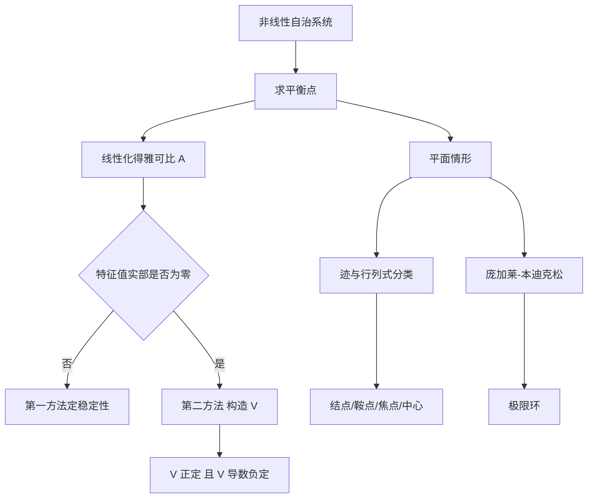

# 第 6 章：非线性微分方程——稳定性、相图与混沌

- **难度**：★★★ | **预估学时**：12 小时 | **前置**：第 1、3、5 章、线性代数、多元微积分

## 学习目标
学完本章，你能：
1. 用 ε-δ 语言写出李雅普诺夫稳定与渐近稳定的定义，并区分它们；
2. 用线性化（第一方法）判断双曲平衡点的稳定性，说明特征值实部的角色；
3. 构造李雅普诺夫函数（第二方法），并说明它为什么不需要解出方程；
4. 按迹与行列式给平面线性系统的奇点分类：结点、鞍点、焦点、中心；
5. 说出庞加莱-本迪克松定理的使用条件，判断极限环是否存在；
6. 写出哈密顿方程，说明能量守恒如何给出首次积分；
7. 解释"对初值敏感"与混沌，并复述李-约克定理的结论。

## 一句话核心
非线性方程绝大多数解不出来，所以这一章换了问题：**不问解是什么，只问解附近稳不稳、轨线往哪走、有没有闭轨**。这是从"求解"到"定性"的转向。

## 零基础讲解

### 6.1 稳定性的定义

考虑自治系统 dx/dt=f(x)，f(0)=0（原点为平衡点）。

**稳定（李雅普诺夫意义）**：对任意 ε>0，存在 δ>0，使 |x(0)|<δ 时，对一切 t≥0 有 |x(t)|<ε。白话：起点足够近，轨线就永远不跑出给定的圈。

**渐近稳定**：稳定，且存在 δ₀>0，使 |x(0)|<δ₀ 时 x(t)→0。白话：不但不跑远，最后还回到原点。

**不稳定**：存在某个 ε，无论 δ 多小，总有起点在 δ 内的轨线跑出 ε 圈。

> 类比：碗底的小球是渐近稳定；碗壁上的小球是稳定但不渐近（它绕圈不落底）；倒扣碗顶的小球是不稳定。
> 失效边界：这个类比只对保守的力学系统直观；对高维系统，"绕圈"可能根本不是周期轨道。

### 6.2 第一方法：线性化

设 A=∂f/∂x 在原点处的雅可比矩阵。若 A 的所有特征值实部都不为零（双曲平衡点），则：

- 所有特征值实部 < 0 ⇒ 原点渐近稳定；
- 存在特征值实部 > 0 ⇒ 原点不稳定；
- 有实部为零的特征值 ⇒ 线性化失效，必须用别的方法（这是"临界情形"）。

这是一条硬结论，有定理保证（哈特曼-格罗布曼定理给出拓扑共轭）。它之所以强，是因为只需求导、算特征值，不用解方程。

### 6.3 第二方法：李雅普诺夫函数

找一标量函数 V(x)，在原点邻域内连续可微、V(0)=0、x≠0 时 V(x)>0（正定），沿轨线求全导数

dV/dt = ∇V · f(x)

判据：
- dV/dt ≤ 0 ⇒ 稳定；
- dV/dt < 0（除原点外）⇒ 渐近稳定；
- dV/dt > 0 ⇒ 不稳定。

**这个方法的妙处**：V 像一个"能量"，你不必知道轨线怎么走，只要知道能量单调下降，轨线就必然被"困"在等能量面上。它把"解方程"换成了"找一个函数"。

典型例子：单摆方程 θ″+sin θ=0 化为一阶系统 (θ, ω)，取

V = ω²/2 + (1 − cos θ)

求导得 dV/dt=ω·(−sin θ)+sin θ·ω=0，恰好守恒。这就是机械能。说明无阻尼单摆是稳定的（但不渐近）。

### 6.4 平面系统的奇点分类

对线性系统 x′=Ax，A 的特征方程为 λ²−(tr A)λ+det A=0。记 p=tr A，q=det A，判别式 Δ=p²−4q。

| 条件 | 奇点类型 | 稳定性 |
|---|---|---|
| q>0，Δ>0，p<0 | 稳定结点 | 渐近稳定 |
| q>0，Δ>0，p>0 | 不稳定结点 | 不稳定 |
| q<0 | 鞍点 | 不稳定 |
| q>0，Δ<0，p<0 | 稳定焦点 | 渐近稳定 |
| q>0，Δ<0，p>0 | 不稳定焦点 | 不稳定 |
| q>0，p=0 | 中心 | 稳定非渐近 |
| q=0 | 高阶奇点 | 需单独分析 |

这一步在相平面上画出来，就是结点、鞍点、焦点、中心四种基本图形。

### 6.5 极限环与庞加莱-本迪克松定理

**极限环**是孤立的闭轨：附近的轨线不是绕着它转（那是中心），而是螺旋靠近或远离它。

**庞加莱-本迪克松定理**：若平面系统的轨线被限制在一个有界闭区域内，且该区域内无平衡点，则区域内必存在闭轨。判断"被限制"的常用办法是构造一个环形区域，让轨线在内外边界上都指向内部。

这个定理只对平面成立，三维及以上不成立——这是它与高维混沌现象之间的分水岭。

### 6.6 哈密顿方程与首次积分

若存在哈密顿函数 H(p,q)，使

dp/dt = −∂H/∂q，dq/dt = ∂H/∂p

则 H 沿轨线守恒：dH/dt=0。这叫**首次积分**。它把相空间限制在 H 的等值面上，是降维的利器。完全可积系统有 n 个独立的、对合的首次积分（刘维尔-阿诺尔德定理）。

### 6.7 混沌

洛伦茨方程

dx/dt=σ(y−x)，dy/dt=x(ρ−z)−y，dz/dt=xy−βz

在 σ=10、ρ=28、β=8/3 时出现奇怪吸引子：轨线被吸引到一个零体积的分形集合上，同时对初值极端敏感（两条初始相距 10⁻⁵ 的轨线，几十个时间单位后距离达到 O(1)）。

**李-约克定理**（"周期三蕴含混沌"）：若一维映射有周期 3 点，则它有任意周期的周期点，且存在不可数集上的轨线行为混乱。这是"混沌"一词进入数学的标志性结果。

需要说清的一点：混沌不是"随机"。它是确定性的——给定初值，轨线唯一；只是长期预测在实践中不可行。

## 图示

看图说明：两条主线都从"平衡点"出发——一条判局部稳定性，一条判全局有无闭轨。前者是代数的（算特征值），后者是几何的（找不变区域）。

## 类比与实例

**类比**：李雅普诺夫函数像"下山的水流"。你不需要知道水具体走哪条沟，只要确认每处地势都在降低，水一定流到谷底。

**失效边界**：V 函数不一定存在；构造它没有通用算法。很多系统需要试很多次，或者干脆只能靠线性化。

**实例 1**：判 x′=−x+y，y′=−x−y 的稳定性。
A=[[−1,1],[−1,−1]]，tr=−2，det=2，Δ=4−8<0，p<0 ⇒ 稳定焦点。

**实例 2**：判 x′=y，y′=−x−y³ 的稳定性。
线性化 A=[[0,1],[−1,0]]，特征值 ±i，实部为零，线性化失效。
构造 V=(x²+y²)/2，则 dV/dt=x·y+y·(−x−y³)=−y⁴≤0，且在除 x 轴外为负。属于稳定（非渐近）——因为 y=0 那条线上的点永远不会离开，但也回不到原点。这个例子说明：**线性化失效时，V 函数是唯一出路**。

**实例 3**：洛伦茨系统的一个平衡点 (0,0,0) 的线性化给出特征值约 −22.8、11.8、−1，有正实部，不稳定；另两个平衡点的稳定性随 ρ 变化，ρ>24.74 时全部不稳定，混沌吸引子出现。

## 常见误解

- **别以为"稳定就是会回到原点"**——实际上是渐近稳定才回到原点；稳定只要求不跑远。
- **别以为"线性化总能判稳定"**——实际上实部为零时失效，必须用 V 函数或其它方法。
- **别以为"中心是渐近稳定的"**——实际上中心只是稳定，轨线绕圈不趋近。
- **别以为"庞加莱-本迪克松定理对三维也成立"**——实际上它只对平面系统成立，三维需要别的工具。
- **别以为"混沌就是随机"**——实际上是确定性的、对初值敏感的有界非周期运动。

## 自测题（答案）

1. 写出渐近稳定的完整定义。
   （答案：稳定，且存在 δ₀>0，使 |x(0)|<δ₀ 时 lim_{t→∞}x(t)=0。解析：两个条件缺一不可，"回到原点"前面必须先有"不跑远"。）

2. 系统 x′=−2x，y′=−3y 的奇点类型？
   （答案：稳定结点。解析：特征值 −2、−3 均为负实根，Δ=1>0，p=−5<0。）

3. 为什么中心不是渐近稳定的？
   （答案：轨线是闭轨，永远绕圈，|x(t)|不趋于 0，只保持常数。解析：稳定性要求"不跑出圈"，渐近性额外要求"收敛到原点"。）

4. 构造 V=x²+y² 判断 x′=−x³，y′=−y³ 的稳定性。
   （答案：dV/dt=−2x⁴−2y⁴<0（除原点），故渐近稳定。解析：V 正定且导数负定。）

5. 洛伦茨系统在 ρ=28 时为什么"确定却不可预测"？
   （答案：轨线由初值唯一确定，但对初值呈指数敏感，初始误差随时间放大到 macroscopic 尺度，长期预测在数值上不可行。解析：这正是"确定性混沌"的定义。）

## 复习锚点
- 稳定不等于渐近稳定；中心只是稳定。
- 双曲平衡点交给线性化；非双曲必须靠 V。
- 平面奇点用 tr、det、Δ 三件套分类。
- 极限环是孤立的闭轨；庞加莱-本迪克松只管平面。
