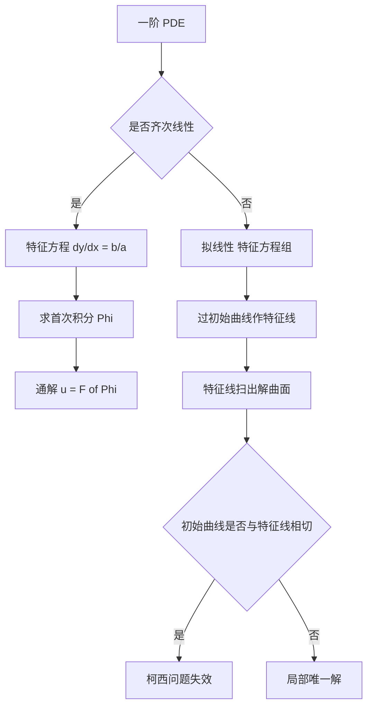

# 第 7 章：一阶线性偏微分方程

- **难度**：★★★ | **预估学时**：7 小时 | **前置**：第 1、2、5 章、多元微积分、隐函数定理

## 学习目标
学完本章，你能：
1. 说出首次积分的定义，并验证一个给定的函数是不是首次积分；
2. 把对称形式的常微分方程组写成 dx/X=dy/Y=dz/Z，并求它的两个独立首次积分；
3. 用特征线法解一阶线性齐次与拟线性偏微分方程；
4. 判断一条初始曲线是不是特征曲线，并据此说明柯西问题何时无解；
5. 说清李群对称的作用：把方程的解从一个变成一族。

## 一句话核心
一阶偏微分方程不是靠"积分"解出来的，而是靠**沿着特征线把偏微分方程降成常微分方程**。整章的技术只有一条：找特征线，沿它积分。

## 零基础讲解

### 7.1 首次积分

考虑对称形式的方程组

dx/X(x,y,z) = dy/Y(x,y,z) = dz/Z(x,y,z)

一个函数 Φ(x,y,z) 若在方程组的每条积分曲线上都取常数值，就称为**首次积分**。等价说法：Φ 沿向量场 (X,Y,Z) 的方向导数为零：

X·Φ_x + Y·Φ_y + Z·Φ_z = 0

一个 n 维一阶方程组有 n−1 个独立的首次积分。求出它们，就等于把解"隐式地"写出来了。

> 类比：首次积分像地形图上的等高线。三维空间里的流线沿着最陡方向走，等高线则是流线永远不穿过的面。给两个独立的等高线，流线就被夹在它们的交线上。

### 7.2 从常微分方程组到偏微分方程

设 Φ(x,y,z) 是首次积分，把它改写成 u(x,y)=z 的形式，对隐函数求导可得

X·u_x + Y·u_y = Z

这就是一阶线性（拟线性）偏微分方程。反过来，解这个偏微分方程就是找它的首次积分。

**特征线法**：把 PDE

a(x,y,u)·u_x + b(x,y,u)·u_y = c(x,y,u)

对应的特征方程组是

dx/ds = a，dy/ds = b，du/ds = c

沿特征线，u 的变化被这个常微分方程组完全决定。

### 7.3 齐次线性 PDE

方程

a(x,y)·u_x + b(x,y)·u_y = 0

的通解是 u=F(Φ(x,y))，其中 Φ 是特征方程 dy/dx=b/a 的首次积分（即一条积分曲线族），F 是任意一元可微函数。

**为什么任意函数都行？** 因为在每条特征线上 u 是常数，而不同特征线上的常数可以不同——这个"不同"就是一个只依赖特征线标号的函数。这就是通解里出现任意函数的来源。

### 7.4 拟线性与柯西问题

拟线性方程里 a、b、c 都依赖 u，特征线本身要解出来才知道。给定初始曲线 Γ：x=x₀(τ)，y=y₀(τ)，u=u₀(τ)，过 Γ 上每一点作一条特征线，这些特征线扫出一张曲面，就是解。

**非特征条件**：若 Γ 与特征线相切，即

a·dy₀/dτ − b·dx₀/dτ = 0

则在 Γ 上无法确定 u 的法向导数，柯西问题或者无解，或者有无穷多解。这个条件就是隐函数定理里雅可比行列式为零的几何翻译。

### 7.5 李群与对称

单参数变换群 x→x+εξ(x,u)，u→u+εη(x,u) 若把方程的解仍映成解，就叫方程的对称。它的无穷小生成元

V = ξ·∂/∂x + η·∂/∂u

满足线性化条件（ prolongation 公式）。求出对称之后，可以令 u 只依赖某个不变量，把 PDE 降阶——这就是"相似解"的来源。

对零基础读者，这一节只需建立两个认识：**对称是方程的结构性质，不是解的性质**；**有一个对称就能把解降一维**。

## 图示

看图说明：判定"是否齐次"决定你走"求一个首次积分"还是"解三个常微分方程"。右下角那个分支是本量最容易忽略的地方：初始曲线与特征线相切时，问题根本没解。

## 类比与实例

**类比**：特征线像织布的经线。PDE 规定了"沿经线怎么变"，你只要把每根经线单独织好，整块布就出来了。初始曲线相当于起针的那一行——如果起针行恰好和经线重合，就织不出布。

**实例**：解 u_x + u_y = 1，u(x,0)=x。
特征方程 ds 参数化：dx/ds=1，dy/ds=1，du/ds=1。得 x=s+x₀，y=s，u=s+u₀。
从初始曲线 y=0 出发：x₀=τ，y₀=0，u₀=τ。
于是 x=s+τ，y=s，u=s+τ。消去 s、τ：u=x。验证：u_x=1，u_y=0，和为 1；边界上 u(x,0)=x。成立。

**实例 2（失效的例子）**：解 u_x + u_y = 0，初始曲线取 x=y=τ，u=τ。
特征线方向 (1,1) 与初始曲线方向 (1,1) 相同 ⇒ 相切 ⇒ 非特征条件不成立。这个柯西问题无解：因为沿特征线 u 必须为常数，而初始条件要求 u 在特征线上变化。

## 常见误解

- **别以为"首次积分就是一个解"**——实际上首次积分是沿轨线取常数的函数，它本身不一定是解。
- **别以为"通解里的任意函数可以随便定"**——实际上它由初始条件通过特征线反演确定，且需要非特征条件保证可解。
- **别以为"柯西问题总有解"**——实际上初始曲线与特征线相切时会失效。
- **别以为"李群对称只是理论装饰"**——实际上它是求相似解、降阶的正规手段。

## 自测题（答案）

1. 验证 Φ=x²+y²+z² 是否为 dx/x=dy/y=dz/z 的首次积分。
   （答案：不是。方向导数 x·2x+y·2y+z·2z=2(x²+y²+z²)≠0。解析：正确的首次积分是 y/x 与 z/x，因为沿 (x,y,z) 方向它们不变。）

2. 求 dy/dx = y/x 的首次积分。
   （答案：Φ=y/x。解析：d(y/x)/dx=(x y′−y)/x²=(xy/x−y)/x²=0。）

3. 齐次线性 PDE a u_x + b u_y = 0 的通解形式？
   （答案：u=F(Φ)，Φ 是 dy/dx=b/a 的首次积分，F 任意可微。解析：每条特征线上 u 为常数。）

4. 柯西问题 u_x+2u_y=0，初始曲线 y=2x，u=x 是否有唯一解？
   （答案：没有。特征方向 (1,2) 与初始曲线方向 (1,2) 平行，相切。解析：非特征条件 a·dy₀/dτ−b·dx₀/dτ=0。）

5. 一个对称能把 PDE 降几维？
   （答案：降一维，即把 n 元方程化为依赖 n−1 个不变量的方程。解析：找不变量是李群方法的标准第一步。）

## 复习锚点
- 首次积分 = 沿特征方向不变的函数；n 维方程组有 n−1 个。
- 齐次 PDE 通解 = 任意函数作用在首次积分上。
- 初始曲线与特征线相切 ⇒ 柯西问题失效。
