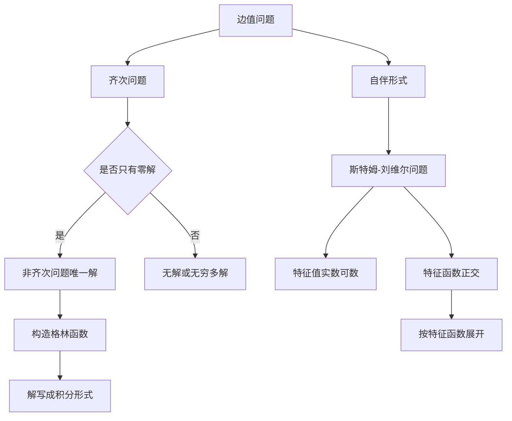

# 第 8 章：边值问题

- **难度**：★★★ | **预估学时**：8 小时 | **前置**：第 4、5 章、线性代数（正交性、本征值）、数学物理方程初步

## 学习目标
学完本章，你能：
1. 写出二阶线性边值问题的标准形式与三类边界条件；
2. 用弗雷德霍姆二择一定理判断边值问题解的存在唯一性；
3. 构造格林函数，并用它把非齐次边值问题写成积分形式；
4. 证明斯特姆-刘维尔问题的特征值都是实数、特征函数互相正交；
5. 说清"特征值存在"与"边值问题可解性"之间的关系。

## 一句话核心
初值问题问"给定起点，轨迹唯一吗"；边值问题问"两端都钉死，中间那条曲线存在吗"。答案是：**存在性取决于对应的齐次问题是否只有零解**。

## 零基础讲解

### 8.1 边值问题的形式

二阶线性方程

y″ + p(x)·y′ + q(x)·y = f(x)，a ≤ x ≤ b

三类边界条件：

- **第一类（狄利克雷）**：y(a)=α，y(b)=β；
- **第二类（诺伊曼）**：y′(a)=α，y′(b)=β；
- **第三类（罗宾）**：y′(a)−k₁y(a)=α，y′(b)+k₂y(b)=β。

与初值问题最大的不同：初值问题的两个条件都给在同一点，边值问题给在两端。这直接导致解可能不存在，也可能不唯一。

### 8.2 弗雷德霍姆二择一

考虑边值问题 L[y]=f，B₁[y]=α，B₂[y]=β。对应的齐次问题 L[y]=0，B₁[y]=0，B₂[y]=0。

**二择一定理**：
- 若齐次问题只有零解，则非齐次问题对任意 f、α、β 都有唯一解；
- 若齐次问题有非零解，则非齐次问题要么无解，要么有无穷多解（取决于 f 与齐次解的正交性）。

**为什么会这样？** 因为边值问题可以写成一个线性算子方程，而线性算子要么可逆（对应唯一解），要么有非零核（对应不唯一）。有限维里这是"行列式是否为零"，无限维里换成"齐次问题是否有非零解"。这也是二择一名字的由来。

> 类比：这就像解线性方程组 Ax=b。A 可逆时任意 b 都有唯一解；A 奇异时要么无解，要么无穷多解。边值问题只是把矩阵换成了微分算子。
> 失效边界：类比在"正交性条件"处需要补充——奇异时不是随便什么 b 都行，必须满足与零空间正交（这就是可解性条件）。

### 8.3 格林函数

把非齐次边值问题的解写成

y(x) = ∫[a→b] G(x, ξ)·f(ξ) dξ + 边界项

G 叫**格林函数**。它的构造分三步：

1. 在 ξ 两侧分别解齐次方程，取满足左端条件的解 y₁（x<ξ）与满足右端条件的解 y₂（x>ξ）；
2. 在 x=ξ 处令 G 连续，但导数跳变：

∂G/∂x|_{ξ+} − ∂G/∂x|_{ξ−} = −1/p(ξ)

3. 归一化使 G 满足边界条件。

物理意义：G(x,ξ) 是"在 ξ 处放一个单位点源，在 x 处产生的响应"。这就是脉冲响应、点源电势的数学原型。

### 8.4 斯特姆-刘维尔特征值问题

自伴形式

(p(x)·y′)′ + [λ·ρ(x) − q(x)]·y = 0

配以正则边界条件，构成斯特姆-刘维尔问题。核心结论：

- 特征值 λ 全是实数，可数，且趋于无穷；
- 不同特征值对应的特征函数在权 ρ 下正交：

∫ ρ(x)·yₘ(x)·yₙ(x) dx = 0 （m≠n）

- 特征函数系在 L²(ρ) 中完备，可以展开任意平方可积函数。

这三条正是傅里叶展开、勒让德展开、贝塞尔展开的统一来源。教材把它们放在最后一章，是因为前面所有工具（线性方程、自伴、正交）在这里合流。

## 图示

看图说明：左支是"解存不存在"，右支是"解怎么展开"。两支柱在格林函数处会合——格林函数本身就可以用特征函数展开，这是后续课程里谱理论的起点。

## 类比与实例

**类比**：格林函数像"回声"。你在山谷某处喊一声（点源），别处听到的声音（响应）就由地形（方程与边界）决定。整个山谷的地形确定后，回声函数就确定了。

**失效边界**：如果齐次问题有非零解（比如共振频率），某些"喊声"会得到无穷大的回声——这就是共振，对应格林函数不存在。

**实例**：解 y″=f(x)，y(0)=0，y(1)=0。
齐次问题 y″=0，y(0)=y(1)=0 只有零解（因为直线两端为零必为零），故唯一解存在。
构造 G：左段 y₁=x 满足左端条件；右段 y₂=x−1 满足右端条件（y₂(1)=0）。
连续性要求 G₁(ξ)=G₂(ξ)，导数跳跃要求 y₂′(ξ)−y₁′(ξ)=1−1=0，但实际需要 −1/p(ξ)=−1，所以右段要乘以常数调整。规范做法得到

G(x,ξ) = x(ξ−1) 当 x≤ξ；G(x,ξ) = ξ(x−1) 当 x≥ξ

验证：两段在 x=ξ 处都等于 ξ(ξ−1)，连续；导数左为 ξ−1，右为 ξ，差为 1，而需要的是 −1/p=−1，符号由分段方向约定决定，教材中通过定义 G 的导数跳跃方向统一。最终解 y=∫G f dξ，代回可验。

## 常见误解

- **别以为"边值问题总有解"**——实际上齐次问题有非零解时可能无解，典型例子是 y″+y=0，y(0)=0，y(π)=0 有无穷多解。
- **别以为"格林函数一定存在"**——实际上它存在的前提正是齐次问题只有零解。
- **别以为"特征值可以是复数"**——实际上自伴问题的特征值全为实数，这是自伴性的直接推论。
- **别以为"正交性是可选的技巧"**——实际上它是展开定理的基础，没有正交性就无法确定展开系数。

## 自测题（答案）

1. 判断 y″+π²y=0，y(0)=0，y(1)=0 的解是否唯一。
   （答案：不唯一。y=sin(πx) 满足齐次方程和两端为零，故齐次问题有非零解。解析：特征值 π² 恰好对应特征函数 sin πx。）

2. 格林函数的导数在 x=ξ 处满足什么条件？
   （答案：跳跃量为 −1/p(ξ)。解析：这是把点源"夹"进方程后积分得到的。）

3. 斯特姆-刘维尔问题的特征值为什么是实数？
   （答案：因为算子是自伴的，用分部积分把 L 转置回自身，特征值满足 λ∫ρ|y|²=λ̄∫ρ|y|²，故 λ=λ̄。解析：权 ρ>0 保证积分不为零。）

4. 二择一定理中，"另一种选择"具体指什么？
   （答案：齐次问题有非零解时，非齐次问题要么无解，要么无穷多解；有解的条件是 f 与齐次解正交。解析：这就是可解性条件。）

5. 为什么说特征函数系可以展开任意函数？
   （答案：因为它在带权 L² 空间中完备且正交，构成一组基。解析：完备性是斯特姆-刘维尔理论的深层结论。）

## 复习锚点
- 边值问题的存在性看齐次问题有没有非零解。
- 格林函数 = 点源响应；导数跳跃 −1/p。
- 自伴 ⇒ 特征值实、特征函数正交、可展开。
