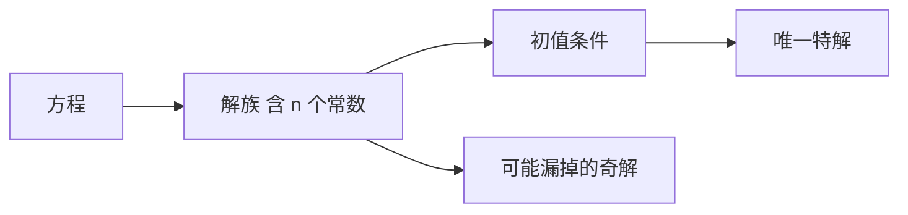

# 通解与初值问题

- **难度**：基础 | **涉及章节**：第 1、3、4 章

## 一句话定义
通解是带 n 个独立任意常数的解族；初值问题是在解族里挑出唯一那条曲线的操作。

## 为什么重要
它是整门课的"记账单位"：所有定理要么在说"解族有多大"，要么在说"给定初值还剩几个解"。皮卡定理回答的是后者。

## 图示

## 详解
以 y′=2xy 为例，通解 y=ce^(x²)。c 取不同值，得到一族互不相交的曲线，铺满整个平面。给 y(0)=3，c=3，曲线被钉死。

"独立"不是"个数够"就行。若写成 c₁+c₂ 的形式，两个常数其实只有一个自由度。判定标准是雅可比行列式不为零。

n 阶方程配 n 个初值条件，这是一一对应的：每积一次分产生一个常数，每给一个初值消耗一个。

## 常见误解
- 别以为通解覆盖所有解——奇解不在族里。
- 别以为初值条件可以随便给在任意点——皮卡定理要求初值点落在 f 的定义域内部。

## 在书中出现的脉络
| 章节 | 语境 | 关键结论 |
|---|---|---|
| 第 1 章 | 定义通解/特解 | 含 n 个独立常数 |
| 第 3 章 | 存在唯一性 | 初值确定唯一解 |
| 第 4 章 | 线性方程解空间 | n 维，通解=基本解组线性组合 |

## 相关概念
- 前置：导数、积分
- 后续：皮卡迭代、基本解组
