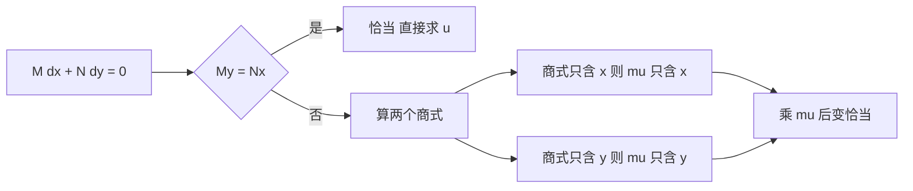

# 积分因子

- **难度**：进阶 | **涉及章节**：第 2、4 章

## 一句话定义
积分因子是一个乘数 μ(x,y)，乘到 M dx+N dy=0 上，把它从"不恰当"变成"恰当"。

## 为什么重要
它是初等解法里唯一的"通用补丁"：分离变量、齐次型都失败时，找 μ 往往还能救。

## 图示

## 详解
判据推导：要求 ∂(μM)/∂y=∂(μN)/∂x，展开得

μ(∂M/∂y−∂N/∂x) + M·∂μ/∂y − N·∂μ/∂x = 0

这是一个关于 μ 的一阶偏微分方程，一般很难解。所以教材只处理两种退化的情形：假设 μ 只依赖 x，或只依赖 y，此时方程退化成一个常微分方程。

若 μ=μ(x)：∂μ/∂y=0，条件变成 μ·(My−Nx) = −N·μ′(x)，即 μ′/μ=(My−Nx)/N。只有这个商式不含 y 时才能积分。

## 常见误解
- 别以为积分因子唯一——无穷多个。
- 别以为没有只依赖一个变量的 μ 就无解——可能存在依赖 x+y 或 xy 的 μ，需要另设形式。
- 别以为乘 μ 不会丢解——μ=0 的地方要单独检查。

## 在书中出现的脉络
| 章节 | 语境 | 关键结论 |
|---|---|---|
| 第 2 章 | 恰当方程补救 | 两个商式判据 |
| 第 4 章 | 一阶线性方程 | e^(∫P dx) 就是一个积分因子 |

## 相关概念
- 前置：全微分、偏导数
- 后续：恰当方程、首次积分
