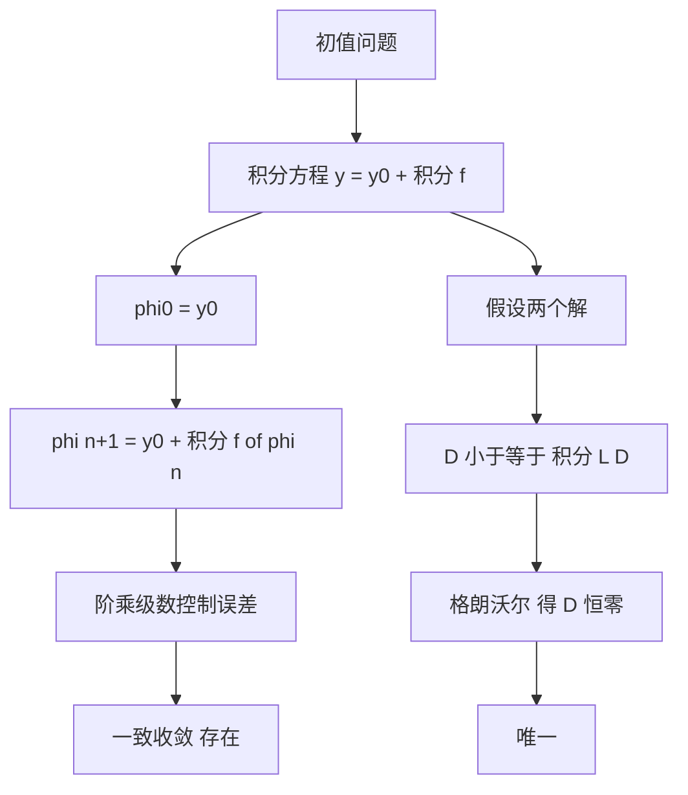

# 皮卡迭代与格朗沃尔引理

- **难度**：高难 | **涉及章节**：第 3 章

## 一句话定义
皮卡迭代是用积分方程反复代换逼近解；格朗沃尔引理是把"差被积分控制"变成"差恒为零"的工具。

## 为什么重要
它们是存在唯一性定理的两个引擎：前者造解，后者保证只造出一个。

## 图示

## 详解
迭代为什么收敛？关键是相邻两项之差被 M Lⁿ hⁿ⁺¹/(n+1)! 控制。这个阶乘因子来自逐次积分，每次积分都多一层积分号，也就多一个长度因子，除以新的阶乘。

格朗沃尔引理的标准形式：D(x) ≤ A + ∫B D，则 D(x) ≤ A e^(B|x−x₀|)。证明技巧是把不等式两边乘以积分因子 e^(−B(x−x₀))，凑成一个导数为负的单调函数。

唯一性里 A=0，于是 D≤0。

## 常见误解
- 别以为"两个解相减就唯一了"——微分方程相减得到的是齐次方程，它的解可以不为零。必须用格朗沃尔把积分界压成零。
- 别以为皮卡迭代只在理论上用——数值上的"预测-校正"格式也是同一思路。

## 在书中出现的脉络
| 章节 | 语境 | 关键结论 |
|---|---|---|
| 第 3 章 | 存在唯一性 | h=min(a,b/M) |
| 第 3 章 | 误差估计 | M Lⁿ hⁿ⁺¹/(n+1)! e^(Lh) |
| 第 6 章 | 稳定性 | 初值敏感度的指数放大因子 |

## 相关概念
- 前置：一致收敛、柯西序列
- 后续：解的延拓、对初值可微性
