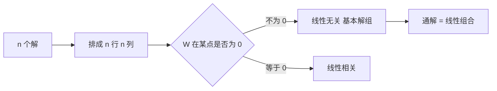

# 朗斯基行列式

- **难度**：进阶 | **涉及章节**：第 4、5 章

## 一句话定义
n 个解及其各阶导数排成的行列式，用来判断这组解是否线性无关。

## 为什么重要
线性方程的解空间是 n 维的，但你怎么知道手里的 n 个解"够用"？朗斯基行列式就是那把尺子。

## 图示

## 详解
为什么只查一点就够？因为刘维尔公式

W(x) = W(x₀)·exp(−∫a₁ dt)

指数因子永远不为零，所以 W 的符号性质不变：要么处处为零，要么处处不为零。

一个常见错误是把这条性质套到非线性方程上。非线性方程的解可以"有时 W 为零有时不为零"，判据失效。

## 常见误解
- 别以为 W=0 一定线性相关——这句话对非线性方程不成立。
- 别以为 W 需要算所有点——算一点即可，因为刘维尔公式。
- 别以为 W≠0 是"解唯一"的条件——它保证的是"这组解构成基"，唯一性来自初值定理。

## 在书中出现的脉络
| 章节 | 语境 | 关键结论 |
|---|---|---|
| 第 4 章 | 高阶线性方程 | 基本解组判据 |
| 第 5 章 | 方程组 | det Φ(t) 是矩阵版 |

## 相关概念
- 前置：行列式、线性相关
- 后续：基本解组、常数变易法
