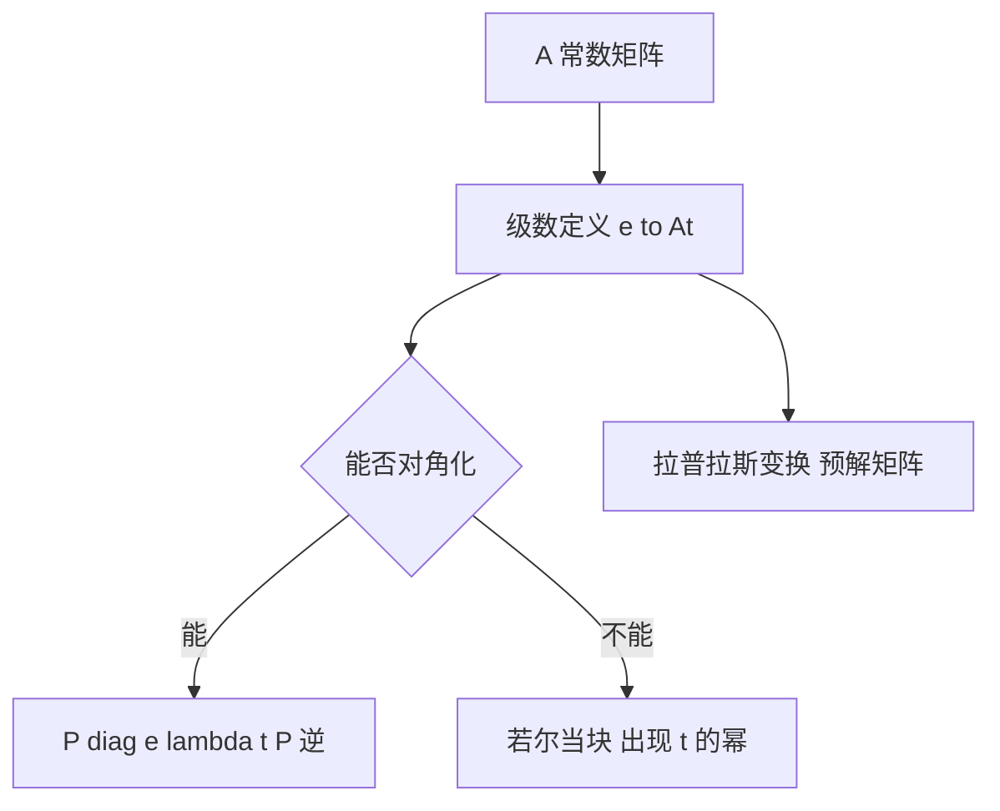

# 基解矩阵与矩阵指数

- **难度**：进阶 | **涉及章节**：第 5 章

## 一句话定义
基解矩阵是把 n 个线性无关解按列排成的矩阵 Φ(t)，满足 Φ′=AΦ 且 det Φ≠0；矩阵指数 e^(At) 是其中满足 Φ(0)=I 的那一个。

## 为什么重要
它把"解方程组"变成"算一个矩阵函数"，并且让初值问题一步到位：x(t)=e^(At)x(0)。

## 图示

## 详解
e^(At) 的定义就是把标量指数级数里的 t 换成矩阵 At。收敛性靠 ||Aᵏ||/k! 的收敛性。

若 A=PJP⁻¹，则 e^(At)=P e^(Jt) P⁻¹。若尔当块 J=λI+N，e^(Jt)=e^(λt)(I+Nt+…+N^(k−1)t^(k−1)/(k−1)!)，因为 N 幂零，级数截断。

工程上更常用拉普拉斯变换：X(s)=(sI−A)⁻¹x(0)，逆变换即得解。

## 常见误解
- 别以为 e^(At) 可以逐元素取指数，只有对角情形才对。
- 别以为特征值重复就不能对角化，要看几何重数。
- 别以为 e^(At) 总是有界，特征值实部为正时会指数增长。

## 在书中出现的脉络
| 章节 | 语境 | 关键结论 |
|---|---|---|
| 第 5 章 | 常系数方程组 | Φ(0)=I 的基解矩阵 |
| 第 6 章 | 线性化 | 特征值实部决定稳定性 |

## 相关概念
- 前置：矩阵、特征值、若尔当标准形
- 后续：稳定性、传递函数
