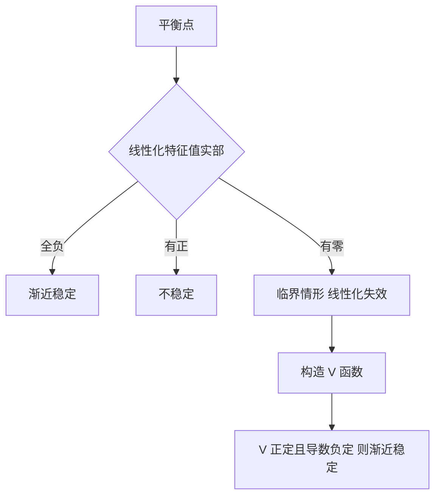

# 李雅普诺夫稳定性

- **难度**：高难 | **涉及章节**：第 6 章

## 一句话定义
稳定：起点足够近，轨线就永远不跑出给定的圈。渐近稳定：稳定且最终回到平衡点。

## 为什么重要
它是"解不出来也能判断行为"的核心工具，也是控制理论的入口。

## 图示

## 详解
两种方法的分工：第一方法是"算"，第二方法是"找"。算得快，但只在双曲情形有效；找得慢，但覆盖临界情形。

V 函数没有通用构造法，常见套路：二次型 xᵀPx（解李雅普诺夫方程 AᵀP+PA=−Q）、能量函数（力学系统）、平方和形式。

第二方法的严格陈述需要 V 正定、连续可微、导数沿轨线负定（或负半定加不变集条件，即拉萨尔不变原理）。

## 常见误解
- 别以为稳定就是回到原点——那是渐近稳定。
- 别以为线性化可以判一切——实部为零时失效。
- 别以为 V 必须唯一——可以构造无穷多个，找到一个是本事。

## 在书中出现的脉络
| 章节 | 语境 | 关键结论 |
|---|---|---|
| 第 6 章 | 稳定性定义 | ε-δ 语言 |
| 第 6 章 | 第一方法 | 双曲情形成立 |
| 第 6 章 | 第二方法 | V 函数判据 |

## 相关概念
- 前置：特征值、正定矩阵
- 后续：极限环、分支、控制稳定性
