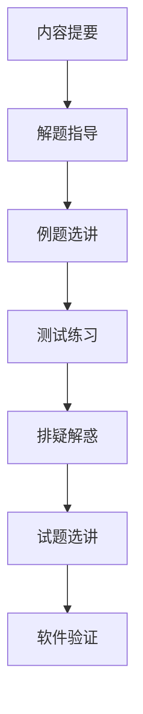

# 《常微分方程学习辅导与习题解答》（朱思铭）点化学习系统

## 这本书在讲什么
它是王高雄《常微分方程》第四版的配套辅导书，每章固定四块：内容提要、学习辅导（解题指导 / 例题选讲 / 测试练习）、补充提高（补充习题 / 排疑解惑 / 应用实例 / 历史与人物）、习题解答。它的价值是把教材的定理翻译成"考场动作"。

## 全书心智模型

## 学习路径（推荐顺序）
| 步骤 | 章节 | 主题 | 前置 | 检查点 |
|---|---|---|---|---|
| 01 | ch01 | 一阶方程解题 | 教材第 2 章 | 一分钟判路线 |
| 02 | ch02 | 存在唯一性解题 | 教材第 3 章 | 验证李普希茨 |
| 03 | ch03 | 高阶线性 | 教材第 4 章 | 共振规则 |
| 04 | ch04 | 线性方程组 | 教材第 5 章 | 算基解矩阵 |
| 05 | ch05 | 非线性与稳定性 | 教材第 6 章 | 五步流程 |
| 06 | ch06 | PDE 与边值 | 教材第 7、8 章 | 特征线法 |
| 07 | ch07 | 试题选讲 | 全部 | 认题 |
| 08 | ch08 | 数学软件 | 全部 | 四重校验 |

## 章节索引
- 第 1 章 一阶方程：要点与解题指导（★★☆）→ chapters/ch01-一阶方程解题指导.md
- 第 2 章 存在唯一性与奇解（★★★）→ chapters/ch02-存在唯一性解题指导.md
- 第 3 章 高阶线性方程（★★★）→ chapters/ch03-高阶线性方程解题指导.md
- 第 4 章 线性微分方程组（★★★）→ chapters/ch04-线性方程组解题指导.md
- 第 5 章 非线性与稳定性（★★★）→ chapters/ch05-非线性与稳定性.md
- 第 6 章 PDE 与边值问题（★★★）→ chapters/ch06-偏微分与边值问题.md
- 第 7 章 期中期末与考研试题（★★★）→ chapters/ch07-试题选讲.md
- 第 8 章 数学软件（★★☆）→ chapters/ch08-数学软件.md

## 前置知识（零基础缺口补讲）
| 缺口 | 对应补讲位置 | 学完标志 |
|---|---|---|
| 教材主线 | 先读 01-王高雄 | 能独立做课后题 |
| 线性代数 | ch04 4.1 | 能算特征向量 |

## 术语表 / 模式库 / 速查表 入口
- 术语：glossary.md
- 模式：patterns.md
- 速查：cheatsheet.md
- 测验：quiz.md
- 抽认卡：flashcards.md
