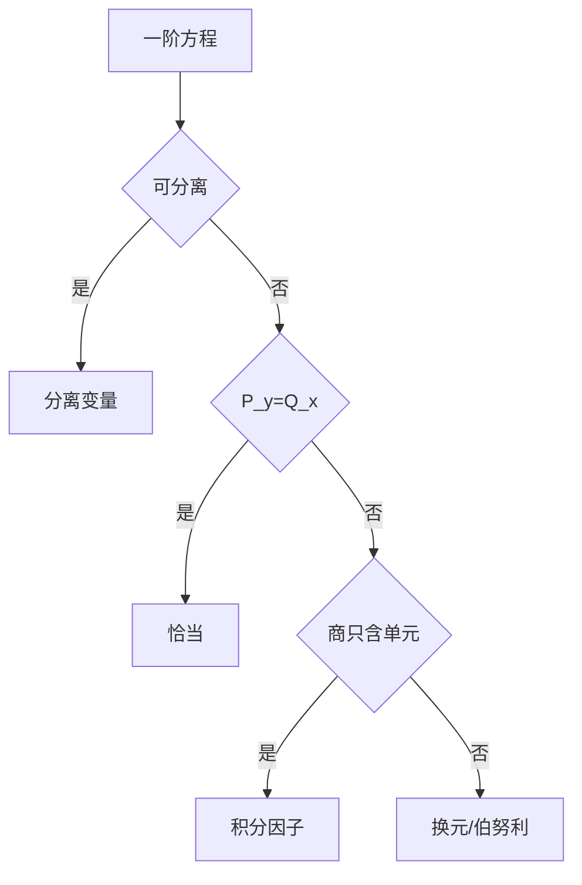

# 第 1 章 一阶方程：要点与解题指导

- **难度**：★★☆ | **预估学时**：6 小时 | **前置**：第 1 章教材内容
- **对应原书**：第一章（内容提要 / 学习辅导）

## 学习目标
学完本章，你能：
1. 在一分钟内判断一道一阶方程该走哪条解法路线；
2. 熟练使用"凑全微分"处理非标准形式的恰当方程；
3. 避开分离变量丢解、积分因子漏乘两个高频错误；
4. 把应用题的建模步骤固定成四步。

## 一句话核心
朱思铭这一章的价值不在知识点，而在**判断顺序**：先看是否可分离，再看是否恰当，最后才是换元。顺序错了，题就解不出来。

## 零基础讲解

### 1.1 判断顺序（这是本章最该背的东西）

1. 能不能写成 y′=f(x)g(y)？能，分离变量。
2. 写成 P dx+Q dy=0 后 P_y=Q_x？能，恰当。
3. 不恰当，但 (P_y−Q_x)/Q 只含 x 或 (N_x−M_y)/M 只含 y？能，求积分因子。
4. 形如 φ(y/x)、f(ax+by+c)？换元。
5. 形如 y′+P(x)y=Q(x)yⁿ？伯努利，令 z=y^(1−n)。

**为什么顺序重要**：同一个方程可能有多种处理方式，但只有一条能算到底。比如 (x+y)dx+x dy=0 既是恰当方程，也可当线性方程处理，前者更快。

### 1.2 两个高频错误

**丢解**：分离变量时除以 g(y)，若 g(y₀)=0，则 y≡y₀ 也是解，必须单独写。

**漏乘**：找到 μ 后要把整条方程乘 μ，包括右端；常见错误是只乘了 P dx 忘了 Q dy。

### 1.3 建模四步

1. 设未知函数（明确它代表什么）。
2. 写出变化率与现存量、流入流出量的关系。
3. 定初值（注意单位）。
4. 解完回代检验量纲与极限行为（t→∞ 是否符合物理直觉）。

**第 4 步是朱思铭反复强调的**：很多学生解完就走，答案量纲不对也发现不了。

### 1.4 典型例题（Malthus 与 Logistic 对比）

Malthus：N′=rN，解 N=N₀e^(rt)，指数增长，无上界。
Logistic：N′=rN(1−N/K)，解 N=K/(1+(K/N₀−1)e^(−rt))，趋于 K。

**比较的意义**：同一个建模思路，加一个"拥挤项"就改变了长期行为。这是数学生物学的入门对比。

## 图示

看图说明：按箭头顺序走，不要跳步。每一步都是"能算到底"的判据，不是"看起来像"。

## 类比与实例

**类比**：解题像选交通工具——先看有没有直达车（分离变量），没有再考虑换乘（换元）。绕远路也能到，但考试时间不够。

**实例**：解 y′=y/x + x。这是线性方程 y′−(1/x)y=x。
P=−1/x，∫P dx=−ln|x|，μ=1/|x|。取 μ=1/x（x>0）：
(xy)′=x·x=x²，xy=x³/3+C，y=x²/3+C/x。
检验：y′=2x/3−C/x²，而 y/x+x=x/3+C/x²+x。两者相等？2x/3−C/x² 与 x/3+C/x²+x 不等。
重算：(1/x)y′−y/x²=1，即 (y/x)′=1，y/x=x+C，y=x²+Cx。
检验：y′=2x+C，y/x+x=x+C+x=2x+C。正确。

## 常见误解

- **别以为"看起来像线性就一定线性"**——要先化成标准形 y′+P(x)y=Q(x)。
- **别以为"积分因子只乘一边"**——整条方程都要乘。
- **别以为"分离变量除掉的因子无所谓"**——漏解是考试扣分点。

## 自测题（答案）

1. y′=y/x+x 的正确解法？
   （答案：化为 (y/x)′=1，得 y=x²+Cx。解析：看出左边是全微分。）

2. 伯努利方程 y′+Py=Qyⁿ 的换元？
   （答案：z=y^(1−n)。解析：化为线性方程。）

3. 分离变量时 g(y₀)=0 意味着什么？
   （答案：y≡y₀ 也是解，必须单独列出。解析：除法丢解。）

4. 应用题解完为什么回代检验？
   （答案：检查量纲与长期行为是否符合物理。解析：建模可能出错。）

## 复习锚点
- 判断顺序：分离 → 恰当 → 因子 → 换元。
- 两个坑：丢解、漏乘。
- 建模四步，最后一步是回代检验。
