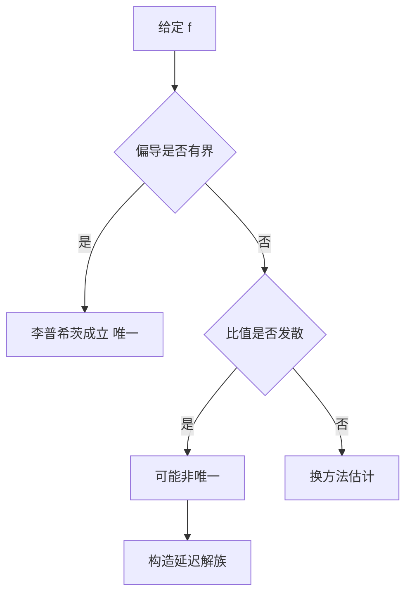

# 第 2 章 存在唯一性与奇解：解题指导

- **难度**：★★★ | **预估学时**：6 小时 | **前置**：第 1 章、教材第三章
- **对应原书**：第二章（学习辅导 / 补充提高）

## 学习目标
学完本章，你能：
1. 在具体方程上正确验证李普希茨条件，并给出一个可用的 L；
2. 判断某点是否唯一，并构造非唯一解族；
3. 用皮卡迭代写出前三项近似；
4. 说明奇解与唯一性失效的对应关系。

## 一句话核心
辅导书这一章的训练目标很明确：**把"验证条件"练成肌肉记忆**。考试里出现的不是抽象定理，而是"这个方程在 (0,0) 处唯一吗"。

## 零基础讲解

### 2.1 验证李普希茨的三种手法

1. **偏导有界**：|∂f/∂y|≤L 在矩形上，直接取 L 为上界。这是最常用的。
2. **中值定理**：|f(x,y₁)−f(x,y₂)|=|f_y(x,ξ)||y₁−y₂|。
3. **直接估计**：如 f=y² 在 |y|≤b 上，|y₁²−y₂²|≤2b|y₁−y₂|，L=2b。

**注意第三种**：李普希茨是局部的，只在给定矩形内成立，不要写成全局。

### 2.2 判断非唯一

典型手法：找 f 使 |f(x,y₁)−f(x,y₂)| 与 |y₁−y₂| 的比值在 y→y₀ 时无界。例如 f=√|y| 在 y=0 附近：

|√y₁−√y₂| = |y₁−y₂|/(√y₁+√y₂) → 发散

于是可以用"延迟出发"构造无穷多解：y≡0 与 y=(x−c)²/4（x≥c）。

### 2.3 皮卡迭代的实操

以 y′=x+y，y(0)=0 为例：
φ₀=0
φ₁=x²/2
φ₂=x²/2+x³/6
φ₃=x²/2+x³/6+x⁴/24
规律已现：φₙ=Σ[k=2→n+1] xᵏ/k!，极限 eˣ−1−x。

**考试常见要求**：写出前两项并估计误差。误差估计用 |φₙ−φ|≤M Lⁿ hⁿ⁺¹/(n+1)!。

### 2.4 奇解的检验流程

1. 求通解。
2. 求 C-判别式。
3. 回代验证是否为解。
4. 验证是否与族中曲线相切。
5. 确认该点李普希茨失效。

五步走完才敢下结论。

## 图示

看图说明：这张图是"判唯一"的判断树。注意最后一步不是"一定非唯一"，而是"可能"，还要实际构造。

## 类比与实例

**类比**：李普希茨条件像"坡度限制"。山坡再陡，只要坡度有上限，你走的路就是唯一的；如果某处坡度无限陡，就可能有多条路。

**实例**：f(x,y)=y^(2/3)，y(0)=0。|y^(2/3)| 在 0 附近比值发散（因为指数 <1），故非唯一。解族：y=0 与 y=((x−c)/3)³（x≥c）。

## 常见误解

- **别以为"连续就唯一"**——实际上连续只保证存在。
- **别以为"李普希茨必须全局"**——实际上局部够用。
- **别以为"判别式算出曲线就是奇解"**——必须回代。

## 自测题（答案）

1. f(x,y)=y² 在 |y|≤3 上的李普希茨常数可取多少？
   （答案：6。解析：|y₁²−y₂²|≤2·3|y₁−y₂|。）

2. y′=y^(2/3)，y(0)=0 唯一吗？
   （答案：不唯一。解析：指数小于 1，李普希茨失效。）

3. 皮卡迭代第二项怎么算？
   （答案：φ₂=y₀+∫f(t,φ₁)dt。解析：逐次代入。）

4. 奇解检验的最后一步是什么？
   （答案：确认该点李普希茨失效。解析：否则唯一性禁止奇解。）

## 复习锚点
- 李普希茨三手法：偏导、中值、直接估。
- 非唯一靠"比值发散 + 构造"。
- 奇解五步检验。
