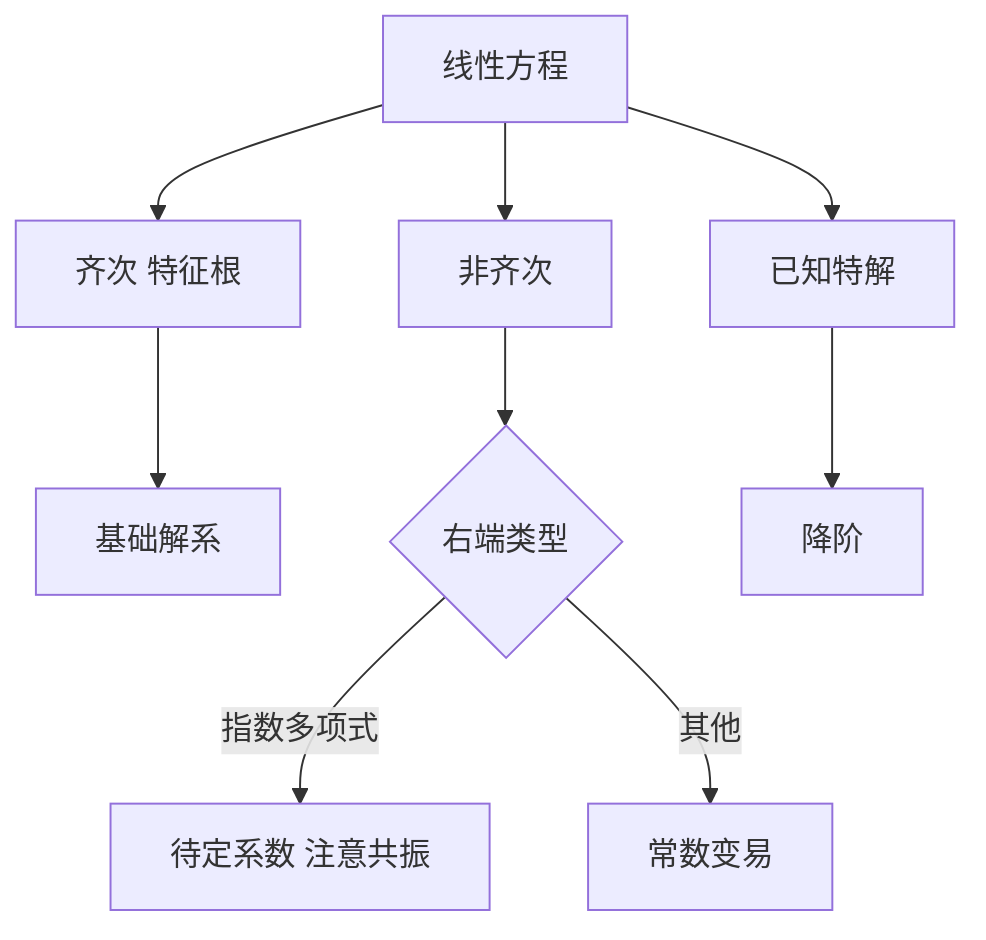

# 第 3 章 高阶线性方程：解法体系

- **难度**：★★★ | **预估学时**：8 小时 | **前置**：第 2 章、教材第四章
- **对应原书**：第三章（学习辅导 / 例题选讲）

## 学习目标
学完本章，你能：
1. 按"齐次 → 非齐次"的顺序组织任何一道线性方程题；
2. 用特征根法、待定系数法、常数变易法三条路径解常系数方程；
3. 用降阶法处理已知特解的情形；
4. 判断共振时特解该乘几次 t。

## 一句话核心
高阶线性方程的解题流程是固定的：**先解齐次拿基础解系，再找非齐次的一个特解**。所有技巧都服务于这两步。

## 零基础讲解

### 3.1 齐次：特征根

特征方程 → 根 → 基础解系。三种情形（单实根、共轭复根、重根）已在教材讲过，这里只强调**重根的写法**：

λ 是 k 重根 ⇒ e^(λx), xe^(λx), …, x^(k−1)e^(λx)。

### 3.2 非齐次：待定系数

右端 f(x) 为 e^(αx)Pₙ(x) 型，设特解 y*=e^(αx)Qₙ(x)x^k，其中 k 是 α 作为特征根的重数（不是根则 k=0）。

**共振规则**：α 是几重根，就乘几次 x。这一步错，整题错。

右端含 sin/cos 时，把它看成 e^(iωx) 的实部或虚部，转成复指数处理。

### 3.3 常数变易

右端不是上述类型时用：

y* = Σ yᵢ(x)∫[Wᵢ/W]f dx

W 是朗斯基行列式，Wᵢ 是把第 i 列换成 (0,…,0,1) 的行列式。

### 3.4 降阶

已知一个特解 y₁，令 y=u y₁：

u″ + (2y₁′/y₁ + p)u′ = f/y₁

这是关于 u′ 的一阶线性方程。

### 3.5 欧拉方程

xⁿy⁽ⁿ⁾+… 型，令 x=eᵗ 化为常系数。注意 t=ln x 只在 x>0 时用。

## 图示

看图说明：左边是主干，右边两个分支是"非齐次怎么找特解"。共振规则藏在 F 那一格里。

## 类比与实例

**类比**：齐次解像"自由振动"，非齐次特解像"被迫振动"。当外力频率与固有频率相同（共振），振幅会随时间增长——这就是为什么要乘 x。

**实例**：y″−3y′+2y=eˣ。
特征根 1、2。α=1 是一重根，故设 y*=Axeˣ。
代入：y*′=Aeˣ(x+1)，y*″=Aeˣ(x+2)。
(x+2)−3(x+1)+2x = −1，故 A=−1，y*=−xeˣ。
通解 y=C₁eˣ+C₂e^(2x)−xeˣ。

## 常见误解

- **别以为"共振就是乘一次 x"**——实际上要看重数。
- **别以为"待定系数对任何右端都行"**——只对指数多项式型有效。
- **别以为"降阶不用已知特解"**——它是降阶的前提。

## 自测题（答案）

1. 右端 e^(2x)，2 是二重特征根，特解该乘几次 x？
   （答案：两次。解析：k 等于重数。）

2. 已知 y₁=x 是某方程的特解，如何降阶？
   （答案：令 y=ux，化为 u′ 的一阶方程。解析：刘维尔-达朗贝尔降阶。）

3. 欧拉方程的标准换元？
   （答案：x=eᵗ。解析：化为常系数。）

4. 常数变易公式里的 W 是什么？
   （答案：朗斯基行列式。解析：基础解系的行列式。）

## 复习锚点
- 先齐次后非齐次。
- 共振乘 x 的次数 = 重数。
- 降阶、欧拉都是化归手段。
