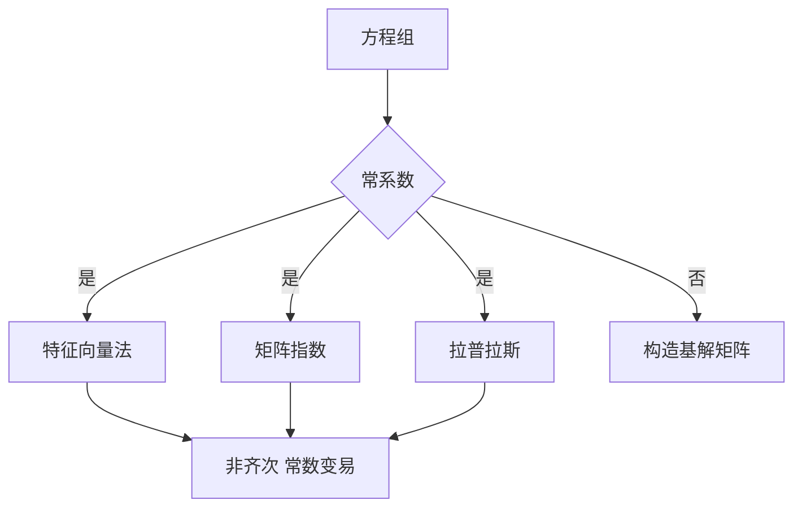

# 第 4 章 线性微分方程组：解法体系

- **难度**：★★★ | **预估学时**：8 小时 | **前置**：第 3 章
- **对应原书**：第四章（学习辅导 / 例题选讲）

## 学习目标
学完本章，你能：
1. 写出基解矩阵并验证它是解；
2. 用三种方法求常系数方程组的解（特征向量法、矩阵指数、拉普拉斯变换）；
3. 处理重特征值与复特征值两种麻烦情形；
4. 用常数变易解非齐次方程组。

## 一句话核心
方程组的解题核心是"求基解矩阵"。常系数时它就是 e^(At)，三种算法任选；变系数时只能靠具体构造。

## 零基础讲解

### 4.1 特征向量法

A 有 n 个线性无关特征向量 ⇒ Φ=[v₁e^(λ₁t),…]。这是最省事的情形。

### 4.2 复特征值

λ=α+iβ，特征向量 v=p+iq。实化解：

e^(αt)(p cos βt − q sin βt)，e^(αt)(p sin βt + q cos βt)

**常见错误**：直接把复解当答案，忘记取实部。

### 4.3 重特征值

若几何重数不足，需要广义特征向量。以二重根 λ 为例，若只有一个特征向量 v，则找 w 满足 (A−λI)w=v，解为

e^(λt)(v + wt)

### 4.4 矩阵指数与拉普拉斯

e^(At) 可用对角化或若尔当形算；也可用拉普拉斯变换：

e^(At) = L⁻¹[(sI−A)⁻¹]

这条在考试里很好用，因为求逆矩阵是机械操作。

### 4.5 非齐次

x=Φ(t)[C+∫Φ⁻¹(s)b(s)ds]。若 b 是常向量且 A 可逆，特解就是 −A⁻¹b。

## 图示

看图说明：三条常系数路线等价，选最顺手的；变系数只能老老实实构造。

## 类比与实例

**类比**：基解矩阵像"三根独立弹簧的振动"——每个特征方向各振各的，合成任意初值。

**实例**：A=[[1,1],[4,1]]。特征值 3、−1，特征向量 (1,2)、(−1,2)。
Φ=[[e^(3t),−e^(−t)],[2e^(3t),2e^(−t)]]。
验证 det Φ=2e^(2t)+2e^(2t)=4e^(2t)≠0，且 tr A=2，刘维尔给 e^(2t)，相差常数 4，一致。

## 常见误解

- **别以为"复特征值直接写复解就行"**——实问题必须取实部。
- **别以为"重根只有一个解"**——还有广义特征向量给的第二个。
- **别以为"拉普拉斯只对初值问题有效"**——也可处理非齐次，但要注意初值项。

## 自测题（答案）

1. 复特征值 α±iβ 的实化解有几个？
   （答案：两个。解析：实部虚部各一个。）

2. 二重根 λ，只有一个特征向量时第二个解是什么？
   （答案：e^(λt)(v+wt)，w 为广义特征向量。解析：(A−λI)w=v。）

3. e^(At) 的拉普拉斯表示？
   （答案：L⁻¹[(sI−A)⁻¹]。解析：矩阵版本的变换。）

4. 非齐次常向量 b 的特解？
   （答案：−A⁻¹b（A 可逆时）。解析：设常特解代入。）

## 复习锚点
- 基解矩阵是核心。
- 复根取实部，重根找广义向量。
- 三条常系数路线等价。
