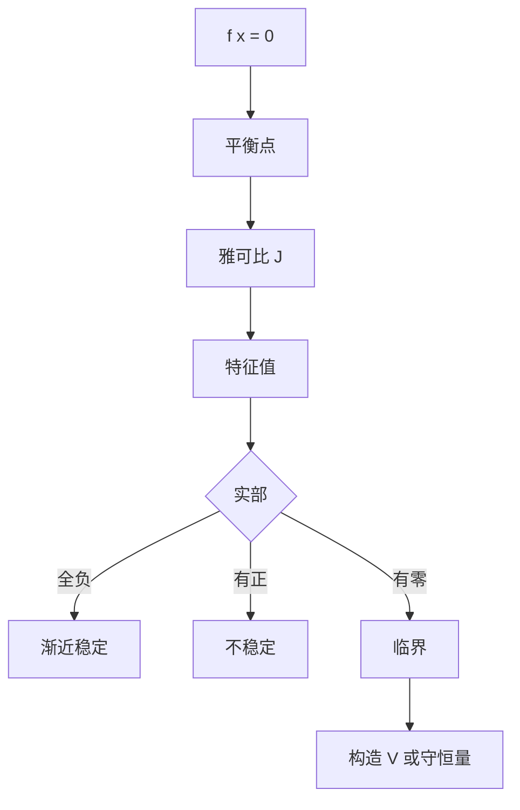

# 第 5 章 非线性方程与稳定性：解题指导

- **难度**：★★★ | **预估学时**：7 小时 | **前置**：第 4 章
- **对应原书**：第五章（学习辅导 / 补充提高）

## 学习目标
学完本章，你能：
1. 按固定流程做稳定性分析（找平衡点 → 线性化 → 判谱 → 必要时找 V）；
2. 用 V 函数完成一道完整的稳定性证明；
3. 判断极限环是否存在（平面情形）；
4. 说明"线性化失效"时该怎么继续。

## 一句话核心
稳定性题的流程是标准化的：**平衡点 → 雅可比 → 特征值 → 分类 → 结论**。非双曲时才需要额外的 V 函数，而 V 的构造有套路可循。

## 零基础讲解

### 5.1 标准流程

1. 解 f(x)=0 找平衡点。
2. 在每个平衡点算雅可比 J。
3. 算 J 的特征值。
4. 实部全负 → 渐近稳定；有正 → 不稳定；有零 → 临界。
5. 临界时构造 V 或找守恒量。

**第 5 步是分水岭**：前面的步骤纯代数，第 5 步靠经验。

### 5.2 V 函数的构造套路

- **二次型**：V=ax²+bxy+cy²，用待定系数让 V̇ 负定。
- **能量型**：机械系统取动能+势能。
- **平方和**：V=Σ(xᵢ−xᵢ*)²，适合对称系统。

以线性系统 ẋ=Ax 为例，取 V=xᵀPx，则 V̇=xᵀ(AᵀP+PA)x。要求负定 ⇔ 解李雅普诺夫方程 AᵀP+PA=−Q（Q 正定）。这是一套可计算的流程，不是碰运气。

### 5.3 极限环

平面系统：构造环形捕获域（外圈向内、内圈向外），域内无平衡点 ⇒ 存在闭轨。

稳定性的判据用庞加莱映射导数，或直接用"轨线是趋近还是远离"的几何判断。

### 5.4 常见考试题型

- 给一个含参数系统，问参数取何值时稳定。答：算特征值，让实部为负，解不等式。
- 给一个 V，问能否判稳。答：验证正定性与 V̇ 的符号。
- 判断某系统有无闭轨。答：捕获域。

## 图示

看图说明：前四步是机械的，第五步才开始动脑。考试失分多在第 1 步（漏平衡点）。

## 类比与实例

**类比**：找平衡点像找"地势平坦处"；线性化像"在平坦处测坡度"；V 函数像"找一个高度计"。

**实例**：ẋ=−x+x³。平衡点 0、±1。
J=−1+3x²。在 0 处 J=−1（稳定）；在 ±1 处 J=2（不稳定）。
结论：0 渐近稳定，±1 不稳定。这是一维的双稳态结构。

## 常见误解

- **别以为"平衡点只有一个"**——实际上可能多个，必须全找。
- **别以为"V 只能靠猜"**——线性系统有李雅普诺夫方程可解。
- **别以为"临界就等于不稳定"**——可能是稳定非渐近。

## 自测题（答案）

1. ẋ=−x+x³ 的平衡点与稳定性？
   （答案：0 稳定，±1 不稳定。解析：J=−1+3x²。）

2. 线性系统 V=xᵀPx 的导数是什么？
   （答案：xᵀ(AᵀP+PA)x。解析：直接求导。）

3. 李雅普诺夫方程的形式？
   （答案：AᵀP+PA=−Q。解析：Q 正定则 P 正定，可判稳。）

4. 极限环存在需要什么区域？
   （答案：环形捕获域，且内部无平衡点。解析：庞加莱-本迪克松。）

## 复习锚点
- 五步流程，第一步别漏。
- V 有套路：二次型、能量、平方和。
- 临界不等于不稳定。
