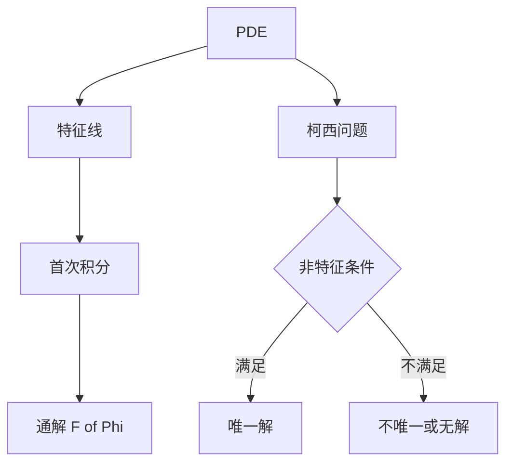

# 第 6 章 一阶偏微分方程与边值问题：解题指导

- **难度**：★★★ | **预估学时**：6 小时 | **前置**：第 2、4 章
- **对应原书**：第六章、第七章（学习辅导）

## 学习目标
学完本章，你能：
1. 用首次积分写出齐次 PDE 的通解；
2. 用特征线法解拟线性方程并验证非特征条件；
3. 判断边值问题是否有唯一解；
4. 用格林函数表示非齐次边值问题的解。

## 一句话核心
这两类问题共享一个思路：**先找"结构"（首次积分/齐次解），再用结构表示一般解**。

## 零基础讲解

### 6.1 齐次 PDE

a u_x+b u_y=0。特征线 dy/dx=b/a，首次积分 Φ。通解 u=F(Φ)。

**验证方法**：把 u=F(Φ) 代回，用链式法则 u_x=F′Φ_x，u_y=F′Φ_y，于是 aF′Φ_x+bF′Φ_y=F′(aΦ_x+bΦ_y)=0（因为 Φ 是首次积分）。

### 6.2 拟线性与柯西问题

特征方程组 dx/ds=a，dy/ds=b，du/ds=c。以初始曲线参数 τ 为另一参数，解出 (x(s,τ), y(s,τ), u(s,τ))，消去 s、τ 得隐式解。

非特征条件 a y_τ−b x_τ≠0 必须验证，否则解不唯一。

### 6.3 边值问题

先解齐次 Ly=0：
- 只有零解 ⇒ 非齐次对任意 f 唯一可解（用格林函数表示）。
- 有非零解 ⇒ 非齐次需满足正交条件，否则无解。

### 6.4 格林函数

对 y″=f，y(0)=y(1)=0，格林函数

G(x,s)=−s(1−x)（x>s），−x(1−s)（x<s）

解 y=∫G(x,s)f(s)ds。格林函数的物理意义是"单位点源引起的响应"。

## 图示

看图说明：左侧是"通解"，右侧是"定解"。两者之间靠参 数化连接。

## 类比与实例

**类比**：格林函数像"在一个点上敲一下，整根弦怎么响应"。任意外力等于无数个点源叠加，所以解就是积分。

**实例**：u_x+u_y=u，u(x,0)=x。
特征方程：dx/ds=1，dy/ds=1，du/ds=u。
解：x=s+x₀，y=s，u=u₀e^s。初始 y=0 ⇒ s=0，x₀=τ，u₀=τ。
由 y=s 得 s=y，x₀=x−y。故 u=(x−y)e^y。
验证：u_x=e^y，u_y=−e^y+(x−y)e^y，和=(x−y)e^y=u。边界 u(x,0)=x。正确。

## 常见误解

- **别以为"通解就是所有解"**——可能还有奇解。
- **别以为"柯西问题随便给初值都能解"**——非特征条件是硬要求。
- **别以为"边值问题一定有解"**——见齐次有非零解的情形。

## 自测题（答案）

1. u_x+2u_y=0 的通解？
   （答案：u=F(x−y/2)。解析：特征线 x−y/2=const。）

2. 格林函数的作用？
   （答案：表示单位点源的响应，叠加得一般解。解析：线性叠加原理。）

3. 非特征条件的式子？
   （答案：a y_τ−b x_τ≠0。解析：初始曲线不能与特征线相切。）

4. 边值问题何时无解？
   （答案：齐次有非零解且非齐次右端不满足正交条件。解析：弗雷德霍姆二择一。）

## 复习锚点
- 齐次 PDE：u=F(Φ)。
- 拟线性：特征线织曲面 + 非特征条件。
- 边值：先齐次，再二择一。
