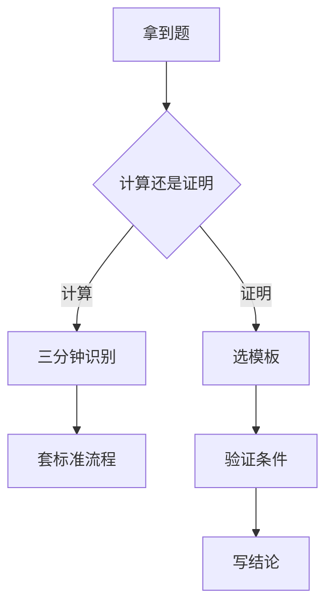

# 第 7 章 期中期末与考研试题选讲

- **难度**：★★★ | **预估学时**：8 小时 | **前置**：第 1–6 章
- **对应原书**：第九章（期中、期末与考研试题）

## 学习目标
学完本章，你能：
1. 按题型（计算、证明、应用）分配考场时间；
2. 识别考研真题中"换了个包装"的经典模型；
3. 用标准套路完成证明题（存在唯一、稳定性、边值）；
4. 避开"算对一半、写错结论"的高频失分点。

## 一句话核心
考试不考"你学过多少"，考"你能在多短时间内认出这是哪类题"。**认题比算题更值钱**。

## 零基础讲解

### 7.1 题型分布（据历年试题归纳）

| 题型 | 占比 | 常考内容 |
|---|---|---|
| 计算 | 50% | 一阶方程、常系数线性、方程组 |
| 证明 | 30% | 存在唯一、稳定性、解的性质 |
| 应用 | 20% | 建模、几何解释、参数讨论 |

### 7.2 计算题的"三分钟识别法"

1. 看阶数：一阶走第一章路线；二阶看是否常系数。
2. 看右端：是不是 e^(αx)Pₙ 型？是则待定系数。
3. 看是否有参数：有参数多半要讨论取值范围（稳定域）。

### 7.3 证明题的四个模板

- **存在唯一**：验证李普希茨 → 引用定理 → 写出 h。
- **稳定性**：算雅可比 → 特征值 → 结论；非双曲补 V。
- **解的性质**：作差 → 格朗沃尔 → 得界。
- **边值可解性**：齐次 → 二择一。

### 7.4 高频失分点

1. 通解漏掉奇解或常数解。
2. 待定系数忘了共振的 x 因子。
3. 稳定性题只算了一个平衡点。
4. 证明题引用了定理却没验证条件。
5. 应用题解完不检验量纲。

## 图示

看图说明：分叉点在"计算/证明"。证明题的失分几乎都在"验证条件"这一步。

## 类比与实例

**类比**：考场像"急诊分诊"。先判断这是哪一科（题型），再叫对应科室（模板），不要一上来就埋头算。

**实例**（考研改编）：设 f 连续且满足 |f(x,y)|≤M，证明 y′=f(x,y)，y(0)=0 的解在 |x|≤b/M 上存在。
答：这题不需要李普希茨（因为只证存在）。用皮亚诺定理：f 连续，矩形内 |f|≤M，故 h=min(a,b/M)。结论成立。

**注意**：如果题目问"唯一"，就必须补验李普希茨。这是最常见的"条件没验全"。

## 常见误解

- **别以为"证明题可以只写结论"**——必须写出条件验证。
- **别以为"计算题越快越好"**——漏解比慢更亏。
- **别以为"应用题不用检验"**——量纲和极限行为是送分点。

## 自测题（答案）

1. 证明"存在唯一"必须验证什么？
   （答案：李普希茨条件，并给出 h。解析：缺条件不能引用定理。）

2. 待定系数法最容易错在哪？
   （答案：共振时忘记乘 x^k。解析：k 为重数。）

3. 稳定性题漏平衡点会怎样？
   （答案：结论不完整。解析：每个平衡点都要分析。）

4. 应用题最后一步做什么？
   （答案：回代检验量纲与长期行为。解析：建模可能出错。）

## 复习锚点
- 先认题，再算题。
- 证明四模板。
- 五个高频失分点。
