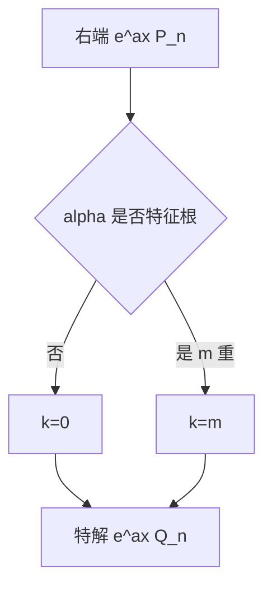

# 共振与特解形式

- **难度**：进阶 | **涉及章节**：第 3 章

## 一句话定义
当非齐次项的指数 α 恰好是特征根时，特解要额外乘 x^k（k 为重数）。

## 为什么重要
这是待定系数法唯一容易错的地方，也是"物理共振"的数学根源。

## 图示

## 详解
道理在于：不乘 x 时，代入后低阶项相消，方程退化，解不出系数。乘 x^k 恰好补回丢失的阶。

物理上，共振时外力与自由振动同频，能量持续注入，振幅线性（或多项式）增长。

## 常见误解
- 别以为共振只乘一次 x。
- 别以为右端是 sin 就不用管共振（要转成复指数看）。
- 别以为 k 与方程阶数有关。

## 在书中出现的脉络
| 章节 | 语境 | 关键结论 |
|---|---|---|
| 第 3 章 | 待定系数 | k = 重数 |

## 相关概念
- 前置：特征根
- 后续：受迫振动、参数共振
