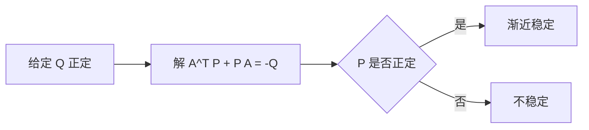

# 李雅普诺夫方程

- **难度**：高难 | **涉及章节**：第 5 章

## 一句话定义
AᵀP+PA=−Q，给定正定 Q 解出 P；P 正定则系统 ẋ=Ax 渐近稳定。

## 为什么重要
它把"构造 V 函数"这件凭经验的事，变成了可计算的线性方程组。

## 图示

## 详解
这是二次型 V=xᵀPx 的直接推论：V̇=xᵀ(AᵀP+PA)x=−xᵀQx<0。

定理（李雅普诺夫）：A 的所有特征值实部为负 ⇔ 对任意正定 Q，方程有唯一正定解 P。

## 常见误解
- 别以为 P 可以随便取（必须解方程）。
- 别以为只对一维有效。
- 别以为 Q 必须为单位阵（任意正定都行）。

## 在书中出现的脉络
| 章节 | 语境 | 关键结论 |
|---|---|---|
| 第 5 章 | V 的构造 | 可计算流程 |

## 相关概念
- 前置：二次型、正定性
- 后续：LQR、Lyapunov 稳定性理论
