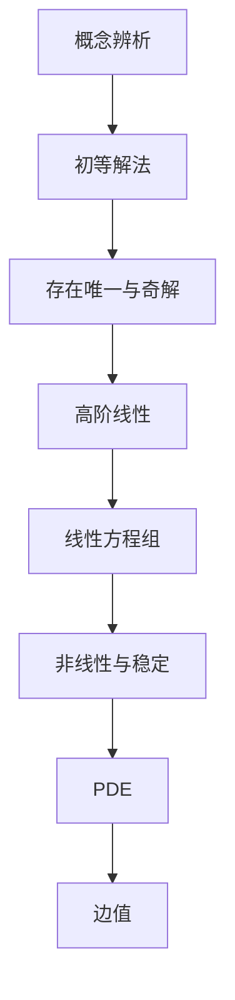

# 《常微分方程（第四版）习题详解》点化学习系统

## 这本书在讲什么
它是王高雄第四版的配套习题解答，每章分三块：本章教材全解、典型例题解析、本章同步自测，后面还有全书习题解答。它的定位是"刷题伴侣"：把教材的每个知识点落成可操作的步骤。

## 全书心智模型

## 学习路径（推荐顺序）
| 步骤 | 章节 | 主题 | 前置 | 检查点 |
|---|---|---|---|---|
| 01 | ch01 | 概念与曲线族 | 微积分 | 由族求方程 |
| 02 | ch02 | 一阶初等解法 | ch01 | 四类四动作 |
| 03 | ch03 | 存在唯一与奇解 | ch02 | 五步检验 |
| 04 | ch04 | 高阶线性 | ch03 | 共振规则 |
| 05 | ch05 | 方程组 | ch04 | 算 Φ 并验 |
| 06 | ch06 | 非线性与稳定 | ch05 | 五步流程 |
| 07 | ch07 | 一阶 PDE | ch02 | 特征线法 |
| 08 | ch08 | 边值 | ch04 | 判可解性 |

## 章节索引
- 第 1 章 绪论与基本概念（★☆☆）→ chapters/ch01-绪论与基本概念.md
- 第 2 章 一阶方程初等解法（★★☆）→ chapters/ch02-一阶初等解法.md
- 第 3 章 存在唯一性与奇解（★★★）→ chapters/ch03-存在唯一性.md
- 第 4 章 高阶线性方程（★★★）→ chapters/ch04-高阶线性方程.md
- 第 5 章 线性微分方程组（★★★）→ chapters/ch05-线性方程组.md
- 第 6 章 非线性与稳定性（★★★）→ chapters/ch06-非线性与稳定性.md
- 第 7 章 一阶线性偏微分方程（★★★）→ chapters/ch07-一阶线性偏微分方程.md
- 第 8 章 边值问题（★★★）→ chapters/ch08-边值问题.md

## 前置知识（零基础缺口补讲）
| 缺口 | 对应补讲位置 | 学完标志 |
|---|---|---|
| 教材正文 | 先读 01-王高雄 | 能独立做基础题 |
| 线性代数 | ch04 4.1 | 能算特征值 |

## 术语表 / 模式库 / 速查表 入口
- 术语：glossary.md
- 模式：patterns.md
- 速查：cheatsheet.md
- 测验：quiz.md
- 抽认卡：flashcards.md
