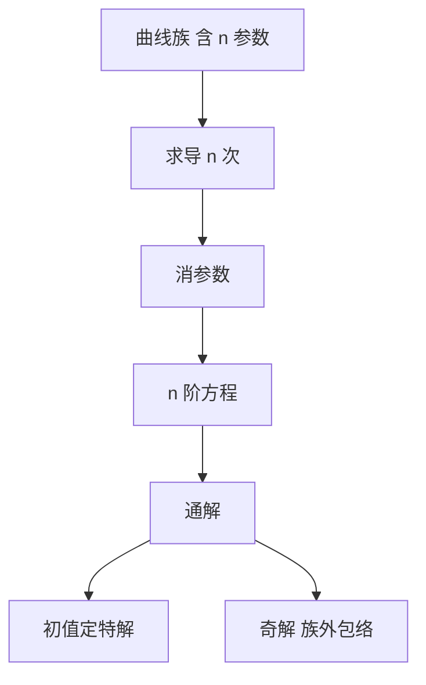

# 第 1 章 绪论与基本概念：全解与例题

- **难度**：★☆☆ | **预估学时**：3 小时 | **前置**：微积分
- **对应原书**：第一章（本章教材全解 / 典型例题解析）

## 学习目标
学完本章，你能：
1. 由曲线族反求微分方程并说明阶数；
2. 判断一个含参数式子是解还是通解；
3. 用相图语言解释一阶方程的几何意义；
4. 独立完成本章同步自测。

## 一句话核心
本章的题目几乎都是"概念辨析"型：**不求你算，只考你分得清"解""通解""特解""奇解"**。

## 零基础讲解

### 1.1 由曲线族求方程

n 个参数 ⇒ n 阶方程。方法：对 x 求 n 次导，联立消参数。

例：y=C₁x+C₂x²。y′=C₁+2C₂x，y″=2C₂。消去得 x²y″−2xy′+2y=0。

**检验**：直接代入 y=C₁x+C₂x²，左边 x²·2C₂−2x(C₁+2C₂x)+2(C₁x+C₂x²)=2C₂x²−2C₁x−4C₂x²+2C₁x+2C₂x²=0。成立。

### 1.2 "是不是解"的检验法

三步：求导到所需阶、代入、看是否恒等。注意恒等是对区间上所有 x 成立，不是对某个 x。

### 1.3 通解与特解

通解含 n 个独立常数；特解由初值定出；奇解不在通解族内且相切。

**"独立"的含义**：不能相互表示。C₁+C₂ 与 C₁−C₂ 不独立。

### 1.4 几何：线素场与等斜线

等斜线是 f(x,y)=k 的曲线，其上所有线素斜率相同。等斜线有助于手绘积分曲线。

## 图示

看图说明：这张图是"正向与反向"两条路的合体：从族到方程，从方程到解族。

## 类比与实例

**类比**：曲线族像"一叠卡片"，方程是"卡片的共同规则"；给你规则让你复原整叠卡片，就是求通解。

**失效边界**：包络不在卡片里，所以奇解是"规则之外的解"。

**实例**：y=C e^(−x)+x。求其满足的方程。
y′=x+1−y？检验：y′=1−Ce^(−x)，而 x+1−y=x+1−Ce^(−x)−x=1−Ce^(−x)。成立。故方程为 y′=x+1−y，即 y′+y=x+1。

## 常见误解

- **别以为"含常数就是通解"**——常数还要独立。
- **别以为"代入一个点成立就是解"**——要恒等。
- **别以为"阶数等于参数个数"**——一般如此，但退化情形例外。

## 自测题（答案）

1. y=C₁e^x+C₂e^(−x) 满足什么方程？
   （答案：y″−y=0。解析：两个参数，二阶。）

2. y=sin(x+C) 是 y′=cos(x+C) 的通解吗？
   （答案：不是，应写 y′=±√(1−y²)。解析：导数要用 y 表示。）

3. 等斜线的作用？
   （答案：标出斜率相同的点，便于手绘积分曲线。解析：几何辅助。）

4. 判断"是解"的关键一步？
   （答案：代入后对区间上所有 x 恒等。解析：不能只验一点。）

## 复习锚点
- n 参数 → n 阶方程。
- 解要恒等，不是点成立。
- 通解常数须独立。
