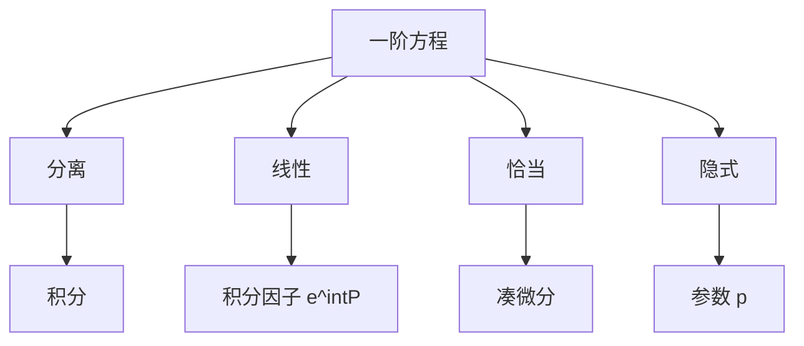

# 第 2 章 一阶方程初等解法：全解与例题

- **难度**：★★☆ | **预估学时**：8 小时 | **前置**：第 1 章
- **对应原书**：第二章（本章教材全解 / 典型例题解析 / 同步自测）

## 学习目标
学完本章，你能：
1. 独立完成分离变量、线性、恰当、隐式四类题；
2. 在恰当方程题中熟练使用分组凑微分；
3. 处理 y′=f(ax+by+c) 与齐次型；
4. 用参数法解 y=xf(p)+g(p) 型。

## 一句话核心
这一章的题量最大，但套路最少：**四类方程，四种固定动作**。练到看见形式就知道动作，就算过关。

## 零基础讲解

### 2.1 分离变量

dy/g(y)=f(x)dx，两边积分。别忘了 g(y)=0 的常数解。

### 2.2 一阶线性

y′+P(x)y=Q(x)，μ=e^(∫P dx)，(μy)′=μQ，y=(∫μQ dx+C)/μ。

**积分技巧**：∫P dx 不用加常数（会并入 C）；μ 取正即可。

### 2.3 恰当与分组

把 P dx+Q dy 拆成若干"明显是全微分"的组：
- x dy+y dx=d(xy)
- (x dy−y dx)/x²=d(y/x)
- (x dx+y dy)/(x²+y²)=d(ln√(x²+y²))

**这三个公式是本章的"乘法口诀"**，背下来能省一半时间。

### 2.4 隐式与参数

y=f(x,p)：对 x 求导，p=f_x+f_p p′，解出 p 后积分。
y=xf(p)+g(p)（拉格朗日型）：对 x 求导得线性方程，解出 x(p)，再代回。

### 2.5 典型例题

解 y=y′x+y′²（克莱罗型）。
令 p=y′：y=px+p²。对 x 求导：p=p+p′x+2pp′，即 p′(x+2p)=0。
分支一：p′=0 ⇒ p=C ⇒ y=Cx+C²（直线族）。
分支二：x=−2p ⇒ y=−p² ⇒ y=−x²/4（奇解）。

## 图示

看图说明：四条支路，最后都落到"积分"。所以本章真正的难点是积分技巧，不是方程类型识别。

## 类比与实例

**类比**：四类方程像四种锁，四种钥匙。训练的目标是"看锁配钥匙"的速度。

**实例**：解 (x+y)dx+(x−y)dy=0。检验 P_y=1，Q_x=1，恰当。
凑：x dx+y dx+x dy−y dy = d(x²/2)+d(xy)−d(y²/2)。
故 x²/2+xy−y²/2=C，即 x²+2xy−y²=C。

## 常见误解

- **别以为"积分因子只能靠公式"**——分组凑微分常常更快。
- **别以为"克莱罗方程只有一个解"**——还有奇解。
- **别以为"线性方程一定要用公式"**——有时观察出 (μy)′ 更省事。

## 自测题（答案）

1. 解 y′+2xy=x。
   （答案：y=1/2+Ce^(−x²)。解析：μ=e^(x²)，(ye^(x²))′=xe^(x²)。）

2. 解 y′=f(3x−y)。
   （答案：令 u=3x−y，u′=3−f(u)。解析：化为分离变量。）

3. 克莱罗方程 y=xp+p³ 的奇解？
   （答案：x=−3p²，y=−2p³，即 y=±(2/3)(−x/3)^(3/2)。解析：消参。）

4. (x+y)dx+(x−y)dy=0 的解？
   （答案：x²+2xy−y²=C。解析：恰当，凑微分。）

## 复习锚点
- 四类四动作。
- 三个凑微分公式要背。
- 隐式方程用 p 降阶。
