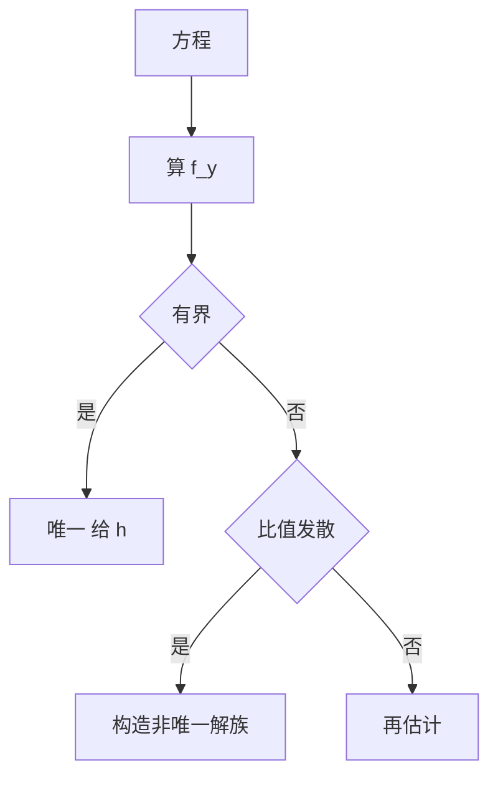

# 第 3 章 存在唯一性与奇解：全解与例题

- **难度**：★★★ | **预估学时**：7 小时 | **前置**：第 2 章
- **对应原书**：第三章（本章教材全解 / 典型例题解析）

## 学习目标
学完本章，你能：
1. 用皮卡迭代算出解的前几项并估计误差；
2. 判断给定方程在给定点是否唯一；
3. 求奇解并完成五步检验；
4. 判断解的最大存在区间。

## 一句话核心
本章题目的标准结构是：**给方程 → 判条件 → 下结论 →（若失效）构造反例**。四步缺一不可。

## 零基础讲解

### 3.1 迭代与误差

以 y′=y，y(0)=1 为例：
φ₀=1，φ₁=1+x，φ₂=1+x+x²/2，…，φₙ=Σ[k=0→n]xᵏ/k!。
误差 |φₙ−eˣ|≤e^(|x|)·|x|ⁿ⁺¹/(n+1)!。

**这个估计是本章唯一需要记的公式**。

### 3.2 判唯一

先算 ∂f/∂y，看它在矩形上是否有界。有界 ⇒ 唯一；无界 ⇒ 可能非唯一，需构造。

### 3.3 奇解五步

求通解 → C-判别式 → 回代 → 验证相切 → 确认李普希茨失效。

**例**：y′=y^(1/3)。通解 y=±(2x/3+C)^(3/2)。y=0 也是解，且与族中曲线相切（在起点处），且 y^(1/3) 在 0 处不满足李普希茨。故 y=0 是奇解。

### 3.4 最大存在区间

解出显式解后，看它在哪一段上连续且满足初值。y′=y²，y(0)=1 ⇒ y=1/(1−x)，区间 (−∞,1)。

## 图示

看图说明：右侧那条"构造"是本章的分水岭。会构造，才算真懂。

## 类比与实例

**类比**：李普希茨条件像"路口有没有护栏"。有护栏（有界）则只有一条路；无护栏则可能分叉。

**实例**：y′=√(1−y²)，y(0)=0。∂f/∂y=−y/√(1−y²)，在 |y|≤1/2 上有界（≤1/√3），故局部唯一。解 y=sin x，在 |x|<π/2 内有效。

## 常见误解

- **别以为"f 连续就唯一"**——连续只给存在。
- **别以为"奇解一定是不连续处"**——是李普希茨失效处，f 可以连续。
- **别以为"最大区间就是 R"**——要看解式。

## 自测题（答案）

1. y′=y^(1/3)，y(0)=0 有多少解？
   （答案：无穷多。解析：y=0 与延迟出发的立方解。）

2. 皮卡误差估计式？
   （答案：|φₙ−y|≤M Lⁿ hⁿ⁺¹/(n+1)!。解析：阶乘收敛。）

3. y′=y²，y(0)=1 的最大区间？
   （答案：(−∞,1)。解析：1/(1−x) 在 1 爆破。）

4. 奇解检验的最后一步？
   （答案：确认李普希茨失效。解析：否则唯一性禁止。）

## 复习锚点
- 判唯一看偏导有界。
- 奇解五步。
- 最大区间看解式定义域。
