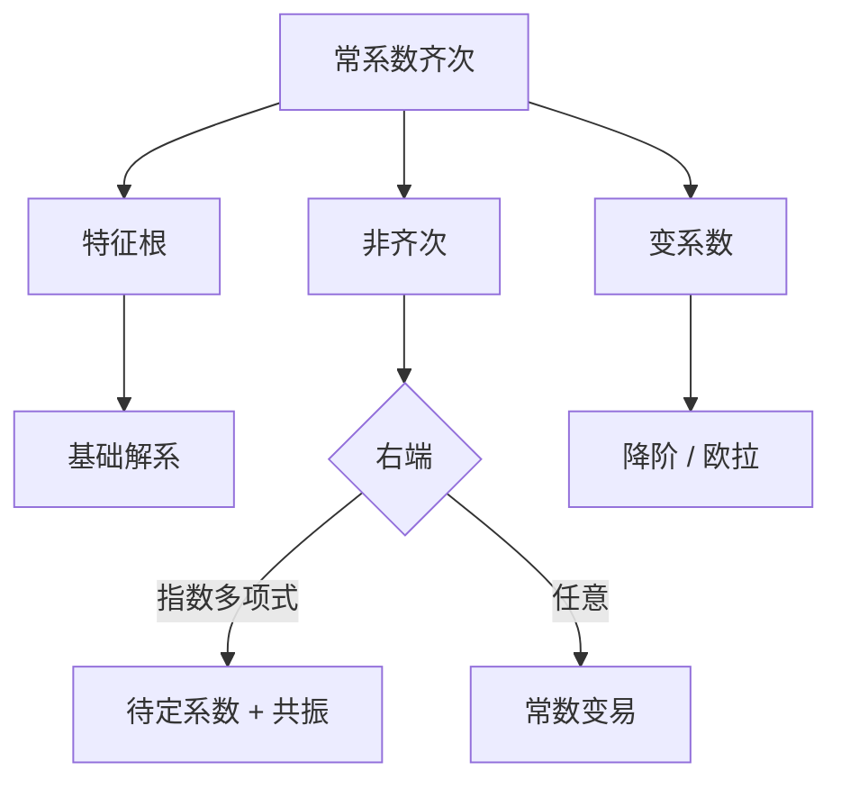

# 第 4 章 高阶线性方程：全解与例题

- **难度**：★★★ | **预估学时**：9 小时 | **前置**：第 3 章
- **对应原书**：第四章（本章教材全解 / 典型例题解析 / 同步自测）

## 学习目标
学完本章，你能：
1. 用特征根法写出任意常系数齐次方程的基础解系；
2. 用待定系数法处理指数、多项式、三角右端；
3. 用常数变易处理任意右端；
4. 用降阶法与欧拉变换处理变系数题；
5. 用朗斯基行列式判断线性相关性。

## 一句话核心
高阶线性题的骨架永远是"基础解系 + 一个特解"，剩下的都是计算细节。**细节里最容易错的是共振和朗斯基的符号。**

## 零基础讲解

### 4.1 齐次三种根

单实根、共轭复根、重根。写基础解系时，重根必须写足 k 个。

### 4.2 待定系数

右端为 e^(αx)Pₙ(x) 时，设特解 e^(αx)Qₙ(x)x^k。k=α 作为特征根的重数。

右端为 Pₙ(x)cos βx 或 sin 时，统一用复指数：解 e^(iβx)Pₙ 的特解，取实部或虚部。

### 4.3 常数变易

y*=Σ yᵢ∫(Wᵢ/W)f dx，其中 Wᵢ 是把 W 的第 i 列换成 (0,…,0,1)。

### 4.4 朗斯基

W(y₁,…,yₙ) 非零 ⇔ 线性无关（对线性方程的解而言）。

**易错点**：W 为零只说明在该点线性相关，不代表函数整体相关（除非它们都是同一方程的解）。

### 4.5 欧拉方程

x²y″+axy′+by=0。令 x=eᵗ，化为常系数；或用 y=x^r 试解，得 r(r−1)+ar+b=0。

## 图示

看图说明：中间"待定系数 + 共振"是本图唯一带星号的地方，也是失分集中区。

## 类比与实例

**类比**：基础解系像"一组基向量"，特解像"平移量"。任何解 = 基的组合 + 平移。

**实例**：y″+y=x。特征根 ±i。右端 x 是 0 次多项式，0 不是根，故设 y*=ax+b。
代入：0+ax+b=x ⇒ a=1，b=0。y*=x。
通解 y=C₁cos x+C₂sin x+x。

## 常见误解

- **别以为"W=0 就线性相关"**——只在同解情形下成立。
- **别以为"欧拉方程只能用 x=eᵗ"**——y=x^r 试解也可。
- **别以为"三角右端不能待定系数"**——转复指数即可。

## 自测题（答案）

1. y″+y=x 的特解？
   （答案：x。解析：0 不是特征根，设一次多项式。）

2. 朗斯基为零说明什么？
   （答案：在该点线性相关；若都是同解则是整体相关。解析：注意前提。）

3. 欧拉方程 x²y″+xy′−y=0 的解？
   （答案：y=C₁x+C₂/x。解析：r(r−1)+r−1=r²−1=0。）

4. 常数变易中 Wᵢ 怎么构造？
   （答案：把 W 第 i 列换成 (0,…,1)。解析：克拉默法则。）

## 复习锚点
- 基础解系 + 特解。
- 共振看重数。
- 朗斯基判相关要注意前提。
