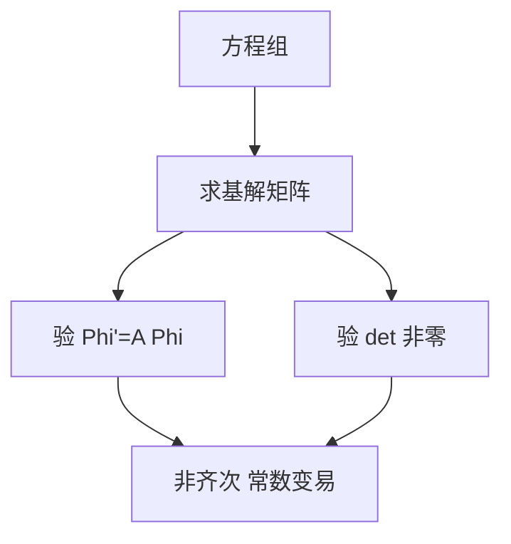

# 第 5 章 线性微分方程组：全解与例题

- **难度**：★★★ | **预估学时**：8 小时 | **前置**：第 4 章
- **对应原书**：第五章（本章教材全解 / 典型例题解析）

## 学习目标
学完本章，你能：
1. 写出基解矩阵并验证；
2. 用特征向量、矩阵指数、拉普拉斯三种方法求常系数解；
3. 用常数变易解非齐次；
4. 用刘维尔公式验算行列式。

## 一句话核心
方程组的题，只要能算出基解矩阵，剩下的都是代入。**所以练的重点是"算 Φ"，不是"背理论"**。

## 零基础讲解

### 5.1 基解矩阵的验证

Φ′=AΦ 且 det Φ≠0。两步都要验，只验一步会扣分。

### 5.2 三种算法

**特征向量**：A 有 n 个无关特征向量，Φ=[vᵢe^(λᵢt)]。
**矩阵指数**：对角化或若尔当。
**拉普拉斯**：Φ=L⁻¹[(sI−A)⁻¹]。

三种方法结果应一致（相差一个常数矩阵右乘）。

### 5.3 非齐次

x=Φ[C+∫Φ⁻¹b ds]。若 b 为常向量且 A 可逆，特解 −A⁻¹b。

### 5.4 刘维尔验算

det Φ(t)=det Φ(0)·e^(t tr A)。这个式子可以快速检查 Φ 算得对不对。

## 图示

看图说明：中间两个"验"是本章的得分点，很多答案错在 Φ 上而自己不知道。

## 类比与实例

**类比**：基解矩阵像"三条独立的运动轨迹拼成的矩阵"，每列一条。

**实例**：A=[[0,1],[−1,0]]。特征值 ±i，特征向量 (1,i)、(1,−i)。
实化解：x₁=cos t，x₂=−sin t。
Φ=[[cos t, sin t],[−sin t, cos t]]，det=1。验证 Φ′=[[−sin t, cos t],[−cos t,−sin t]]，而 AΦ=[[−sin t, cos t],[−cos t,−sin t]]。一致。

## 常见误解

- **别以为"Φ 只要满足 Φ′=AΦ 就行"**——还要 det≠0。
- **别以为"三种算法结果必须完全相同"**——相差常数矩阵右乘。
- **别以为"刘维尔公式只用于验算"**——它也用于证明 Φ 恒可逆。

## 自测题（答案）

1. 验证基解矩阵要做哪两步？
   （答案：Φ′=AΦ 且 det Φ≠0。解析：缺一不可。）

2. A 的特征值为 ±2i，实解是什么形式？
   （答案：cos 2t 与 sin 2t 的组合。解析：实部虚部。）

3. 刘维尔公式？
   （答案：det Φ(t)=det Φ(0)e^(t tr A)。解析：迹控制行列式。）

4. 非齐次常向量特解？
   （答案：−A⁻¹b。解析：常特解代入。）

## 复习锚点
- 算 Φ，验两步。
- 三种算法等价。
- 刘维尔公式验算。
