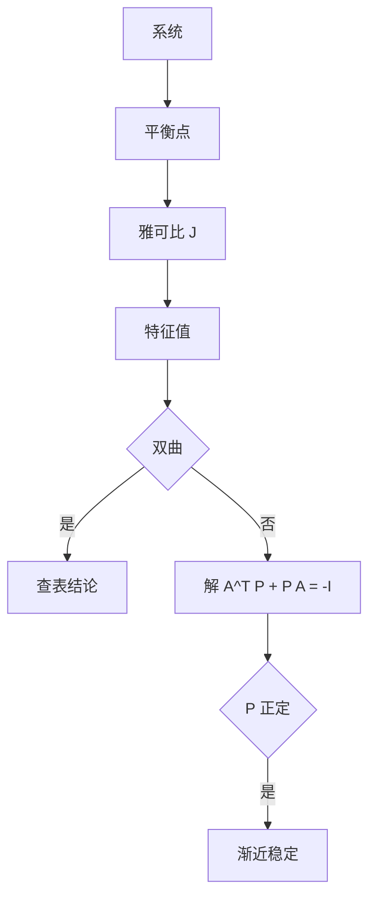

# 第 6 章 非线性方程与稳定性：全解与例题

- **难度**：★★★ | **预估学时**：8 小时 | **前置**：第 5 章
- **对应原书**：第六章（本章教材全解 / 典型例题解析 / 同步自测）

## 学习目标
学完本章，你能：
1. 完整走完稳定性分析五步；
2. 构造二次型 V 并验证条件；
3. 判断平面系统的奇点类型与稳定性；
4. 用捕获域论证闭轨存在。

## 一句话核心
非线性题的答案不唯一，但**论证结构是唯一的**：平衡点、线性化、谱、结论或补 V。

## 零基础讲解

### 6.1 五步走

1. 解 f(x)=0。
2. 每个平衡点算 J。
3. 算特征值。
4. 判符号。
5. 临界时找 V 或守恒量。

### 6.2 二次型 V 的构造

设 V=xᵀPx，要求 P 正定。V̇=xᵀ(AᵀP+PA)x，要求负定。

**实操**：解 AᵀP+PA=−I，若解出 P 正定，则渐近稳定。

### 6.3 平面奇点

p=tr A，q=det A，Δ=p²−4q。查表分类（结点、鞍点、焦点、中心）。

### 6.4 闭轨存在

构造环形区域 D：外边界上向量场指向内，内边界上指向外，且 D 内无平衡点 ⇒ 有闭轨。

**实操**：常用"圆环 + 径向场符号判断"。

## 图示

看图说明：右侧那条"解方程判 P"是可计算的路径，比"猜 V"可靠。

## 类比与实例

**类比**：平衡点像"地形上的坑与丘"。V 像"海拔计"，V̇<0 说明水往低处流。

**实例**：ẋ=−x+2y，ẏ=−2x−y。J=[[−1,2],[−2,−1]]，特征值 −1±2i，实部负 ⇒ 稳定焦点。

## 常见误解

- **别以为"线性化失效就无解"**——要另找方法。
- **别以为"V 只能猜"**——线性系统有方程可解。
- **别以为"捕获域随便画"**——边界上的向量方向必须验证。

## 自测题（答案）

1. 二次型 V 的导数公式？
   （答案：xᵀ(AᵀP+PA)x。解析：直接求导。）

2. 特征值 −1±2i 对应什么奇点？
   （答案：稳定焦点。解析：复根带负实部。）

3. 捕获域需要几个条件？
   （答案：外边界向内、内边界向外、内部无平衡点。解析：庞加莱-本迪克松。）

4. 五步流程的第一步？
   （答案：解 f(x)=0 找平衡点。解析：漏了就错。）

## 复习锚点
- 五步流程。
- 二次型 V 可解方程。
- 捕获域三条件。
