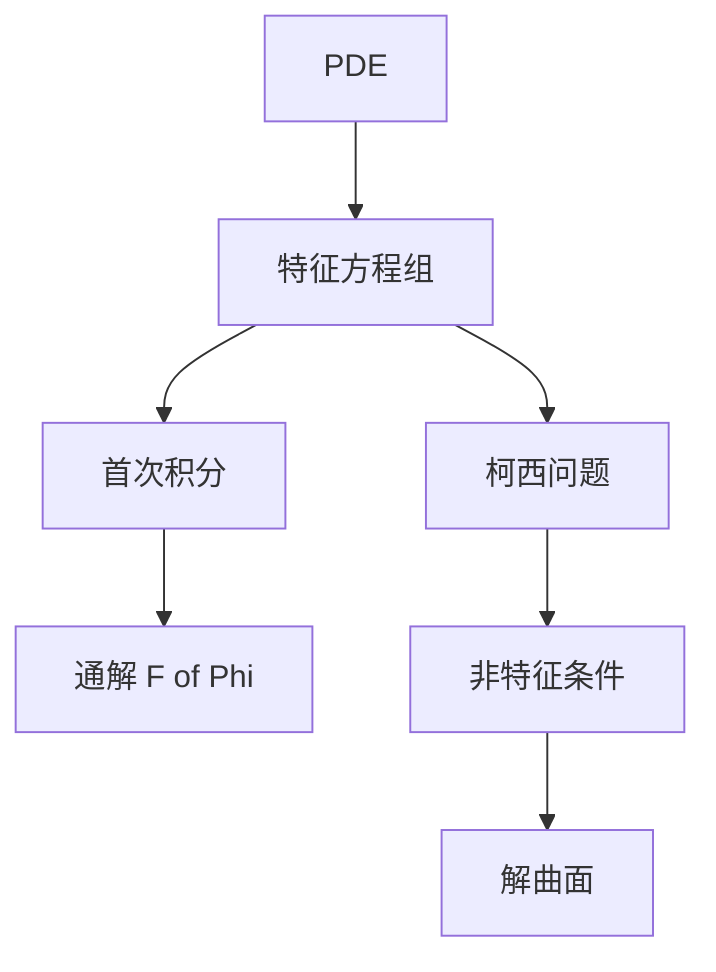

# 第 7 章 一阶线性偏微分方程：全解与例题

- **难度**：★★★ | **预估学时**：6 小时 | **前置**：第 2 章
- **对应原书**：第七章（本章教材全解 / 典型例题解析）

## 学习目标
学完本章，你能：
1. 用首次积分写出齐次 PDE 通解；
2. 用特征线法解拟线性方程；
3. 验证非特征条件；
4. 处理含多个自变量的情形。

## 一句话核心
PDE 题的答案形式是"隐式"的：**F(Φ₁,Φ₂,…)=0 或 u=G(Φ)**。这个形式本身就说明了一条轨线/一张解曲面。

## 零基础讲解

### 7.1 首次积分法

a u_x+b u_y=0。特征方程 dy/dx=b/a，解出 Φ(x,y)=C。通解 u=F(Φ)。

**多变量情形**：a₁u_x₁+…+aₙu_xₙ=0，需要 n−1 个独立首次积分，通解 u=F(Φ₁,…,Φ_{n−1})。

### 7.2 拟线性

特征方程组 dx/ds=a，dy/ds=b，du/ds=c。给定初始曲线参数 τ，解出含 (s,τ) 的表达式，消去得解。

**隐式写法**：Φ₁(x,y,u)=C₁，Φ₂(x,y,u)=C₂，解由 F(Φ₁,Φ₂)=0 给出。

### 7.3 非特征条件

a y_τ−b x_τ≠0。不满足则初始曲线与特征线相切，解不唯一。

### 7.4 典型例题

u_x+u_y=1，u(x,0)=x²。
特征：dx/ds=1，dy/ds=1，du/ds=1。
x=s+x₀，y=s，u=s+u₀。初始：y=0 ⇒ s=0，u₀=τ²，x₀=τ。
由 y=s 得 s=y，τ=x−y，u=y+(x−y)²。
验证：u_x=2(x−y)，u_y=1−2(x−y)，和=1。边界 u(x,0)=x²。正确。

## 图示

看图说明：左侧"通解"与右侧"定解"共用同一套特征线，区别只在是否给初始曲线。

## 类比与实例

**类比**：首次积分像"地图上的等高线编号"。知道编号，就知道自己在哪条线上。

**实例**：x u_x+y u_y=2u。特征：dx/ds=x，dy/ds=y，du/ds=2u。
解：x=x₀e^s，y=y₀e^s，u=u₀e^(2s)。
首次积分：y/x=y₀/x₀，u/x²=u₀/x₀²。
故 u=x²F(y/x)。

## 常见误解

- **别以为"PDE 通解只有一个任意常数"**——是任意函数。
- **别以为"非特征条件可以跳过"**——不满足时解不唯一。
- **别以为"消参数一定可行"**——有时只能写隐式。

## 自测题（答案）

1. x u_x+y u_y=0 的通解？
   （答案：u=F(y/x)。解析：特征线 y/x=const。）

2. 非特征条件的式子？
   （答案：a y_τ−b x_τ≠0。解析：切向不能与特征向重合。）

3. 三变量齐次 PDE 需要几个首次积分？
   （答案：2 个。解析：n−1=2。）

4. 隐式解的一般形式？
   （答案：F(Φ₁,Φ₂)=0。解析：两个首次积分确定一条特征线。）

## 复习锚点
- 齐次：u=F(Φ)。
- 拟线性：特征方程组 + 初始曲线。
- 非特征条件必须验。
