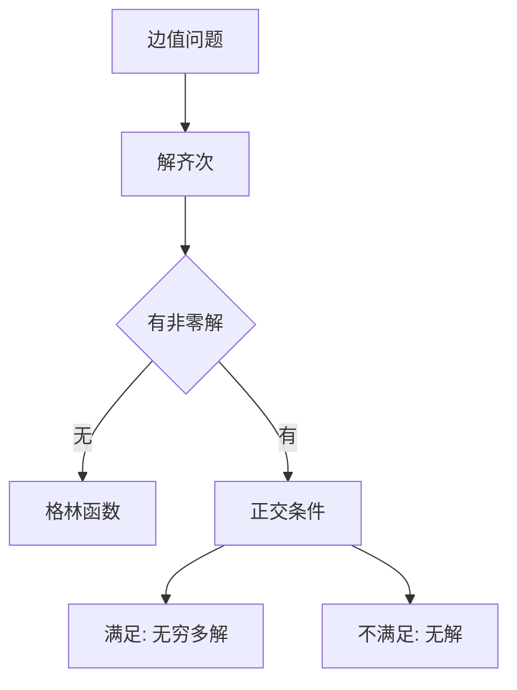

# 第 8 章 边值问题：全解与例题

- **难度**：★★★ | **预估学时**：7 小时 | **前置**：第 4、6 章
- **对应原书**：第八章（本章教材全解 / 典型例题解析 / 同步自测）

## 学习目标
学完本章，你能：
1. 判断边值问题是否有唯一解；
2. 求斯特姆-刘维尔问题的特征值与特征函数；
3. 用格林函数表示非齐次边值问题的解；
4. 处理周期边界条件。

## 一句话核心
边值问题的解法只有三条路：**直接积分（罕用）、格林函数、特征函数展开**。选哪条取决于"齐次问题有没有非零解"。

## 零基础讲解

### 8.1 先判可解性

解齐次 Ly=0 加边界条件：
- 只有零解 ⇒ 对任意 f 有唯一解。
- 有非零解 ⇒ 需 ∫f·yₙ=0（正交条件），否则无解。

### 8.2 格林函数

对 y″=f，y(0)=y(1)=0：

G(x,s)=−s(1−x)（x>s）；−x(1−s)（x<s）

y(x)=∫₀¹G(x,s)f(s)ds。

**验证**：G 在 x=s 处连续，导数跳跃 1（这正是 δ 源的特征）。

### 8.3 特征函数展开

对 y″+λy=f，y(0)=y(1)=0，特征函数 sin(nπx)。展开 f=Σfₙsin(nπx)，则

y=Σ fₙ/(n²π²−λ)·sin(nπx)

λ 等于某个特征值时出现共振（分母为零）→ 无解或无穷多解。

### 8.4 周期边界

y(0)=y(1)，y′(0)=y′(1)。特征函数 cos(2nπx)、sin(2nπx)（n≥1）加常数 1。

## 图示

看图说明：分叉点就是"齐次有没有非零解"。这一步定错，后面全错。

## 类比与实例

**类比**：格林函数像"在弦上某点按一下，整根弦的形状"。任意外力是无数个按压的叠加。

**实例**：y″=1，y(0)=y(1)=0。直接积分：y=x²/2+ax+b，b=0，1/2+a=0 ⇒ a=−1/2。y=x²/2−x/2=x(x−1)/2。
用格林函数：∫G(x,s)ds。分段积分应得同一结果。

## 常见误解

- **别以为"边值问题总能解"**——共振时可能无解。
- **别以为"格林函数必须显式"**——也可以用特征函数展开表示。
- **别以为"周期边界与分离边界一样"**——特征值结构不同。

## 自测题（答案）

1. y″+π²y=0，y(0)=y(1)=0 有非零解吗？
   （答案：有，y=sin πx。解析：π² 是特征值。）

2. 格林函数在 x=s 处的性质？
   （答案：连续，导数跳跃 1。解析：对应 δ 源。）

3. 共振时边值问题会怎样？
   （答案：无解或无穷多解。解析：分母为零。）

4. 周期边界的特征函数？
   （答案：1、cos 2nπx、sin 2nπx。解析：周期条件。）

## 复习锚点
- 先判齐次。
- 格林函数 = 点源响应。
- 特征值处共振。
