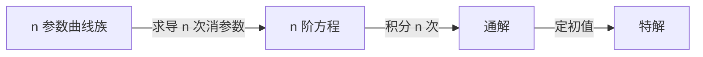

# 曲线族与微分方程

- **难度**：基础 | **涉及章节**：第 1 章

## 一句话定义
含 n 个独立参数的曲线族，对应一个 n 阶常微分方程；反过来，n 阶方程的通解含 n 个参数。

## 为什么重要
它把"几何对象（曲线族）"与"分析对象（方程）"对应起来，是理解通解含义的第一课。

## 图示

## 详解
参数独立是关键：若两个参数可以合并成一个，实际参数个数少一个，阶数也少一阶。

反例：y=C₁x+C₂x 实际上是 (C₁+C₂)x，只有一个参数，对应一阶方程 y′=y/x。

## 常见误解
- 别以为"表达式里出现两个字母就是两个参数"。
- 别以为"阶数一定等于参数个数"（退化时例外）。

## 在书中出现的脉络
| 章节 | 语境 | 关键结论 |
|---|---|---|
| 第 1 章 | 全解 | n 参数 ↔ n 阶 |

## 相关概念
- 前置：导数
- 后续：通解、初值问题
