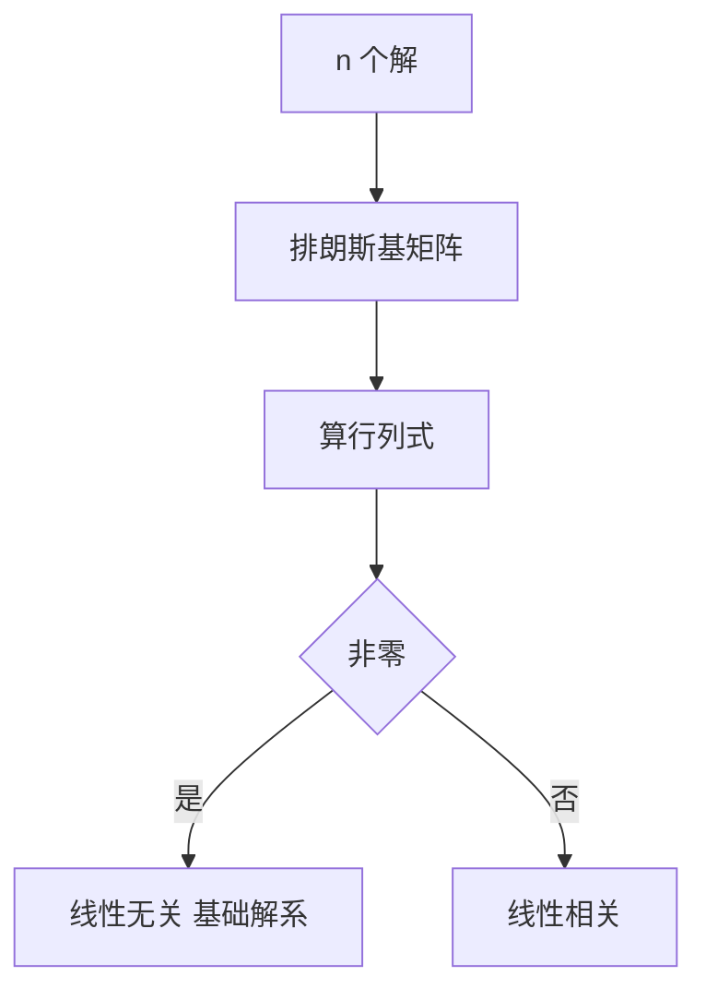

# 朗斯基行列式

- **难度**：进阶 | **涉及章节**：第 4、5 章

## 一句话定义
由 n 个函数及其直到 n−1 阶导数排成的行列式，用于判断线性相关性。

## 为什么重要
它是线性方程理论里"基础解系"的判据，也是常数变易公式的分母。

## 图示

## 详解
对同一线性方程的解，W 要么处处非零，要么处处为零（刘维尔公式）。这个"全有或全无"性质是它好用的原因。

对一般函数，W 在某点为 0 不代表线性相关（如 x² 与 x|x|）。

## 常见误解
- 别以为 W=0 一定线性相关（要限定为同解）。
- 别以为 W 是常数（一般随 t 变）。
- 别以为 W 与解的选择无关（换基会乘常数）。

## 在书中出现的脉络
| 章节 | 语境 | 关键结论 |
|---|---|---|
| 第 4 章 | 基础解系 | W≠0 判无关 |
| 第 5 章 | 常数变易 | W 作分母 |

## 相关概念
- 前置：行列式
- 后续：刘维尔公式
