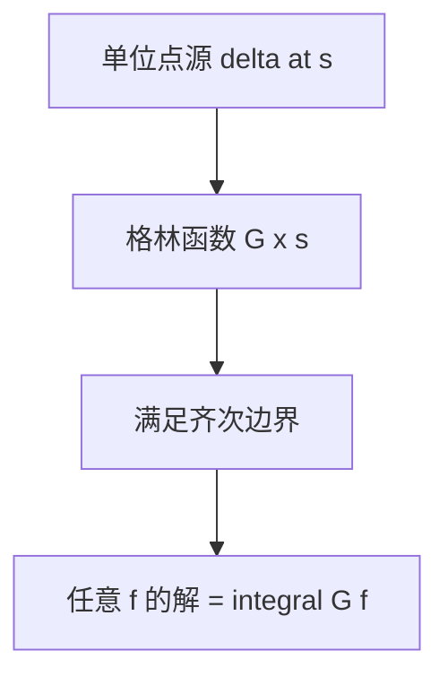

# 格林函数

- **难度**：高难 | **涉及章节**：第 8 章

## 一句话定义
线性边值问题对"单位点源"的响应；一般右端的解由它积分叠加得到。

## 为什么重要
它把"解微分方程"变成"做积分"，并且把边界条件的信息全部编码进一个函数。

## 图示

## 详解
G 的性质：对 x≠s 满足齐次方程；在 x=s 处连续；一阶导数跳跃 1（对应 δ）。这三条唯一确定 G。

对称性：自伴问题的 G(x,s)=G(s,x)。

## 常见误解
- 别以为格林函数只对二阶有效（高阶也有，但是张量）。
- 别以为 G 满足非齐次方程（它满足的是带 δ 的方程）。
- 别以为存在性无条件（共振时不存在）。

## 在书中出现的脉络
| 章节 | 语境 | 关键结论 |
|---|---|---|
| 第 8 章 | 边值问题 | 积分表示 |

## 相关概念
- 前置：δ 函数、边值问题
- 后续：特征函数展开
