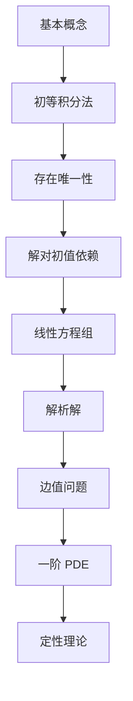

# 《常微分方程》（柳彬，北京大学出版社）点化学习系统

## 这本书在讲什么
它把常微分方程按"理论完整性"重排了一遍：初等积分以积分因子为主线串起来，存在性分成 Picard 与 Peano 两条路，解对初值的依赖单列一章，边值问题带上斯特姆比较定理，最后补一阶偏微分方程与定性理论。相比工科教材，它更在意"定理的边界条件"和"方法什么时候失效"。

## 全书心智模型

## 学习路径（推荐顺序）
| 步骤 | 章节 | 主题 | 前置 | 检查点 |
|---|---|---|---|---|
| 01 | ch01 | 基本概念 | 微积分 | 能由曲线族反求方程 |
| 02 | ch02 | 初等积分法 | ch01 | 用积分因子主线重解四类方程 |
| 03 | ch03 | 存在唯一性 | ch02 | 说清 Picard 与 Peano 的差别 |
| 04 | ch04 | 对初值依赖 | ch03 | 写出变分方程 |
| 05 | ch05 | 线性方程组 | ch04 | 弗洛凯乘子判稳 |
| 06 | ch06 | 解析解 | ch05 | 用幂级数解艾里方程 |
| 07 | ch07 | 边值问题 | ch05 | 证特征函数正交 |
| 08 | ch08 | 一阶 PDE | ch02 | 特征线法解拟线性方程 |
| 09 | ch09 | 定性理论 | ch05 | 判极限环 |

## 章节索引
- 第 1 章 基本概念（★☆☆）→ chapters/ch01-基本概念.md
- 第 2 章 初等积分法（★★☆）→ chapters/ch02-初等积分法.md
- 第 3 章 存在和唯一性（★★★）→ chapters/ch03-存在唯一性.md
- 第 4 章 解对初值和参数的依赖性（★★★）→ chapters/ch04-解对初值依赖.md
- 第 5 章 线性微分方程组（★★★）→ chapters/ch05-线性方程组.md
- 第 6 章 解析解（★★★）→ chapters/ch06-解析解与幂级数.md
- 第 7 章 边值问题（★★★）→ chapters/ch07-边值问题.md
- 第 8 章 一阶偏微分方程（★★★）→ chapters/ch08-一阶偏微分方程.md
- 第 9 章 定性理论简介（★★★）→ chapters/ch09-定性理论.md

## 前置知识（零基础缺口补讲）
| 缺口 | 对应补讲位置 | 学完标志 |
|---|---|---|
| 全微分与偏导 | ch02 零基础讲解 2.1 | 能判断 P dx+Q dy 是否恰当 |
| 一致收敛与紧性 | ch03 零基础讲解 3.1 | 能说出为什么需要一致收敛 |
| 若尔当标准形 | ch05 零基础讲解 5.3 | 能写重特征值的解 |
| 幂级数与解析函数 | ch06 零基础讲解 6.1 | 能估收敛半径 |

## 术语表 / 模式库 / 速查表 入口
- 术语：glossary.md
- 模式：patterns.md
- 速查：cheatsheet.md
- 测验：quiz.md
- 抽认卡：flashcards.md
