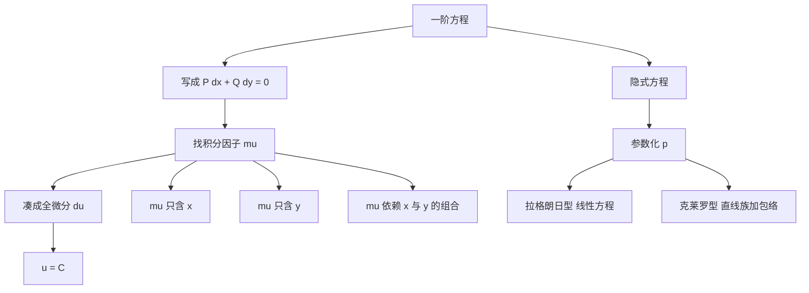

# 第 2 章：初等积分法——以积分因子为主线

- **难度**：★★☆ | **预估学时**：12 小时 | **前置**：第 1 章、偏导数、全微分
- **对应原书**：第二章

## 学习目标
学完本章，你能：
1. 用"凑全微分"的眼光统一看待分离变量、齐次型、线性方程；
2. 求出两类积分因子，并说明为什么只考虑单变量情形；
3. 解隐式方程，并识别拉格朗日型与克莱罗型；
4. 解 Riccati 方程（已知一个特解时）；
5. 建立 Volterra 捕食模型与二体问题的方程，并做定性说明；
6. 用降阶法处理二阶自治方程。

## 一句话核心
柳彬这一章的组织方式和多数教材不同：**所有初等解法都归到"找一个积分因子使方程变成全微分"这一条主线上**。分离变量只是积分因子恰好只依赖一个变量的特例。

## 零基础讲解

### 2.1 恰当方程与积分因子主线

方程写成

P(x,y)dx + Q(x,y)dy = 0

若存在 μ 使 μP dx+μQ dy=du，则解为 u=C。判定与求 μ 的办法与王高雄教材一致，但这里的讲法更强调"统一"：

- 分离变量 y′=f(x)g(y)。写成 dy−f(x)g(y)dx=0，取 μ=1/g(y)，立刻变成 du=0。**所以分离变量是积分因子的特例**。
- 齐次型 y′=φ(y/x)。写成 dy−φ(y/x)dx=0，取 μ=1/(y−xφ(y/x)) 之类的因子，可凑成 d(ln x) 形式。
- 一阶线性 y′+P y=Q。写成 (Py−Q)dx+dy=0，积分因子 e^(∫P dx)，恰好就是公式里那个指数。

这条主线的好处是：你不需要记四条互不相干的套路，只需要记"怎么凑全微分"。

### 2.2 一阶线性方程

标准推导：先解齐次，再常数变易。柳彬在这里补了一句值得记住的话：**线性方程的解对右端是线性的**——若 Q₁ 对应解 y₁，Q₂ 对应解 y₂，则 Q₁+Q₂ 对应 y₁+y₂。这叫叠加原理，是后面所有线性理论的种子。

### 2.3 隐式方程

三类：y=f(x,p)、x=f(y,p)、F(x,y,p)=0。前两类用 p 参数化后求导降阶；第三类一般只能局部解出。

**拉格朗日型** y=x·f(p)+g(p)：求导后得到关于 p 的线性方程，可用常数变易。
**克莱罗型** y=xp+g(p)：求导得 (x+g′(p))dp/dx=0，给出直线族与包络（奇解）。

### 2.4 Riccati 方程

y′ = P(x)y² + Q(x)y + R(x)

一般不可积。但**已知一个特解 y₁** 时，令 y=y₁+1/u，代入可化为关于 u 的线性方程：

u′ = −(2P y₁ + Q)u − P

这一步换元是整章最漂亮的技巧：非线性方程在已知一个解之后，可以被"线性化"。

### 2.5 Volterra 捕食模型

dx/dt = x(a − b y)，dy/dt = y(−c + d x)

这是 Lotka-Volterra 方程。它有一个首次积分

H(x,y) = d x − c ln x + b y − a ln y

沿轨线 H 为常数，所以轨线是闭曲线（在第一象限内）。这说明捕食系统的种群数量会周期振荡，不会灭绝也不会无限增长——这是生态学里最重要的定性结论之一。

### 2.6 二体问题

两个质点在万有引力下运动。约化到质心系后，相对运动满足

d²r/dt² = −G(m₁+m₂) r/|r|³

在平面内取极坐标，得到轨道方程，解是圆锥曲线（椭圆、抛物线、双曲线），由能量与角动量决定。这是"解出来"的典范，也是后来定性理论（开普勒问题）的起点。

### 2.7 二阶自治方程的降阶

方程 y″=f(y,y′) 不显含 x。令 p=y′，则 y″=p·dp/dy，方程降为一阶：

p·dp/dy = f(y,p)

这一步对所有"不显含自变量"的二阶方程都适用，是机械系统分析的标准第一步。

## 图示

看图说明：这张图的重点是最上面的"写成对称形式"。同一个方程写成 dy/dx=… 和写成 P dx+Q dy=0，后一种更容易看出全微分结构。

## 类比与实例

**类比**：积分因子像"给方程配一副合适的眼镜"。同一个方程，肉眼看不出它是全微分；戴上 μ 这副眼镜，du=0 的结构立刻显形。

**失效边界**：μ 可能依赖 x 与 y 的复杂组合，这时"猜"不出来。教材只保证两类单变量情形可算。

**实例**：解 Riccati 方程 y′=y²−1/x²。观察到一个特解 y₁=1/x。令 y=1/x+1/u：
y′=−1/x²−u′/u²，右端 =(1/x+1/u)²−1/x²=2/(xu)+1/u²。
于是 −1/x²−u′/u²=2/(xu)+1/u²，整理得 u′=−(2/x)u−1。解这个线性方程得 u=x⁻²(C−x³/3)。回代即得通解。

## 常见误解

- **别以为 Riccati 方程总能解**——实际上必须先猜到一个特解，否则没有初等解法。
- **别以为 Volterra 模型的闭轨就是极限环**——实际上闭轨是一族连续分布的（中心型），极限环是孤立的。
- **别以为降阶只对二阶有效**——实际上任何不显含 x 的方程都可降一阶。

## 自测题（答案）

1. 把 y′=f(x)g(y) 写成对称形式，并指出它的一个积分因子。
   （答案：dy−f(x)g(y)dx=0，取 μ=1/g(y)。解析：乘后得 dy/g(y)−f(x)dx=0，左边是全微分。）

2. 克莱罗方程 y=xp+p² 的奇解是什么？
   （答案：y=−x²/4。解析：x+2p=0 得 p=−x/2，代回 y=x(−x/2)+x²/4=−x²/4。）

3. Riccati 方程已知特解 y₁ 后，换元 y=y₁+1/u 把方程化成了什么类型？
   （答案：关于 u 的一阶线性方程。解析：这是 Riccati 可积的关键。）

4. 为什么 Volterra 模型的轨线是闭曲线而不是趋向平衡点？
   （答案：存在首次积分 H，轨线被限制在 H 的等值线上，而等值线是闭合曲线。解析：H 在平衡点处取极小值，等值线围绕它闭合。）

## 复习锚点
- 一切初等解法 = 找积分因子凑全微分。
- 克莱罗的包络是奇解；拉格朗日型可线性化。
- Riccati：有一个特解就能线性化。
- 不显含 x 的二阶方程，令 p=y′ 降阶。
