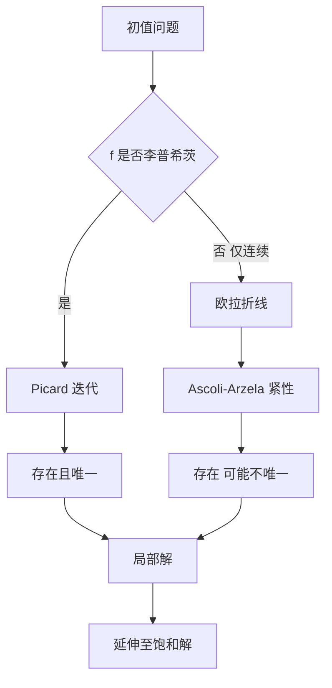

# 第 3 章：解的存在和唯一性

- **难度**：★★★ | **预估学时**：10 小时 | **前置**：第 2 章、一致收敛、紧性
- **对应原书**：第三章

## 学习目标
学完本章，你能：
1. 写出 Picard 定理的完整条件，并用迭代证明存在性；
2. 说明 Peano 定理只要求连续，为什么唯一性会失效；
3. 用 Ascoli-Arzelà 定理的框架解释 Peano 定理的证明思路；
4. 说清解的延伸与"饱和解"的关系；
5. 用 p-判别式找奇解并回代检验。

## 一句话核心
连续只保证"至少有一条解"，李普希茨才保证"只有一条"。两者的差距，就是整个存在性理论的分水岭。

## 零基础讲解

### 3.1 准备知识：为什么需要一致收敛

皮卡迭代产生一列函数 φₙ。要说明它收敛到一个解，必须说明：
1. 这列函数逐点收敛；
2. 收敛是**一致**的，否则极限函数未必连续；
3. 极限函数满足积分方程（这需要 f 的一致连续性把极限与积分交换）。

这三件事分别对应：柯西准则、一致收敛的连续性定理、控制收敛。

### 3.2 Picard 定理

条件：f 在矩形 R：|x−x₀|≤a，|y−y₀|≤b 上连续，且关于 y 满足李普希茨条件（常数 L）。
结论：在 |x−x₀|≤h（h=min(a,b/M)，M=max|f|）上存在唯一解。

证明骨架与王高雄教材相同：积分方程 → 迭代 → 阶乘级数控制 → 一致收敛 → 格朗沃尔证唯一。

柳彬在这里强调了一个细节：**李普希茨条件可以是局部的**，只要在 R 上成立即可；而且 L 可以依赖 R 的选择，换一个更小的矩形，L 可能更小。

### 3.3 Peano 定理

条件：f 在 R 上**连续**（不要求李普希茨）。
结论：解存在（至少一个），但不保证唯一。

证明思路与皮卡完全不同：构造欧拉折线序列，用 Ascoli-Arzelà 定理抽出**一致收敛的子列**。因为折线族是等度连续且一致有界的，紧性保证有收敛子列，极限满足积分方程。

反例必须记住：

y′ = √|y|，y(0)=0

解有无穷多个：y≡0；以及对任意 c≥0，

y = 0 （x≤c）；y = (x−c)²/4 （x>c）

验证：在 x>c 段，y′=(x−c)/2，√|y|=(x−c)/2，相等；在接点处左右导数都为 0，光滑。

> 类比：李普希茨条件是"漏斗不能太陡"。漏斗陡到垂直时，一滴水可以从多个方向流入同一点——路径不唯一。
> 失效边界：即使不满足李普希茨，解仍可能存在（Peano 保证），只是不唯一。

### 3.4 解的延伸

局部解只在 |x−x₀|≤h 上有定义。延伸是说：把解一段一段接下去。若解在右端点 x₁ 处仍有定义且 (x₁,y(x₁)) 在 f 的定义域内部，就可以继续。一直延伸到不能延伸为止，得到**饱和解**。

终止的两种方式：碰到定义域边界，或者在有限时间内爆破（如 y′=y²）。

### 3.5 奇解

奇解是通解族的包络。求法：从 F(x,y,p)=0 与 F_p=0 消去 p 得 p-判别式曲线，再把候选曲线代回原方程检验。

关键点：**p-判别式可能包含"不是解"的曲线**（例如 y′=y 的 p-判别式给出整个平面），必须回代。

## 图示

看图说明：两条证明路线用的是完全不同的工具——左边是"构造 + 压缩"，右边是"紧性 + 抽子列"。这是分析里两种典型的存在性证明范式。

## 类比与实例

**类比**：Picard 是"按图纸一层层盖楼"，每层都由上一层决定；Peano 是"把一堆可能的草稿放在桌上，紧性保证总有一张能收敛成正式图纸"。

**失效边界**：紧性只能给出子列收敛，不能告诉你哪一张是"对的那张"；唯一性需要额外条件。

**实例**：y′=√|y| 的非唯一性验算。取 c=1：x≤1 时 y=0；x>1 时 y=(x−1)²/4。在 x=1 处，左导数 0，右导数 (1−1)/2=0，导数存在且为 0。而 √|y(1)|=0，方程成立。所以这确实是一个解，与 y≡0 不同。

## 常见误解

- **别以为"连续就能保证唯一"**——实际上连续只保证存在。
- **别以为"Peano 定理弱所以没用"**——实际上它在需要最少假设的场合（如只知连续的控制系统）是唯一可用的存在性工具。
- **别以为"解一定能延伸到无穷"**——实际上有限时间爆破很常见。
- **别以为 p-判别式给出的就一定是奇解**——实际上必须回代检验。

## 自测题（答案）

1. Picard 定理中 h 为什么取 min(a,b/M)？
   （答案：a 保证 x 不超出矩形，b/M 保证迭代值不超出矩形的 y 范围。解析：两者取小才同时满足。）

2. Peano 定理证明中，哪条定理提供收敛子列？
   （答案：Ascoli-Arzelà 定理。解析：欧拉折线族等度连续且一致有界，故有紧性。）

3. y′=√|y|，y(0)=0 为什么有无穷多解？
   （答案：f 在 y=0 处不满足李普希茨，可构造任意"延迟出发"的解族。解析：见正文 c≥0 的构造。）

4. 饱和解的两个终止条件？
   （答案：抵达定义域边界，或解在有限时间内爆破。解析：此时无法继续延伸。）

## 复习锚点
- 连续 ⇒ 存在（Peano）；连续 + 李普希茨 ⇒ 唯一（Picard）。
- 两种证明范式：迭代构造 vs 紧性抽子列。
- 奇解要回代检验，p-判别式只是候选。
