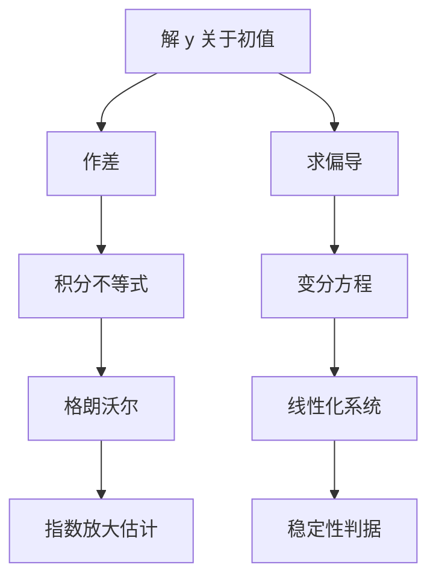

# 第 4 章：解对初值和参数的依赖性

- **难度**：★★★ | **预估学时**：8 小时 | **前置**：第 3 章、格朗沃尔引理、多元微积分
- **对应原书**：第四章

## 学习目标
学完本章，你能：
1. 说明为什么要把 m 维线性空间中的方程作为一般框架；
2. 用格朗沃尔引理证明解对初值的连续依赖，并写出放大因子的来源；
3. 写出变分方程，解释它为什么是"线性化"的原型；
4. 说明解对参数的连续可微性与"灵敏度"的关系；
5. 用这些结论解释数值计算中初值误差为什么会被指数放大。

## 一句话核心
存在唯一性只保证"给定初值有一条解"。本章补上下半句：**初值动一点，解也动一点，而且动多少是可以估出来的**。这个估计的指数因子，就是稳定性理论的全部起点。

## 零基础讲解

### 4.1 为什么要用 m 维框架

高阶方程化为一阶方程组后，未知量是一个 m 维向量。把"m 维线性空间中的微分方程"作为统一对象，好处是所有定理只需证一次：

dy/dx = f(x, y)，y∈R^m

一切估计都用向量范数书写，标量情形就是 m=1 的特例。

### 4.2 连续依赖

**定理**：设 f 在区域 D 上连续且关于 y 满足李普希茨（常数 L），解 y(x; x₀, y₀) 在公共存在区间上满足

|y(x; x₀, y₀) − y(x; x₀, y₁)| ≤ |y₀ − y₁|·e^(L|x−x₀|)

证明路线：两个解作差，差值满足

|Δy(x)| ≤ |Δy₀| + L·∫|Δy(t)|dt

直接套格朗沃尔引理，A=|Δy₀|，B=L。

**这个式子的含义**：初值误差被指数放大，放大速率是李普希茨常数。数值积分里为什么长时间模拟会失真？就是因为这个 e^(Lt)。

### 4.3 连续可微与变分方程

解的偏导数 ∂y/∂y₀ 存在，记作 Φ(x)。它满足

dΦ/dx = f_y(x, y(x))·Φ，Φ(x₀) = I

这叫**变分方程**。它是把原系统在参考轨线附近线性化的结果：Φ 就是线性化系统的基解矩阵。

这个结论是整个"线性化判稳"的理论依据：稳定性分析里算的雅可比矩阵，正是 f_y 在平衡点处的取值。

### 4.4 对参数的依赖

若右端含参数 μ：dy/dx=f(x,y,μ)，则解对 μ 也可微，且 ∂y/∂μ 满足

d/dx(∂y/∂μ) = f_y·(∂y/∂μ) + f_μ

多出来的 f_μ 正是"参数直接改变方程"的那部分贡献。工程上这叫灵敏度方程。

## 图示

看图说明：左边是"误差能有多大"，右边是"误差怎么长"。两者其实是同一个线性化系统的两个侧面。

## 类比与实例

**类比**：解对初值的依赖像"两条相邻的河流"。起点差一米，短期内还在一起流，时间够长就可能一条进了湖、一条冲下山。

**失效边界**：这个估计是上界，不是真实误差。实际放大可能远小于 e^(Lt)，也可能因为非线性效应而更快（超出李普希茨适用范围）。

**实例**：y′=y，y(0)=y₀。解 y=y₀eˣ，∂y/∂y₀=eˣ，恰是变分方程 Φ′=Φ，Φ(0)=1 的解。这里 L=1，估计式给出 |Δy|≤|Δy₀|e^(|x|)，与实际完全吻合——因为系统本身就是线性的，估计是紧的。

## 常见误解

- **别以为"连续依赖就是说解差不多"**——实际上有定量估计，而且可能指数放大。
- **别以为变分方程是另一套理论**——实际上它就是原系统沿参考解的线性化。
- **别以为"参数不影响解的结构"**——实际上参数变化可能导致分支（解的数量或稳定性突变）。

## 自测题（答案）

1. 连续依赖估计中的指数因子由什么决定？
   （答案：李普希茨常数 L 与区间长度 |x−x₀|。解析：|Δy|≤|Δy₀|e^(L|x−x₀|)。）

2. 变分方程的初值为什么是 I？
   （答案：因为 ∂y/∂y₀ 在 x=x₀ 处，y 就是 y₀，对 y₀ 求导得单位矩阵。解析：这是恒等映射的导数。）

3. 参数灵敏度方程比变分方程多出哪一项？
   （答案：f_μ，即右端对参数的偏导。解析：参数直接进入方程，产生了额外源项。）

4. 为什么数值长期积分会失真？
   （答案：初值与舍入误差被 e^(Lt) 放大。解析：见连续依赖估计。）

## 复习锚点
- 连续依赖 = 差值积分不等式 + 格朗沃尔。
- 变分方程 Φ′=f_yΦ，Φ(x₀)=I。
- 灵敏度方程多一项 f_μ。
