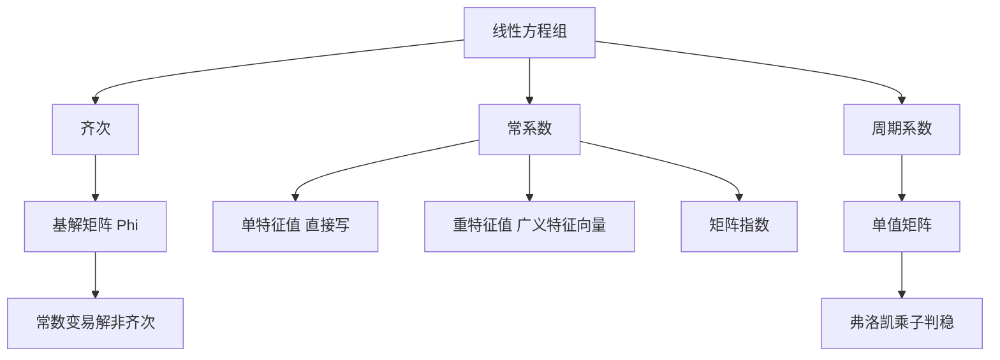

# 第 5 章：线性微分方程组

- **难度**：★★★ | **预估学时**：10 小时 | **前置**：第 4 章、矩阵、若尔当标准形
- **对应原书**：第五章

## 学习目标
学完本章，你能：
1. 写出齐次与非齐次线性方程组的一般理论，包括基解矩阵与常数变易；
2. 对常系数系统，按"单特征值"和"重特征值"两种情况写出基解矩阵；
3. 把高阶线性方程纳入方程组框架，说明两者的等价；
4. 说出周期系数系统（弗洛凯理论）的乘法表示与稳定性判据。

## 一句话核心
线性方程组的一切结论都建立在"解集是有限维线性空间"这一条上；常系数时它退化成"算矩阵指数"，周期系数时退化成"算单值矩阵的特征值"。

## 零基础讲解

### 5.1 一般理论

dy/dx = A(x)y + f(x)

齐次解集是 m 维线性空间；基解矩阵 Φ 满足 Φ′=AΦ，det Φ≠0；非齐次解由常数变易给出：

y = Φ(x)[C + ∫Φ⁻¹(s)f(s)ds]

刘维尔公式：det Φ(x)=det Φ(x₀)·exp(∫tr A dt)。这条式子说明基解矩阵的行列式永远不为零（只要初值不为零），所以"基"的性质是全局保持的。

### 5.2 常系数：单特征值

A 有 m 个互不相同的特征值 λ₁,…,λₘ，对应特征向量 v₁,…,vₘ。基解矩阵直接写出：

Φ(x) = [v₁e^(λ₁x), …, vₘe^(λₘx)]

这就是"单特征值情形最好算"的原因：不需要求若尔当形，也不需要处理 t 的幂。

### 5.3 常系数：重特征值

若 λ 是 k 重特征值，但几何重数不足，则需要广义特征向量链 v₁,…,v_k，满足 (A−λI)v_j=v_{j−1}。对应的解是

e^(λx)[v₁ + v₂x + … + v_k x^(k−1)/(k−1)!]

这与矩阵指数里的若尔当块写法完全一致：多出来的 t 的幂，来自广义特征向量链的长度。

### 5.4 高阶线性方程

y⁽ⁿ⁾+a₁y⁽ⁿ⁻¹⁾+…+aₙy=f 通过令 y₁=y, y₂=y′,… 化为一阶方程组。反过来，方程组的每个分量都满足一个 n 阶方程（消元法的结果）。两种框架的信息量相同。

### 5.5 周期系数：弗洛凯理论

若 A(x+T)=A(x)，则基解矩阵满足

Φ(x+T) = Φ(x)·M

M=Φ(T) 叫**单值矩阵**（monodromy matrix）。它的特征值叫**弗洛凯乘子**。判据：
- 所有乘子的模 < 1 ⇒ 零解渐近稳定；
- 有乘子的模 > 1 ⇒ 不稳定；
- 模等于 1 ⇒ 临界，需进一步分析。

这条结论的意义：周期系数系统不能用"特征值实部"判断，因为没有常特征值；必须用"绕一圈之后的放大倍数"。

## 图示

看图说明：右下角那一支是本章区别于普通教材的地方。周期系数系统没有"特征值"可用，只能靠"绕一圈的放大倍数"。

## 类比与实例

**类比**：单值矩阵像"跑完一圈的账本"。每一步的盈亏可能很复杂，但一年下来账户变了多少倍，就是那一两个乘子说了算。

**失效边界**：乘子模等于 1 时账本可能"总体不增不减"，但内部有共振，单看乘子判断不了。

**实例**：马蒂厄方程 y″+(δ+ε cos 2x)y=0 是周期系数方程，它的稳定性区域图（ tongues）正是弗洛凯理论的应用。参数落在稳定舌内，解有界；落在舌外，解指数增长。

**实例 2**：A=[[0,1],[−1,0]]（常系数），Φ(x)=[[cos x, sin x],[−sin x, cos x]]，det Φ=1，乘子为 e^(±ix)，模为 1，属于临界情形——对应中心。

## 常见误解

- **别以为"周期系数也能算特征值"**——实际上 A(x) 随 x 变，没有固定特征值，必须用单值矩阵。
- **别以为"重特征值一定需要若尔当块"**——实际上几何重数够时可以对角化。
- **别以为"基解矩阵唯一"**——实际上任意右乘一个非奇异常矩阵仍是基解矩阵。

## 自测题（答案）

1. 刘维尔公式在方程组情形是什么？
   （答案：det Φ(x)=det Φ(x₀)exp(∫tr A dt)。解析：迹接替了标量方程里的 a₁。）

2. 单值矩阵的定义？
   （答案：M=Φ(T)，其中 Φ 是基解矩阵，T 是周期。解析：它把"走一个周期"的演化压成一个矩阵。）

3. 弗洛凯乘子模为 1 时能下结论吗？
   （答案：不能，属于临界情形，需要进一步分析。解析：模为 1 对应不增不减，可能有共振或多项式增长。）

4. 重特征值的解里为什么会出现 x 的幂？
   （答案：广义特征向量链导致，与若尔当块同理。解析：见 e^(λx)[v₁+v₂x+…] 的形式。）

## 复习锚点
- 齐次 m 维、非齐次 = 特解 + 齐次。
- 常系数：单根直接写，重根用广义特征向量。
- 周期系数：算单值矩阵，看乘子模。
