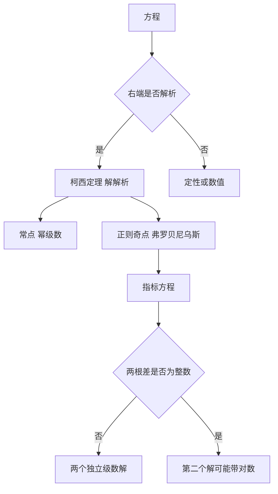

# 第 6 章：解析解与幂级数解法

- **难度**：★★★ | **预估学时**：7 小时 | **前置**：第 3、5 章、复变函数初步、幂级数
- **对应原书**：第六章

## 学习目标
学完本章，你能：
1. 陈述柯西定理：右端解析 ⇒ 解解析，并说明收敛半径怎么估；
2. 在常点附近用幂级数求方程的解，写出系数递推关系；
3. 区分常点、正则奇点、非正则奇点；
4. 用弗罗贝尼乌斯方法处理正则奇点；
5. 说明解析解与数值解、定性分析三者的适用边界。

## 一句话核心
幂级数解法是"在解不出来的时候，把解写成一串系数"。柯西定理保证这串系数确实收敛到一个真解，收敛半径由右端函数的奇点位置决定。

## 零基础讲解

### 6.1 柯西定理

**定理**：若 f(x,y) 在点 (x₀,y₀) 的邻域内解析（对 x、y 都能展成收敛的幂级数），则初值问题的解 y(x) 在 x₀ 的某邻域内也解析。

证明思路是"优级数法"：把 f 的幂级数系数用一个大常数 M 压住，构造一个比它增长更快的"优函数"，证明形式幂级数的系数被优级数控制，从而收敛。

**收敛半径的实用估计**：解的收敛半径不小于"从 x₀ 到 f 的最近奇点"的距离。例如

y′ = y/(1−x²)

右端在 x=±1 奇，从 0 出发的收敛半径不超过 1。

### 6.2 常点处的幂级数解法

设 y=Σaₖ(x−x₀)ᵏ，代入方程，比较各次幂的系数，得到递推关系。以勒让德方程为例：

(1−x²)y″ − 2xy′ + n(n+1)y = 0，x₀=0

代入后 xᵏ 的系数满足

(k+2)(k+1)a_{k+2} = (k−n)(k+n+1)a_k

这个递推把偶数项和奇数项分开，得到两个独立解。当 n 为整数时，其中一个解退化成多项式——这就是勒让德多项式。

### 6.3 奇点分类

把方程写成标准形

y″ + p(x)y′ + q(x)y = 0

- **常点**：p、q 在 x₀ 解析。
- **正则奇点**：p 至多一阶极点，q 至多二阶极点，即 (x−x₀)p 与 (x−x₀)²q 解析。
- **非正则奇点**：极点阶数更高。

**弗罗贝尼乌斯方法**：在正则奇点处设

y = (x−x₀)^r·Σaₖ(x−x₀)ᵏ，a₀≠0

代入得指标方程（关于 r 的二次方程）。两个根之差不为整数时，给出两个独立的级数解；差为整数时，第二个解可能带对数项。

### 6.4 三种方法的边界

| 方法 | 适用 | 给什么 | 不给什么 |
|---|---|---|---|
| 初等积分 | 少数可积类型 | 显式解 | 大多数方程不行 |
| 幂级数 | 常点/正则奇点附近 | 局部解析解 | 全局行为、大范围结构 |
| 定性分析 | 一般非线性系统 | 稳定性、相图 | 具体解的数值 |

这张表是整门课的"方法论地图"：没有一种方法能包打天下。

## 图示

看图说明：判定顺序是"解析性 → 点类型 → 方法"。指标方程的根之差是正则奇点情形最关键的分叉点。

## 类比与实例

**类比**：幂级数解法像"用一列越来越细的积木拼出函数"。递推关系告诉你下一块积木多长；柯西定理保证这堆积木不会拼到一半就塌。

**失效边界**：在奇点附近（尤其非正则奇点），积木尺寸可能指数增长，级数根本不收敛。

**实例**：解 y″−xy=0（艾里方程）在 x=0 附近。
设 y=Σaₖxᵏ，代入得 Σk(k−1)aₖx^(k−2) = Σaₖx^(k+1)。
移项比较系数：a₂=0，(k+2)(k+1)a_{k+2}=a_{k−1}。
于是 a₃=a₀/6，a₄=a₁/12，a₅=0，a₆=a₃/30=a₀/180…两组解分别由 a₀、a₁ 生成。这个级数在全平面收敛（因为右端 x·y 是整函数）。

## 常见误解

- **别以为"幂级数解法能给出全局解"**——实际上只在收敛半径内有效。
- **别以为"奇点一定不能解"**——实际上正则奇点可以用弗罗贝尼乌斯方法。
- **别以为"两个根之差为整数就无解"**——实际上第二个解可能是带对数的形式，仍存在。
- **别以为"解析解总比数值解好"**——实际上大范围行为、混沌现象，解析解给不出。

## 自测题（答案）

1. 柯西定理的条件是什么？
   （答案：f 在初值点邻域内解析。解析：只要求解析，不要求李普希茨的显式常数。）

2. 方程 (1−x²)y″−2xy′+6y=0 在 x=0 处的收敛半径至少是多少？
   （答案：1。解析：右端系数的最近奇点在 x=±1，距离为 1。）

3. 正则奇点的判定条件？
   （答案：(x−x₀)p 与 (x−x₀)²q 都在 x₀ 解析。解析：即 p 至多一阶极点，q 至多二阶极点。）

4. 指标方程两根之差为整数时会发生什么？
   （答案：第二个线性无关解可能含对数项。解析：这是弗罗贝尼乌斯方法的经典例外。）

## 复习锚点
- 右端解析 ⇒ 解解析（柯西定理）。
- 收敛半径 ≥ 到最近奇点的距离。
- 常点幂级数、正则奇点弗罗贝尼乌斯。
