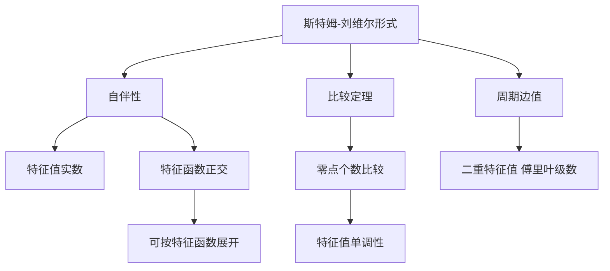

# 第 7 章：边值问题

- **难度**：★★★ | **预估学时**：9 小时 | **前置**：第 5 章、变分法初步、泛函分析入门
- **对应原书**：第七章

## 学习目标
学完本章，你能：
1. 写出斯特姆-刘维尔问题的标准形式与边界条件；
2. 用斯特姆比较定理判断两个方程解的零点个数关系；
3. 证明不同特征值的特征函数带权正交；
4. 说明周期边值问题与普通边值问题的差别；
5. 把特征值问题理解为"线性算子的谱"。

## 一句话核心
边值问题的核心不是"解出来"，而是"算谱"：**特征值是可数无穷的，特征函数构成正交基**。这套结论是傅里叶级数、量子力学、振动模态的共同底座。

## 零基础讲解

### 7.1 斯特姆-刘维尔形式

(p(x)y′)′ + [λρ(x) − q(x)]y = 0，a ≤ x ≤ b

其中 p>0，ρ>0。边界条件通常是分离型：

α₁y(a)+α₂y′(a)=0，β₁y(b)+β₂y′(b)=0

这一形式的关键是**自伴**：把算子 L[y]=(py′)′−qy 拿来做分部积分，边界项会消失（因为边界条件），于是

⟨L[y], z⟩ = ⟨y, L[z]⟩

自伴性是后面所有结论的源头。

### 7.2 斯特姆比较定理

**定理（比较定理）**：设 (p₁y′)′+q₁y=0 与 (p₂y′)′+q₂y=0，若在区间上 q₂≥q₁ 且 p₂≤p₁，则第一个方程的任一非零解在 (a,b) 内的零点个数不多于第二个方程。

白话：**势能越大（q 越大）、扩散越弱（p 越小），解震荡得越快，零点越多**。

这条定理的用处是定性判断：不必解出方程，就能知道解转了几圈。它也是特征值单调性的来源——q 增大，第 n 个特征值随之增大。

### 7.3 正交性

设 yₘ、yₙ 对应不同特征值 λₘ≠λₙ，则

∫[a→b] ρ(x)·yₘ(x)·yₙ(x) dx = 0

证明只有三步：两个方程分别乘以对方的解、相减、在 [a,b] 上积分，边界项由边界条件消掉，剩下 (λₘ−λₙ)∫ρyₘyₙ=0。

**为什么这条重要**：它让"展开系数"可以像向量投影一样算出来：

cₙ = ∫ρ·f·yₙ dx / ∫ρ·yₙ² dx

### 7.4 周期边值问题

条件改成 y(a)=y(b)，y′(a)=y′(b)。此时边界项在分部积分中同样消失，自伴性保留，但特征值结构不同：可能出现二重特征值（对应 sin 与 cos 同时是特征函数），也可能出现负特征值。

周期边值问题比分离边界更"富"，因为它允许解绕一圈后回到原样——这正是傅里叶级数里 cos nx、sin nx 成对出现的原因。

## 图示

看图说明：从"自伴"出发分三支：实特征值、正交性、可展开。右边两支是定性结论（比较定理、周期情形），它们不需要解出方程。

## 类比与实例

**类比**：特征函数像琴弦的各个驻波模式。基频是第一个特征值，泛音是后面的。不同模式在同一点上的位移乘积积分为零，这就是正交性的物理版本。

**失效边界**：如果边界条件不是自伴型（比如混合了非线性边界），正交性可能失效。

**实例**：y″+λy=0，y(0)=y(π)=0。特征值 λₙ=n²，特征函数 yₙ=sin nx。验证正交性：

∫₀^π sin mx sin nx dx = 0（m≠n）。这是三角函数的正交性，也是傅里叶正弦级数的基础。

## 常见误解

- **别以为"边值问题总有特征值"**——实际上需要正则性条件（p、q、ρ 连续且 p、ρ 为正）。
- **别以为"正交性靠巧合"**——实际上是自伴性 + 边界条件的必然结果。
- **别以为"周期边值就是分离边值的特例"**——实际上谱结构不同，可能出现重特征值。

## 自测题（答案）

1. 斯特姆-刘维尔算子为什么是自伴的？
   （答案：分部积分后边界项由边界条件消去。解析：⟨Ly,z⟩−⟨y,Lz⟩ 只剩边界项。）

2. 比较定理中 q₂≥q₁ 说明什么？
   （答案：第二个方程的解零点更多，震荡更快。解析：势能越大，解转得越快。）

3. 展开系数公式里的权函数 ρ 起什么作用？
   （答案：定义带权内积，使特征函数在该内积下正交。解析：cₙ=∫ρfyₙ/∫ρyₙ²。）

4. 周期边值问题为什么会出现二重特征值？
   （答案：sin nx 与 cos nx 同时满足周期条件，对应同一特征值。解析：这就是傅里叶级数成对出现的原因。）

## 复习锚点
- S-L 形式的关键是自伴。
- 自伴 ⇒ 实特征值 + 正交 + 可展开。
- 比较定理：q 大、p 小 ⇒ 零点多。
