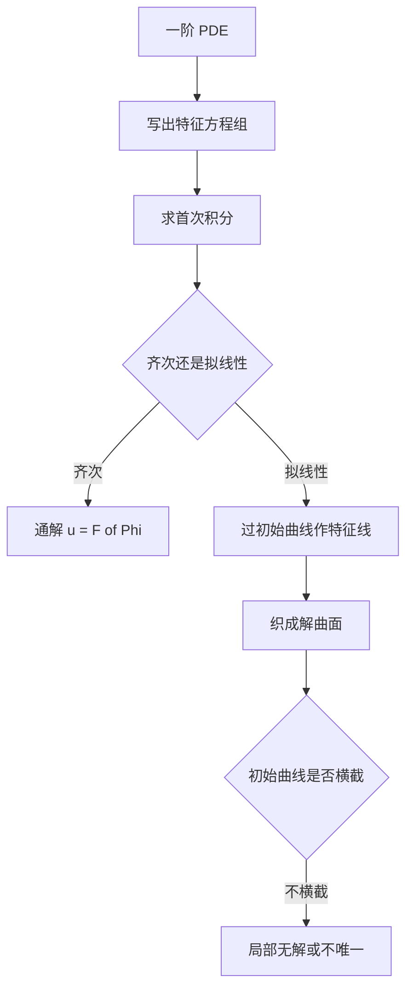

# 第 8 章：一阶偏微分方程

- **难度**：★★★ | **预估学时**：6 小时 | **前置**：第 2、3 章、隐函数定理
- **对应原书**：第八章

## 学习目标
学完本章，你能：
1. 给出首次积分的定义与三条基本性质；
2. 说明首次积分存在性与向量场线性无关性的关系；
3. 用特征线法解一阶齐次与拟线性偏微分方程；
4. 从几何角度解释解的构成：特征线织成解曲面；
5. 判断柯西问题的局部可解性。

## 一句话核心
一阶偏微分方程的解法，本质是"沿特征线把偏导变成常导"。首次积分是这条路线上的通用货币。

## 零基础讲解

### 8.1 首次积分的定义与性质

对自治方程组 dx/dt=X(x)，函数 F(x) 若沿每条轨线为常数，即

X·∇F = 0

则称 F 是首次积分。

三条性质：
1. **沿轨线为常数**，因此每个首次积分把相空间切成若干不变面；
2. **首次积分的任意函数仍是首次积分**（因为复合后方向导数仍为零）；
3. **首次积分在区域内连续可微且梯度不为零时，其等值面是 (n−1) 维的**。

### 8.2 存在性

n 维自治系统在一点附近有 n−1 个独立首次积分，条件是向量场在该点不为零（局部存在）。证明用局部坐标变换把向量场拉直成"第一个分量恒为 1"，其余分量视为参数，于是问题化为解 n−1 个常微分方程。

如果向量场在某点为零（平衡点），首次积分的个数和结构都会退化——这正是定性理论要单独处理平衡点的原因。

### 8.3 一阶齐次线性偏微分方程

a(x,y)u_x + b(x,y)u_y = 0

特征方程 dy/dx=b/a，其首次积分 Φ(x,y)=C。通解 u=F(Φ)。

**几何解释**：u 在每条特征线上是常数，所以 u 只依赖"哪条特征线"，即只依赖 Φ。F 就是这个"依赖关系"。

### 8.4 一阶拟线性偏微分方程

a(x,y,u)u_x + b(x,y,u)u_y = c(x,y,u)

特征方程组

dx/ds=a，dy/ds=b，du/ds=c

给定初始曲线 Γ，过 Γ 上每点作特征线，这些线扫出一张曲面即解。可解的条件是 Γ 横截特征方向：

a·dy₀/dτ − b·dx₀/dτ ≠ 0

### 8.5 几何图景

把 (x,y,u) 看成三维空间，PDE 规定了"曲面上的方向场"：曲面 u=u(x,y) 在每点的切平面必须包含方向 (a,b,c)。特征线就是这些方向场的积分曲线；解曲面由特征线织成。

这个图景把 PDE 变成了"找一张由给定方向场织成的曲面"，与常微分方程的"找一条由方向场织成的曲线"完全平行。

## 图示

看图说明：整章只有一条主线——把 PDE 变成特征方程组。齐次情形是它的退化（c=0，u 沿特征线不变）。

## 类比与实例

**类比**：特征线是"经线"，初始曲线是"起针行"。PDE 只说"沿经线怎么走"，你把经线一根根织出来，布就成了。如果起针行恰好在经线方向上，就织不起来。

**失效边界**：这个类比假设特征线互不相交。若特征线在有限处相交，解曲面会出现折痕（激波），此时需要弱解理论。

**实例**：解 u_x + u_y = u，u(x,0)=x。
特征方程：dx/ds=1，dy/ds=1，du/ds=u。
解得 x=s+x₀，y=s，u=u₀e^s。
初值 u₀=τ=x₀，y₀=0。
消去 s、τ：s=y，x₀=x−y，u=(x−y)e^y。
验证：u_x=e^y，u_y=−e^y+(x−y)e^y，和为 (x−y)e^y=u。边界 y=0 时 u=x。成立。

## 常见误解

- **别以为首次积分就是"解"**——实际上它是沿轨线取常数的函数，本身不满足原方程。
- **别以为 n 维系统总有 n 个首次积分**——实际上独立的有 n−1 个。
- **别以为"初始曲线任意给都行"**——实际上必须横截特征方向。

## 自测题（答案）

1. 首次积分的方向导数条件是什么？
   （答案：X·∇F=0。解析：这就是"沿轨线为常数"的微分形式。）

2. 为什么 n 维自治系统只有 n−1 个独立首次积分？
   （答案：轨线是一维的，所以每点的余维是 n−1。解析：n−1 个不变面相交成一条曲线。）

3. 齐次 PDE 通解中的 F 为什么可以是任意函数？
   （答案：每条特征线上 u 为常数，不同特征线上的常数可以不同，这个"不同"就是一个任意函数。解析：依赖的是特征线的标号 Φ。）

4. 柯西问题失效的几何原因？
   （答案：初始曲线与特征方向相切，导致无法确定 u 的法向导数。解析：非特征条件不满足。）

## 复习锚点
- 首次积分：X·∇F=0，n 维有 n−1 个。
- 齐次 PDE 通解 = F(Φ)。
- 拟线性：过初始曲线作特征线织曲面，需横截条件。
