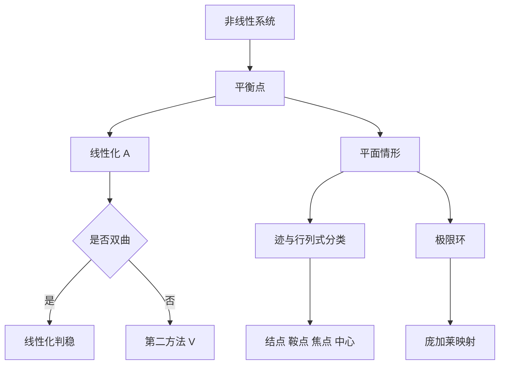

# 第 9 章：定性理论简介

- **难度**：★★★ | **预估学时**：8 小时 | **前置**：第 4、5、7 章、线性代数
- **对应原书**：第九章

## 学习目标
学完本章，你能：
1. 区分动力系统、相空间、轨线三个概念；
2. 用线性近似判断李雅普诺夫稳定性，并说明双曲条件；
3. 用李雅普诺夫第二方法判稳；
4. 按迹与行列式分类平面初等奇点；
5. 说明极限环的存在判据与环面上的特殊现象。

## 一句话核心
定性理论换了一个问题：不问"解是什么"，只问"轨线在相空间里怎么排布"。答案是拓扑的，不是数值的。

## 零基础讲解

### 9.1 动力系统与相空间

把 dx/dt=f(x) 的解看成"点在空间里随时间移动的轨迹"，则：
- **相空间**：状态 x 所在的空间；
- **轨线**：解在相空间中的像（不含时间信息）；
- **动力系统**：由 f 决定的整个演化规则。

轨线与积分曲线的区别在于：轨线丢掉了"什么时候到哪"，只留下"经过哪些点"。对自治系统，轨线可以相交于平衡点，但不会自交。

### 9.2 李雅普诺夫稳定性

定义与前面教材一致：稳定（不跑远）、渐近稳定（回到平衡点）、不稳定。

**按线性近似判断**：设 A=f′(0)，若 A 的特征值实部全负，渐近稳定；有正实部，不稳定；实部有零，线性近似失效。

### 9.3 第二方法

找 V 正定、沿轨线导数负定。V 不必是能量，可以是任何满足条件的函数。构造没有通用算法，常用套路是二次型、能量、平方和。

### 9.4 平面初等奇点

对线性系统，用 p=tr A，q=det A，Δ=p²−4q 分类：结点、鞍点、焦点、中心（详见速查表）。

对非线性系统，若平衡点是双曲的（特征值实部不为零），则其局部相图与线性化系统拓扑等价（哈特曼-格罗布曼）。这是"看线性化就够了"的理论保证。

### 9.5 极限环

极限环是孤立的闭轨。它与中心型闭轨的区别是：
- 中心：闭轨连续分布成一族，附近轨线绕着走，不靠近也不远离；
- 极限环：附近轨线螺旋趋近或远离它。

判据：庞加莱-本迪克松定理（平面、有界、无平衡点 ⇒ 存在闭轨）。稳定性判据用庞加莱映射的导数（一维时就是"绕一圈的放大率"）。

### 9.6 环面上的方程

在环面 T² 上，轨线可能永远不闭合（如果两个频率不可公度），也可能闭合（可公度）。这给出了"准周期运动"的几何图像，也是 KAM 理论的入口。

## 图示

看图说明：图中最下面一条支线是本章的高潮：从"局部判稳"走到"全局闭轨存在"，工具从代数变成拓扑。

## 类比与实例

**类比**：相空间像一张地形图，轨线像水流路径。平衡点是湖底或山顶，极限环是一条环形的"跑道"，附近的水流都被吸上去绕着跑。

**失效边界**：三维以上没有庞加莱-本迪克松，轨线可能被吸引到奇怪吸引子上，既不是平衡点也不是闭轨。

**实例**：范德波尔振子 x″+ε(x²−1)x′+x=0。化为系统后，ε>0 时存在唯一稳定极限环，所有非零初值的轨线都螺旋趋近它。这正是电子管振荡器的数学模型。

## 常见误解

- **别以为"轨线就是积分曲线"**——实际上轨线丢了时间信息。
- **别以为"闭轨就是极限环"**——实际上中心型闭轨成族分布，极限环是孤立的。
- **别以为"线性化总能判稳"**——实际上非双曲时失效。
- **别以为"平面定理能推广到高维"**——实际上三维开始出现奇怪吸引子。

## 自测题（答案）

1. 轨线与积分曲线的区别？
   （答案：轨线不含时间信息，只记录经过的点。解析：对自治系统，轨线是相空间中的曲线。）

2. 双曲平衡点的定义？
   （答案：雅可比矩阵的特征值实部都不为零。解析：此时线性化与非线性拓扑等价。）

3. 极限环与中心型闭轨的区别？
   （答案：极限环孤立，附近轨线螺旋趋近或远离；中心型闭轨成族，附近轨线绕行不趋近。解析：这决定了稳定性判据不同。）

4. 环面上什么时候轨线不闭合？
   （答案：两个频率不可公度时。解析：轨线在环面上稠密，永不回到起点。）

## 复习锚点
- 相空间 + 轨线 + 演化规则 = 动力系统。
- 双曲 ⇒ 线性化可判；非双曲 ⇒ 找 V。
- 极限环孤立，中心闭轨成族。
