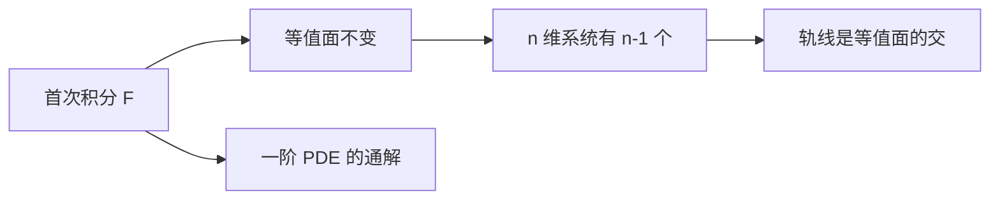

# 首次积分

- **难度**：进阶 | **涉及章节**：第 2、8 章

## 一句话定义
沿方程组的每条轨线都取常数的函数，等价于方向导数为零。

## 为什么重要
它是连接常微分方程与偏微分方程的那道桥：每一个首次积分都对应一个一阶偏微分方程的解。

## 图示

## 详解
以 Volterra 系统为例，H=d x − c ln x + b y − a ln y 沿轨线不变，所以轨线全部落在 H 的等值线上。又因为 H 在平衡点取极小，等值线是闭合的，于是种群数量周期性振荡。

首次积分不唯一：任意函数作用在它上面仍是首次积分。要找"独立"的一组，需要梯度线性无关。

## 常见误解
- 别以为首次积分是解——它只是沿解不变的函数。
- 别以为一定能找到 n 个——独立的最多 n−1 个。
- 别以为存在性无条件——向量场在平衡点处退化。

## 在书中出现的脉络
| 章节 | 语境 | 关键结论 |
|---|---|---|
| 第 2 章 | Volterra 模型 | 存在闭轨 |
| 第 8 章 | 一阶 PDE | 通解由首次积分生成 |

## 相关概念
- 前置：方向导数、向量场
- 后续：哈密顿系统、可积性
