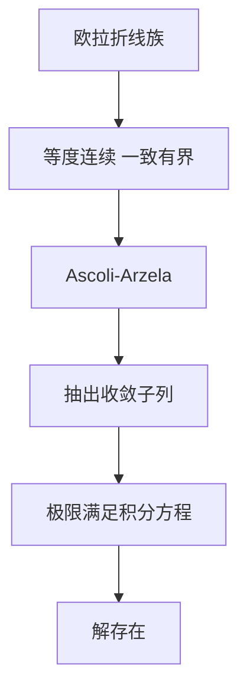

# Peano 存在定理

- **难度**：进阶 | **涉及章节**：第 3 章

## 一句话定义
只要右端连续，初值问题就至少有一个解；唯一性不在保证范围内。

## 为什么重要
它标出了"存在"与"唯一"之间的真实分界：连续性是最低要求，李普希茨是额外成本。

## 图示

## 详解
证明不用迭代，用紧性。取步长 hₙ→0 的欧拉折线 yₙ，它们一致有界（被 M·h 控制）且等度连续（斜率被 M 控制）。Ascoli-Arzelà 给出一个一致收敛的子列，极限连续，再用 f 的一致连续性把积分与极限交换，得到它满足积分方程。

经典反例 y′=√|y|，y(0)=0 有无穷多解，说明"连续"确实不够。

## 常见误解
- 别以为 Peano 定理没用——它是假设最少的工具，在只知连续时不可替代。
- 别以为"存在多个解"意味着"解不光滑"——它们都可以很光滑。
- 别以为 Ascoli 定理只在这里用——紧性方法是整个分析的存在性范式。

## 在书中出现的脉络
| 章节 | 语境 | 关键结论 |
|---|---|---|
| 第 3 章 | 存在性 | 连续即可 |
| 第 3 章 | 反例 | 唯一性失效 |

## 相关概念
- 前置：等度连续、紧性
- 后续：奇解、非唯一性现象
