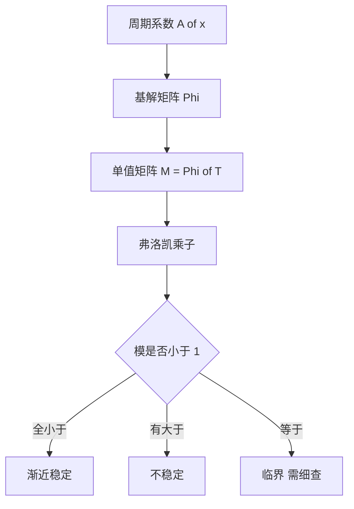

# 弗洛凯理论

- **难度**：高难 | **涉及章节**：第 5 章

## 一句话定义
周期系数系统的稳定性由"绕一个周期后的演化矩阵"（单值矩阵）的特征值决定。

## 为什么重要
常系数系统能算特征值，周期系数不能——没有固定矩阵。弗洛凯理论用"绕一圈的放大倍数"替代了特征值。

## 图示

## 详解
由 Φ(x+T)=Φ(x)M 可知，走一个周期相当于右乘 M。所以 x(nT)=Mⁿx(0)，稳定性完全由 M 的谱决定。

M 与基解矩阵的选取无关（相似变换不改变特征值）。乘子本身不是特征值，特征值（弗洛凯指数）是它们的对数除以 T。

## 常见误解
- 别以为可以直接对 A(x) 算特征值——它随 x 变。
- 别以为乘子模为 1 就稳定——可能多项式增长（若尔当块）。
- 别以为 M 唯一——相似意义下唯一。

## 在书中出现的脉络
| 章节 | 语境 | 关键结论 |
|---|---|---|
| 第 5 章 | 周期系数方程组 | Φ(x+T)=Φ(x)M |
| 第 5 章 | 判稳 | 看乘子模 |

## 相关概念
- 前置：基解矩阵
- 后续：马蒂厄方程、参数共振
