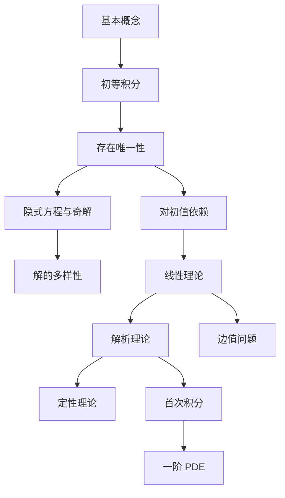

# 《常微分方程教程》（丁同仁、李承治，第三版）点化学习系统

## 这本书在讲什么
它是国内最"理论完整"的常微分方程教材之一：存在唯一性给两套证明（皮卡与皮亚诺），奇解单列一章解释唯一性失效，解对初值的依赖单独成章，再往后是线性理论、解析理论、定性理论、边值问题、首次积分、一阶偏微分方程。它的节奏是"定理—证明—推论"，例题不多但每个都为定理服务。

## 全书心智模型

## 学习路径（推荐顺序）
| 步骤 | 章节 | 主题 | 前置 | 检查点 |
|---|---|---|---|---|
| 01 | ch01 | 基本概念 | 微积分 | 说清解为何必须在区间上 |
| 02 | ch02 | 初等积分 | ch01 | 用恰当方程主线解四类 |
| 03 | ch03 | 存在唯一性 | ch02 | 复述皮卡四步 |
| 04 | ch04 | 隐式方程与奇解 | ch03 | 判别式 + 回代 |
| 05 | ch05 | 对初值依赖 | ch03 | 写变分方程 |
| 06 | ch06 | 线性方程组 | ch05 | 基解矩阵与常数变易 |
| 07 | ch07 | 解析理论 | ch06 | 判常点/正则奇点 |
| 08 | ch08 | 定性理论 | ch06 | 奇点分类表 |
| 09 | ch09 | 边值问题 | ch06 | 用二择一判可解 |
| 10 | ch10 | 首次积分 | ch08 | 验证一个首次积分 |
| 11 | ch11 | 一阶 PDE | ch10 | 特征线法一例 |

## 章节索引
- 第 1 章 基本概念（★☆☆）→ chapters/ch01-基本概念.md
- 第 2 章 初等积分法（★★☆）→ chapters/ch02-初等积分法.md
- 第 3 章 存在和唯一性定理（★★★）→ chapters/ch03-存在唯一性.md
- 第 4 章 一阶隐式方程与奇解（★★★）→ chapters/ch04-隐式方程与奇解.md
- 第 5 章 解对初值和参数的连续可微性（★★★）→ chapters/ch05-解对初值依赖.md
- 第 6 章 线性微分方程组与高阶线性方程（★★★）→ chapters/ch06-线性方程组.md
- 第 7 章 解析理论（★★★）→ chapters/ch07-解析理论.md
- 第 8 章 定性理论（★★★）→ chapters/ch08-定性理论.md
- 第 9 章 边值问题（★★★）→ chapters/ch09-边值问题.md
- 第 10 章 首次积分（★★★）→ chapters/ch10-首次积分.md
- 第 11 章 一阶偏微分方程（★★★）→ chapters/ch11-一阶偏微分方程.md

## 前置知识（零基础缺口补讲）
| 缺口 | 对应补讲位置 | 学完标志 |
|---|---|---|
| 全微分与恰当性 | ch02 2.1 | 能判 P_y=Q_x |
| 一致收敛 | ch03 3.1 | 说清为什么需要它 |
| 矩阵指数 | ch06 6.3 | 能算 2×2 情形 |
| 幂级数 | ch07 7.2 | 能写递推 |

## 术语表 / 模式库 / 速查表 入口
- 术语：glossary.md
- 模式：patterns.md
- 速查：cheatsheet.md
- 测验：quiz.md
- 抽认卡：flashcards.md
