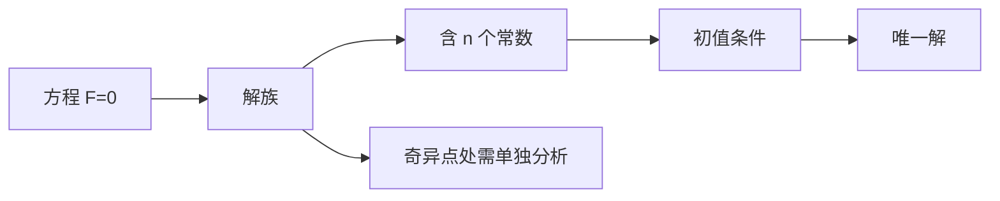

# 第 1 章：基本概念

- **难度**：★☆☆ | **预估学时**：2 小时 | **前置**：微积分
- **对应原书**：第一章

## 学习目标
学完本章，你能：
1. 用"联系自变量、未知函数及导数"的定义识别方程，并排除 y(x)=y(y(x)) 这类伪方程；
2. 说清解的定义里"在区间上恒等成立"为什么必须强调区间；
3. 理解 n 阶方程通解含 n 个常数的"积分来源"解释；
4. 用自由落体的例子说明为什么"没有定解条件的方程有无穷多解"。

## 一句话核心
丁同仁这一章刻意写得极简：只给定义和几何解释，把建模例子推后。**它想让你先分清"方程"和"解的区间"这两个对象，再谈求解。**

## 零基础讲解

### 1.1 定义里的两个坑

定义：F(x, y, y′, …, y⁽ⁿ⁾)=0 叫常微分方程，最高阶导数的阶叫阶。

坑一：y(x)=y(y(x)) 不是常微分方程。因为右边是 y 在另一点的值，不是导数。教材专门点出这一点，是因为"函数方程"和"微分方程"容易混。

坑二：解必须在**区间**上定义。y=1/x 是 y′=−y² 在 (0,+∞) 上的解，在 (−∞,0) 上也是，但不能说它在 R 上是解（0 点没定义）。

### 1.2 解与通解

**解**：φ 在区间 I 上有直到 n 阶导数，代入后对一切 x∈I 成为恒等式。

**通解**：含 n 个独立常数的解族。教材在这里给了一个"积分来源"的解释：n 阶方程要积 n 次分，每次产生一个常数，所以通解该有 n 个常数。这是启发式，严格证明推迟到第十章。

这个解释很重要，因为它说明了为什么"通解"这个概念天生带有"不严格"的色彩——它是从积分操作推出来的，而不是从解集结构证明出来的。

### 1.3 自由落体：为什么必须给初值

方程 y″=−g。积分两次：

y′ = −g t + C₁，y = −g t²/2 + C₁ t + C₂

两个常数，对应"从多高开始"和"初速度多少"。不给定这两个数，方程描述的是"所有自由落体运动"的集合，不是一个具体运动。给定 y(0)=y₀、y′(0)=v₀，才有唯一解。

> 类比：方程是"运动规律"，初值是"这次运动的档案"。规律对所有下落都成立，档案只对这一次成立。

### 1.4 几何解释：积分曲线

一阶方程 y′=f(x,y) 的每个解在平面上是一条曲线（积分曲线）。曲线在点 (x₀,y₀) 的斜率必须等于 f(x₀,y₀)——这是解的几何刻画。

教材由此引出线素场、等斜线、奇异点，与其它教材一致，但更强调"奇异点处方程不再定义方向，必须单独分析"。

## 图示

看图说明：左上到右下是"从方程到具体解"的路径；右侧分支提醒你，奇异点不在这个流程的覆盖范围内。

## 类比与实例

**类比**：n 阶方程像一个 n 次积分任务，每积一次留下一个"待定系数"，初值就是把这些系数逐个钉死的钉子。

**失效边界**：如果方程不可积（大多数非线性方程都不可积），"n 次积分"的图景就不成立，但"通解含 n 个常数"的结论仍由存在唯一性定理保证。

**实例**：验证 y=Ce^(−2x)+x/2−1/4 是 y′+2y=x 的通解。
y′=−2Ce^(−2x)+1/2，y′+2y=(−2Ce^(−2x)+1/2)+2(Ce^(−2x)+x/2−1/4)=1/2+x−1/2=x。成立。

## 常见误解

- **别以为"解可以定义在整个实轴上"**——实际上要在使表达式有意义的区间上讨论。
- **别以为"方程里导数符号出现几次就是几阶"**——实际上看最高阶。
- **别以为"通解包含所有解"**——实际上可能漏掉奇解（教材在第四章专门处理）。

## 自测题（答案）

1. y(x)=y(x+1) 是常微分方程吗？
   （答案：不是。解析：方程里没有导数，这是函数方程。）

2. y=1/x 是 y′=−y² 的解，它的最大存在区间是什么？
   （答案：(0,+∞) 或 (−∞,0)，取决于初值所在的一侧。解析：x=0 处无定义。）

3. 自由落体方程 y″=−g 的通解为什么有两个常数？
   （答案：需要积分两次，每次产生一个常数。解析：对应初始位置与初始速度。）

4. 积分曲线上某点的斜率由什么决定？
   （答案：由 f(x,y) 在该点的值决定。解析：这就是方程 y′=f(x,y) 的几何含义。）

## 复习锚点
- "常"指一元；阶看最高阶导数。
- 解必须在区间上恒等成立。
- 通解的 n 个常数来自 n 次积分。
